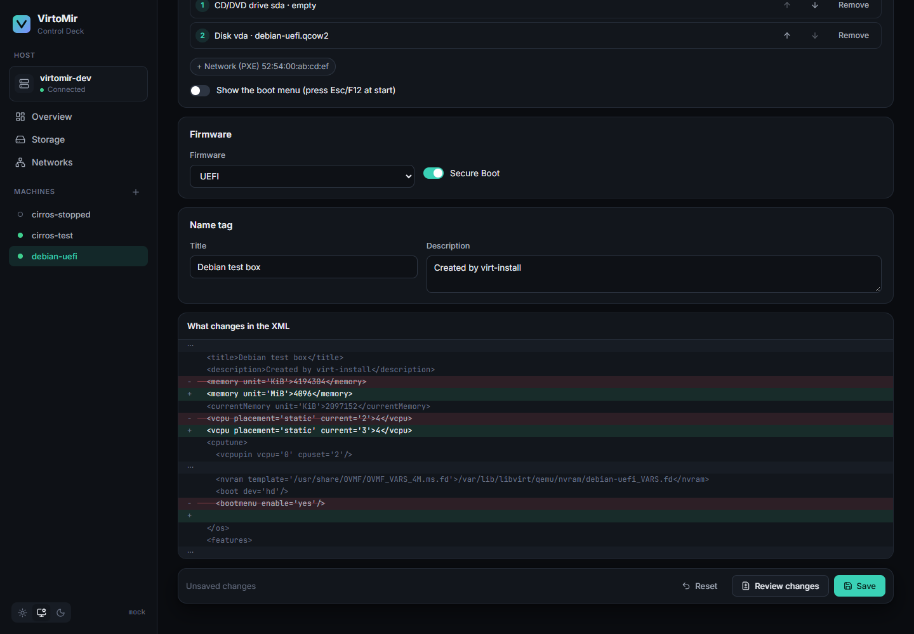

# VirtoMir

**A Detailed Control Deck for Virtual Environments.**

VirtoMir is a modern web control panel for **KVM / QEMU / libvirt** that tries to be two things at once:

- **Effortless** — create and run a VM without knowing much about virtualization.
- **Terrifyingly detailed** — every libvirt setting is reachable, editable and, yes, breakable.

It installs on the Linux host you already have (Debian, Ubuntu, Fedora, …) as a single binary. No dedicated distribution, no database, no agents.

> 🚧 **Status: pre-alpha.** Under active development; expect rough edges. Don't run it on hosts you can't afford to break yet.


## Why?

| Tool | Gap |
|---|---|
| Cockpit (machines) | Easy, but shallow — advanced settings send you back to `virsh` / XML |
| virt-manager | Detailed, but a desktop app with weak monitoring and no web access |
| Proxmox VE | Powerful, but it *is* the operating system |

VirtoMir sits in the middle: as easy as Cockpit, as deep as raw libvirt XML, as polished as a modern SaaS dashboard.

## Features

### Machines

- Live overview of host and machines, updated every second
- New-machine wizard: install from an ISO, start from a **cloud image with cloud-init** (user, password, SSH keys), or boot an existing disk. Linux, Windows (UEFI + Secure Boot + TPM 2.0) and "other" profiles with sensible defaults
- Start, shut down, reboot, pause, force off — one by one or **in bulk**
- Rename, **clone** (full copies, new identity, runs in the background), delete (optionally with its own disks — never shared ones)
- **Templates**: turn a prepared machine into a template and create new machines from it in seconds — **linked clones** (store only their own changes) or full copies, with optional cloud-init
- **Console in the browser**: graphical (noVNC) and serial, also full-screen
- **Settings form** for CPU (topology, model), memory (balloon), boot order, firmware — with a **"review changes" XML diff** before saving; vCPUs and memory are applied live where possible
- **Tuning**: CPU and emulator pinning, huge pages, NUMA memory policy
- **XML editor** for everything else, validated by libvirt
- **Configuration history**: every version of a machine's definition — also changes made with `virsh` — with a diff and one-click restore
- Hardware: add/remove disks and network adapters (hot-plug), insert/eject ISOs, **grow disks**
- **PCI/USB passthrough** with an IOMMU group view and safety checks (devices the host needs are refused, with the reason)
- More devices from the Hardware tab: **shared folders** (virtiofs), **vGPU slices** (mediated devices, created on the Hardware page), **clipboard sharing**, video model and **up to 4 monitors**, watchdog, TPM 2.0, random number generator — hot-plugged where possible, otherwise from the next start (and it says which)
- Expert **QEMU command line** (extra arguments and environment), clearly marked as such
- **Import**: OVA appliances, a libvirt domain XML, or a disk image already on the host
- **Snapshots** as a tree: take, revert, delete
- **Backups**: live (no downtime) or offline, restore as a new machine; **automatic snapshots and backups** on a schedule with retention

### Monitoring

- Per machine: CPU, per-vCPU load, disk throughput / IOPS / latency, network traffic, guest-reported memory
- Host CPU, memory, physical disk and network throughput
- **History** for 1 h, 6 h, 24 h, 7 days and 30 days — kept by VirtoMir itself, no Prometheus needed
- …and a **Prometheus endpoint** (`/api/v1/metrics`) for those who have one; the whole API is described by **OpenAPI** (`/api/v1/openapi.json`)
- **Alerts** with sensible defaults (host overloaded, machine crashed, pool filling up, libvirt down) — to a webhook, Slack, Discord, ntfy or e-mail

### Storage & networks

- Storage pools and volumes, **ISO / cloud image upload** with progress, grow volumes
- Virtual networks (NAT, isolated, routed, bridged), DHCP leases with machine names, **reserved addresses**
- **NFS, iSCSI and Ceph RBD storage**, and one pool on every host of a cluster in a single step
- **VLANs** on Open vSwitch bridges (per network or per adapter), and one network on every host in a single step

### Several hosts

- Install VirtoMir on each host and join them with a **one-time join code** — no shared database, no extra services; if one host is down, the others carry on
- Manage every host from any of them: **cluster overview** with live host cards and all machines in one list, host switcher, consoles and live charts of any host
- **Move machines between hosts**: stopped ones are copied, running ones are **live-migrated** — without copying disks on shared NFS storage, or copying them live
- Alerts, activity and backups of all hosts in one place, history charts of every host side by side; roles apply on every host
- Alert rules, notifications and the backup location saved **the same on every host** in one step
- A **CPU model every host supports**, so machines can live-migrate between different CPUs

### Security

- Sign in with your Linux account (**PAM**); only root and members of the `libvirt` group
- **Roles** from Linux groups: admin (`libvirt`), operator (`virtomir-operator`: run machines, console, snapshots, backups) and viewer (`virtomir-viewer`)
- **LDAP / Active Directory** and **OpenID Connect** ("Sign in with …") besides local accounts, roles from directory groups
- **Two-step sign-in** with any authenticator app (TOTP), with recovery codes; admins can reset it
- **Quotas and self-service**: operators create and manage their own machines within a limit on machines, vCPUs and memory
- **API tokens** for scripts and automation, limited to their owner's role
- HTTPS by default (self-signed certificate created on first start, or your own)
- Session timeouts, lockout after failed sign-ins, CSRF protection, **activity log** of every change (CSV export)

| | |
|---|---|
|  |  |
|  |  |
|  |  |

<sub>Screenshots use sample data. Dark, light and "match system" themes; works on phones too.</sub>

## Install

Requirements: a Linux host with **libvirt + QEMU/KVM** running and **systemd**.

```sh
# Debian / Ubuntu: libvirt itself, if you don't have it yet
sudo apt install qemu-system-x86 libvirt-daemon-system ovmf swtpm

# Download a release, unpack it and run the installer
tar xzf virtomir_v0.1.0_linux_amd64.tar.gz
sudo ./virtomir_v0.1.0_linux_amd64/install.sh
```

The installer puts `virtomird` in `/usr/local/bin`, adds a PAM service (`/etc/pam.d/virtomir`) and a systemd unit, starts it and prints the address — usually `https://<host>:8420/`. Your browser asks you to accept the self-signed certificate once.

- Sign in as `root` or as a user in the `libvirt` group (`sudo usermod -aG libvirt <user>`).
- Only local access, behind your own reverse proxy: `sudo ./install.sh --listen 127.0.0.1:8420`
- Upgrade: run the installer of the new release. Remove: `sudo ./install.sh --uninstall` (your VMs are not touched).
- From GitHub directly: `sudo ./install.sh --download` (uses the `gh` CLI for private repositories).

### Configuration

`virtomird` flags (edit `ExecStart` in `/etc/systemd/system/virtomird.service`):

| Flag | Default | Meaning |
|---|---|---|
| `-listen` | `127.0.0.1:8420` (installer: `0.0.0.0:8420`) | address and port |
| `-auth` | `pam` | `none` disables sign-in — development only |
| `-auth-group` | `libvirt` | besides root, who may sign in as admin |
| `-operator-group` | `virtomir-operator` | members may run machines but not change them |
| `-viewer-group` | `virtomir-viewer` | members may look but change nothing |
| `-tls` | `auto` | `auto` (self-signed in `-state-dir`), `files` (`-tls-cert`, `-tls-key`), `off` (behind a TLS proxy) |
| `-state-dir` | `/var/lib/virtomir` | certificate, metric history, alerts, schedules, activity log, tokens, cluster membership, configuration history, quotas, LDAP/OIDC settings; default backup location (`backups/`) |
| `-name` | hostname | how this host is called in a cluster |
| `-libvirt-socket` | `/var/run/libvirt/libvirt-sock` | |

## Build from source

```sh
git clone https://github.com/onurbaydas/VirtoMir && cd VirtoMir
(cd web && npm ci && npm run build)                            # web UI, embedded into the binary
CGO_ENABLED=1 go build -tags pam -o virtomird ./cmd/virtomird  # needs gcc + libpam0g-dev
# or everything incl. a release tarball:
sh scripts/build-release.sh v0.1.0-dev
```

Without `-tags pam` the binary builds anywhere (also cross-compiled from Windows/macOS), but can only run with `-auth none`.

Tags `v*` build and publish a release through GitHub Actions (`.github/workflows/release.yml`).

## Development

- Go (daemon, `cmd/` + `internal/`) and Svelte 5 + TypeScript (UI, `web/`).
- `go test ./...` and `cd web && npm run check` run anywhere, no libvirt needed.
- `scripts/dev-run.ps1` builds on Windows and runs on a Hyper-V dev host created by `dev/hyperv/New-VirtoMirDevHost.ps1` (Debian 13 with nested KVM).
- Design decisions live in [`.ai/context/decisions.md`](.ai/context/decisions.md); contributors and AI agents start at [AGENTS.md](AGENTS.md).

## Roadmap

High availability (restart machines of a failed host on another one), scheduled reports, per-tenant disk quotas.

## License

Not decided yet.
