<p align="center"></p>

<h1 align="center">VirtoMir</h1>

<p align="center"><strong>A Detailed Control Deck for Virtual Environments.</strong><br>
A modern web control panel for KVM / QEMU / libvirt that installs on the Linux you already run.</p>

<p align="center">
English ·
<a href="docs/i18n/README.tr.md">Türkçe</a> ·
<a href="docs/i18n/README.de.md">Deutsch</a> ·
<a href="docs/i18n/README.fr.md">Français</a> ·
<a href="docs/i18n/README.es.md">Español</a> ·
<a href="docs/i18n/README.pt-BR.md">Português</a> ·
<a href="docs/i18n/README.it.md">Italiano</a> ·
<a href="docs/i18n/README.pl.md">Polski</a> ·
<a href="docs/i18n/README.nl.md">Nederlands</a> ·
<a href="docs/i18n/README.ru.md">Русский</a> ·
<a href="docs/i18n/README.uk.md">Українська</a> ·
<a href="docs/i18n/README.zh-CN.md">简体中文</a> ·
<a href="docs/i18n/README.zh-TW.md">繁體中文</a> ·
<a href="docs/i18n/README.ja.md">日本語</a> ·
<a href="docs/i18n/README.ko.md">한국어</a> ·
<a href="docs/i18n/README.ar.md">العربية</a>
</p>

<p align="center">
  <a href="https://github.com/onurbaydas/VirtoMir/releases/latest"></a>
  <a href="https://github.com/onurbaydas/VirtoMir/actions/workflows/ci.yml"></a>
  <a href="LICENSE"></a>
  
  <a href="https://github.com/onurbaydas/VirtoMir/issues?q=is%3Aissue+is%3Aopen+label%3A%22good+first+issue%22"></a>
</p>

<p align="center">
  <a href="https://github.com/onurbaydas/VirtoMir/stargazers"></a>
  <a href="https://github.com/onurbaydas/VirtoMir/fork"></a>
  <a href="https://github.com/onurbaydas/VirtoMir/subscription"></a>
</p>

<p align="center">
  <a href="https://onurbaydas.github.io/VirtoMir/demo/"><b>▶ Live demo</b></a> ·
  <a href="#install">Install</a> ·
  <a href="docs/try-in-a-vm.md">Try it in a VM</a> ·
  <a href="docs/features.md">All features</a> ·
  <a href="#contribute">Contribute</a> ·
  <a href="https://github.com/onurbaydas/VirtoMir/discussions">Discussions</a>
</p>

<table align="center">
<tr><td align="center"><h3>1</h3></td><td align="center"><h3>0</h3></td><td align="center"><h3>0</h3></td><td align="center"><h3>90+</h3></td><td align="center"><h3>16</h3></td><td align="center"><h3>1 s</h3></td></tr>
<tr><td align="center"><sub>binary, UI built in</sub></td><td align="center"><sub>databases</sub></td><td align="center"><sub>agents in your VMs</sub></td><td align="center"><sub>features</sub></td><td align="center"><sub>README languages</sub></td><td align="center"><sub>live charts</sub></td></tr>
</table>

<p align="center"></p>

VirtoMir tries to be two things at once:

- **Effortless.** Create and run a VM without knowing much about virtualization.
- **Terrifyingly detailed.** Every libvirt setting is reachable, editable and, yes, breakable.

It is a single binary with the web UI built in: no dedicated distribution, no database, no agents inside your machines. Install it on a host that runs KVM, open `https://<host>:8420/`, and sign in with your Linux account.

> **Status: 1.2.** Tested on Ubuntu 26.04 and Fedora 44, on single hosts and small clusters. High availability has not been tried on real BMC hardware yet, and the VMware import is experimental. From 1.0 on no new features are added: the work goes into making everyday single-host use solid. Test it before you trust it with production, and tell us what breaks in [#1](https://github.com/onurbaydas/VirtoMir/issues/1).

> [!TIP]
> **Like where this is going? Give it a ⭐.** VirtoMir is built by one person: stars are how other people find it, and they keep it going. To hear about new versions, click **Watch → Custom → Releases**.

> [!NOTE]
> **Tried it? Tell us in 30 seconds.** [Open the quick feedback form](https://github.com/onurbaydas/VirtoMir/issues/new?template=quick_feedback.yml), pick 😀 😐 😞 or 💡 and add a sentence if you like. Inside VirtoMir, the 💬 button at the bottom of the sidebar opens the same form with your versions already filled in.

## Try it in 30 seconds

| | |
|---|---|
| **Just look** | Click through the [online demo](https://onurbaydas.github.io/VirtoMir/demo/): made-up hosts, nothing to install. |
| **Throwaway host** | One command gives you a test VM with VirtoMir inside: [Try VirtoMir without touching your servers](docs/try-in-a-vm.md). |
| **Debian / Ubuntu** | `sudo apt install ./virtomir_1.2.1_amd64.deb` from the [latest release](https://github.com/onurbaydas/VirtoMir/releases/latest), or the [signed repository](#signed-package-repository-apt--dnf). |
| **Fedora / RHEL** | `sudo dnf install ./virtomir-1.2.1-1.x86_64.rpm`, or the [signed repository](#signed-package-repository-apt--dnf). |

The package pulls in libvirt and QEMU/KVM if they are missing, opens port 8420 and starts the service. Nothing else is left to type.

## Why VirtoMir?

| | **VirtoMir** | Cockpit Machines | virt-manager | Proxmox VE |
|---|:---:|:---:|:---:|:---:|
| Installs on the Linux you already run | ✅ | ✅ | ✅ | ❌ it *is* the OS |
| In the browser | ✅ | ✅ | ❌ desktop app | ✅ |
| Every libvirt setting, with an XML diff before saving | ✅ | ➖ basic settings | ✅ | ➖ not libvirt |
| History of every change, with one-click restore | ✅ | ❌ | ❌ | ❌ |
| Live charts and 30 days of history built in | ✅ | ➖ | ❌ | ✅ |
| Snapshots, scheduled backups, off-site copies | ✅ | ➖ snapshots | ➖ snapshots | ✅ |
| Several hosts, live migration, high availability | ✅ | ❌ | ➖ migration | ✅ |

VirtoMir sits in the middle: as straightforward as Cockpit, as thorough as raw libvirt XML.

## Highlights

<table>
<tr>
<td width="50%" valign="top">
<h3>🖥️ Machines, in depth</h3>
A wizard that asks only what every machine needs (ISO, cloud image with cloud-init, or an existing disk), and behind it every setting libvirt has: CPU topology and pinning, huge pages, NUMA, PCI/USB passthrough, vGPU, TPM, Secure Boot, a browser console over VNC or SPICE.
<br><br>
</td>
<td width="50%" valign="top">
<h3>🕰️ What changed, and when</h3>
Every version of a machine's definition is kept, also changes made with <code>virsh</code>. The timeline puts lifecycle events, changes, snapshots, backups and alerts in one list: the answer to "it worked yesterday".
<br><br>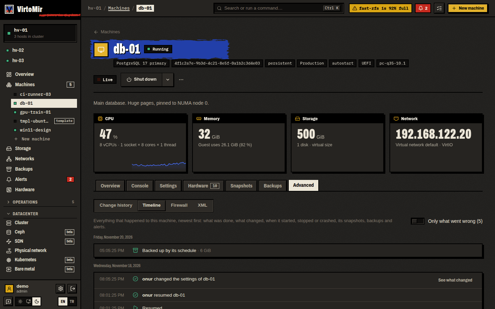
</td>
</tr>
<tr>
<td valign="top">
<h3>💾 Storage and networks</h3>
Directory, LVM, ZFS, NFS, iSCSI and Ceph pools; NFS, SMB and iSCSI targets found on the LAN and connected in one click. NAT, bridged (also on Wi-Fi), VLAN and VXLAN networks, and changes to the host's own network that undo themselves if you lose the connection.
<br><br>
</td>
<td valign="top">
<h3>🛟 Backups that come back</h3>
Live backups without downtime, schedules with retention, restore as a new machine, checksums verified. Off-site copies with restic to S3, B2, Azure, SFTP or a disk, encrypted and deduplicated.
<br><br>
</td>
</tr>
<tr>
<td valign="top">
<h3>🌐 Several hosts, one view</h3>
Join hosts with a one-time code: no shared database, no extra services. Live migration, a scheduler that balances load, maintenance mode, rolling upgrades, and high availability with quorum and fencing.
<br><br>
</td>
<td valign="top">
<h3>🔐 Made for a shared host</h3>
Sign-in with Linux accounts (PAM), LDAP/AD or OpenID Connect, two-step sign-in, roles, projects with quotas, API tokens and a tamper-evident activity log. HTTPS by default.
<br><br>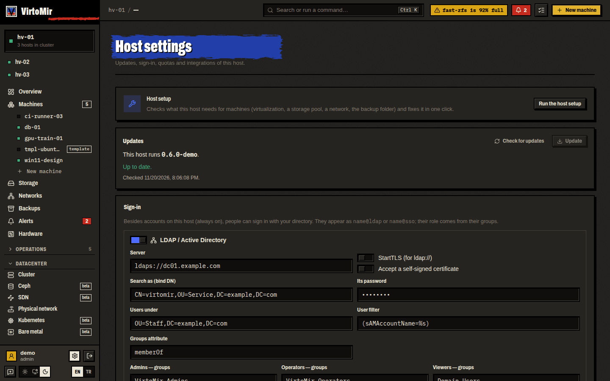
</td>
</tr>
</table>

Everything else, from alerts and reports to Kubernetes clusters and the VMware import, is in **[the full feature list](docs/features.md)**.

<details>
<summary><b>More screenshots</b></summary>

| | |
|---|---|
| 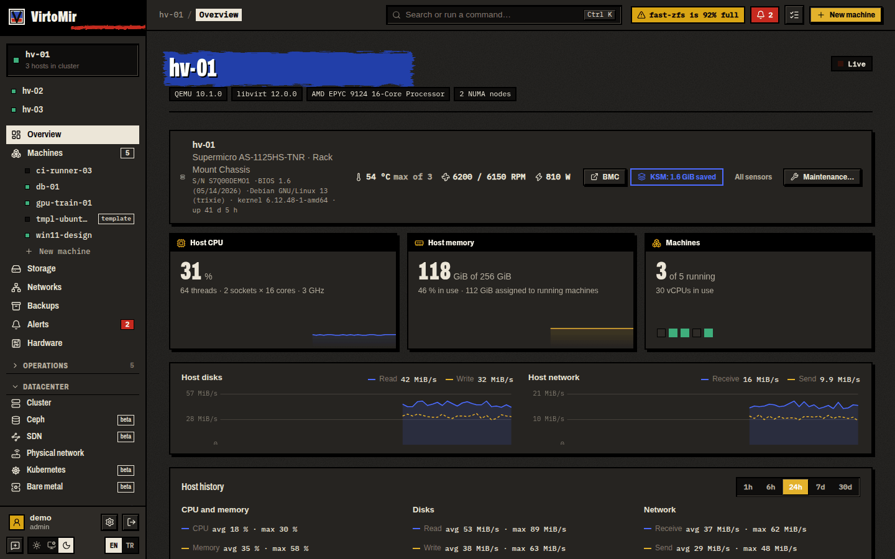 | 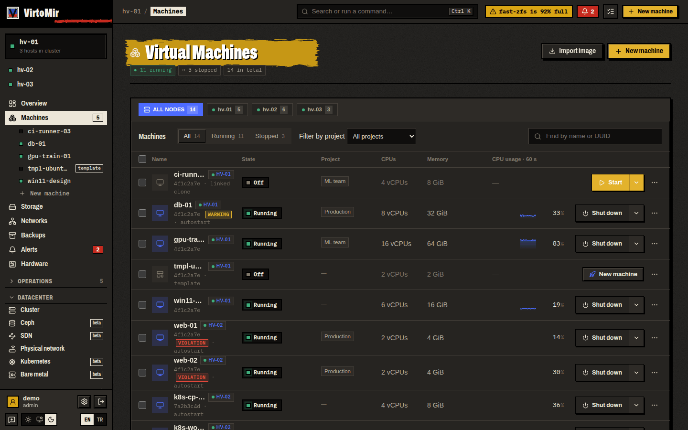 |
| 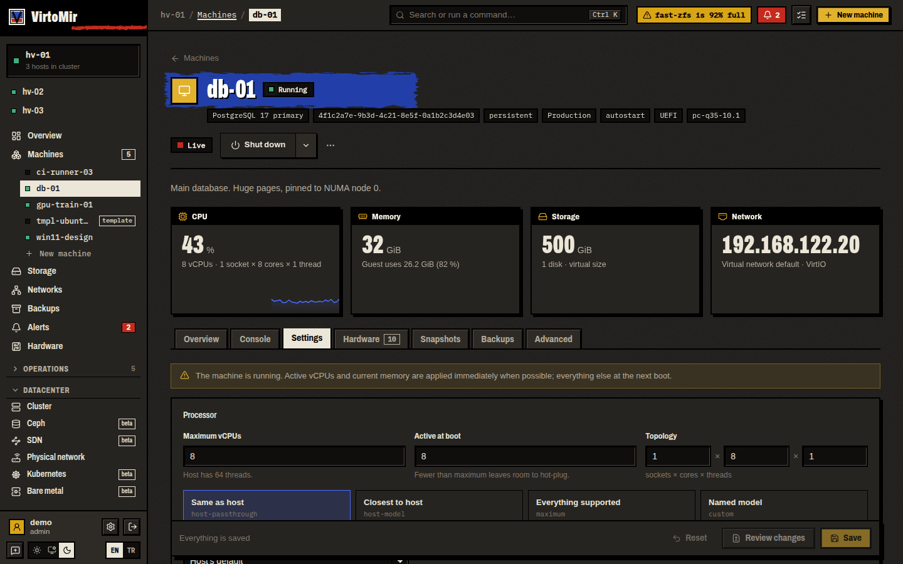 | 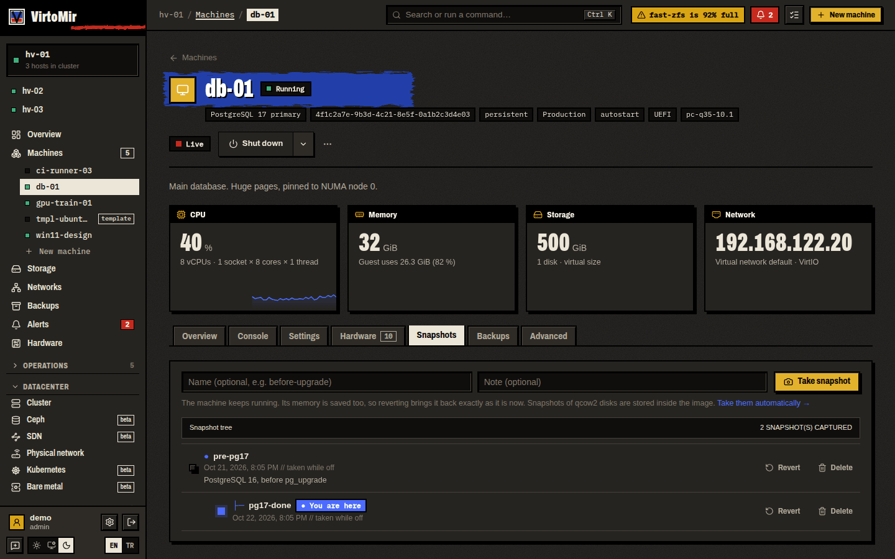 |
| 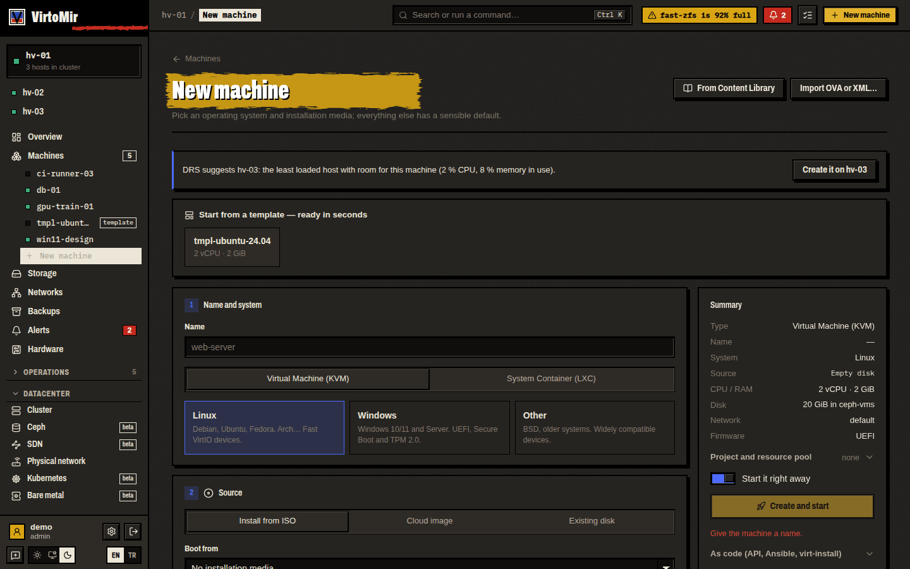 | 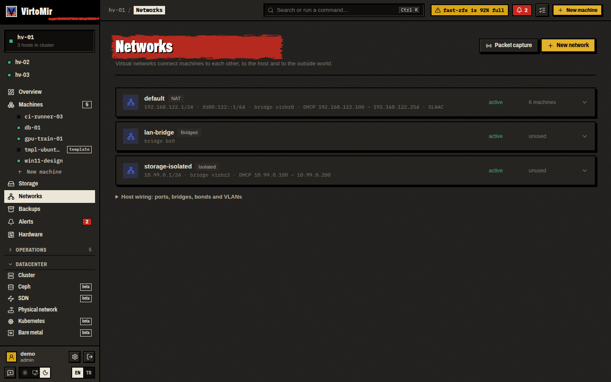 |
| 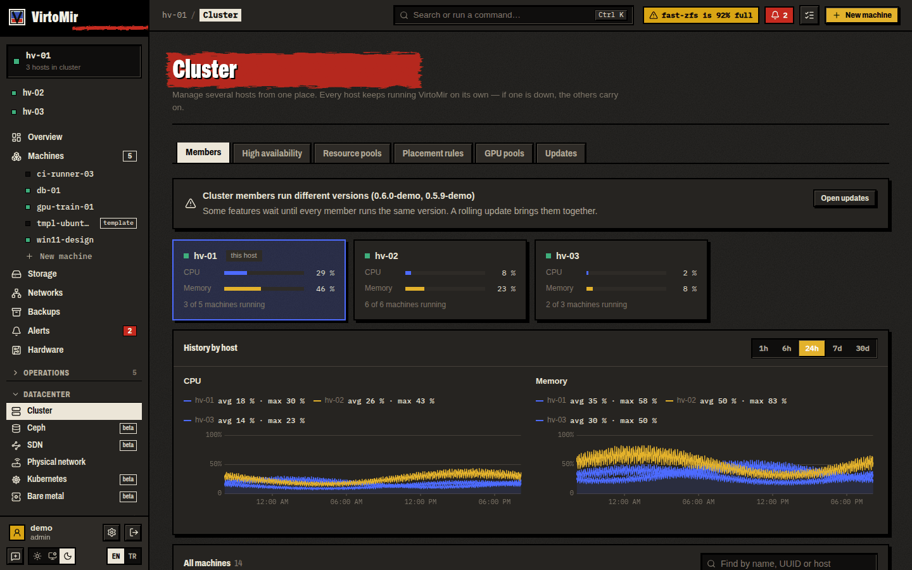 | 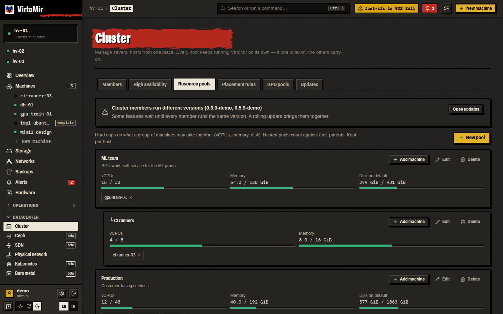 |
| 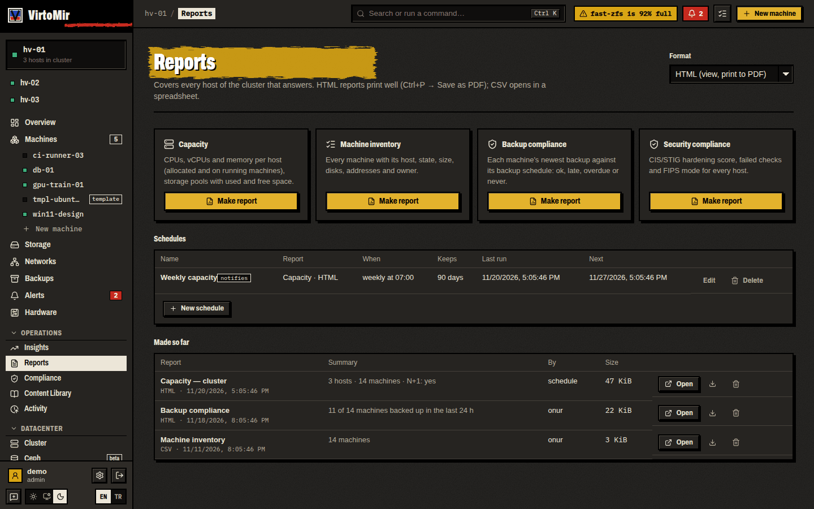 | 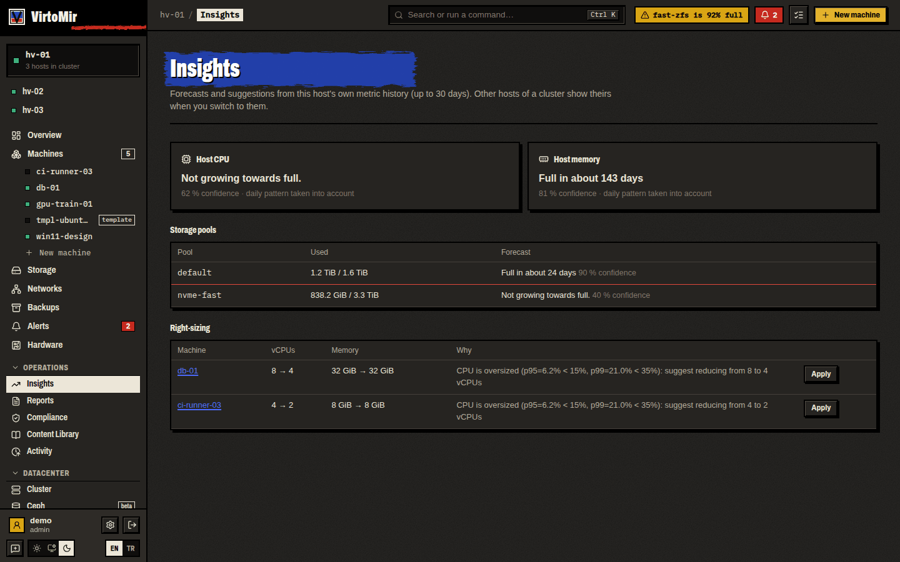 |
| 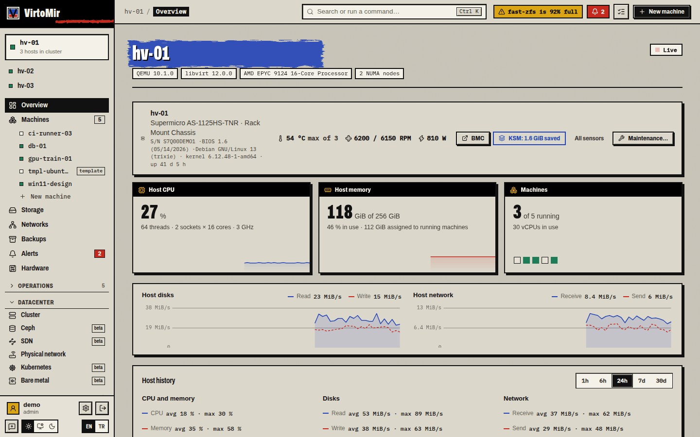 |  |

<p align="center">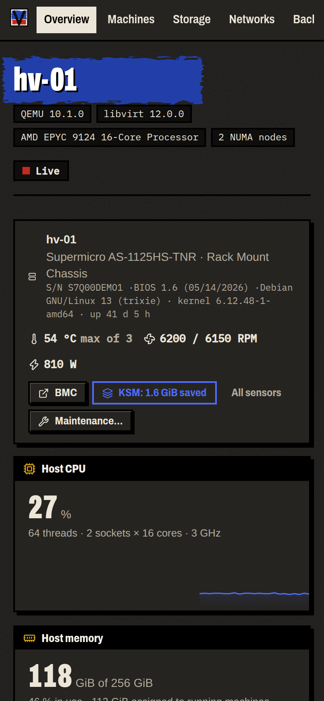</p>

<sub>Screenshots from the <a href="https://onurbaydas.github.io/VirtoMir/demo/">online demo</a> (VirtoMir 1.2, made-up hosts and machines). Dark, light and "match system" themes; works on phones too. The UI speaks English and Turkish.</sub>
</details>

## How it works

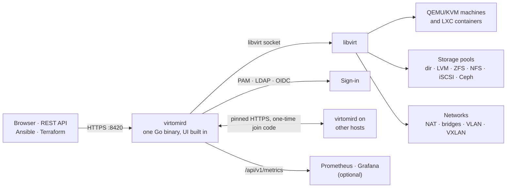

- **One service, `virtomird`**, running as root because it talks to the system libvirt socket and checks passwords through PAM.
- **Its own state in `/var/lib/virtomir`**: certificate, metric history, settings, activity log. No database.
- **It never touches your existing machines on its own.** It reads what libvirt has and changes only what you ask for; every change is in the activity log.
- **It removes cleanly:** `sudo apt purge virtomir` deletes the service and its state; your machines, disks and networks stay.

## Install

### Signed package repository (apt / dnf)

Releases are published to a signed repository, so updates come with `apt upgrade` / `dnf upgrade` (or the Update button in the UI):

```sh
# Debian / Ubuntu
sudo install -d -m 0755 /etc/apt/keyrings
sudo curl -fsSL -o /etc/apt/keyrings/virtomir.asc https://onurbaydas.github.io/VirtoMir/virtomir.asc
echo "deb [signed-by=/etc/apt/keyrings/virtomir.asc] https://onurbaydas.github.io/VirtoMir/apt stable main" | sudo tee /etc/apt/sources.list.d/virtomir.list
sudo apt update && sudo apt install virtomir

# Fedora / RHEL 10 (experimental)
sudo curl -fsSL -o /etc/yum.repos.d/virtomir.repo https://onurbaydas.github.io/VirtoMir/virtomir.repo
sudo dnf install virtomir
```

Then open `https://<host>:8420/` and sign in as `root` or as an administrator (groups `sudo`, `wheel` or `libvirt`). The browser asks you to accept the self-signed certificate once. The first admin to sign in is walked through what the host still needs: storage, a backup location, a first image.

<details>
<summary><b>Debian / Ubuntu package</b></summary>

```sh
sudo apt install ./virtomir_1.2.1_amd64.deb   # or _arm64.deb; pulls libvirt and QEMU if missing
```

Every package does the host setup itself: it pulls in libvirt and QEMU/KVM, starts libvirt and its `default` NAT network, opens port 8420 in ufw or firewalld when one is on, and starts `virtomird` (self-signed HTTPS). Members of `virtomir-operator` and `virtomir-viewer` get fewer rights than admins. Flags (listen address, own certificate) go in `/etc/default/virtomird`, then `sudo systemctl restart virtomird`. `sudo apt purge virtomir` also deletes `/var/lib/virtomir`; your machines are never touched. Build the package yourself with `scripts/build-deb.sh <version>` on Debian/Ubuntu (Go, Node, gcc, libpam0g-dev).
</details>

<details>
<summary><b>Fedora / RHEL package (experimental)</b></summary>

```sh
sudo dnf install ./virtomir-1.2.1-1.x86_64.rpm   # or .aarch64.rpm; Fedora 40+ / RHEL 10
```

Same service and port; flags go in `/etc/sysconfig/virtomird`. Update with `dnf` or from the UI. Built with `scripts/build-rpm.sh <version>`. With SELinux on, the package (and `install.sh`) loads a small policy module, `virtomir`: without it libvirt refuses virtomird ("Cannot find start time for pid") and QEMU cannot write backups. Storage pool folders and backup locations outside the usual places are given the label for VM images by VirtoMir itself.
</details>

<details>
<summary><b>Tarball (any Linux with systemd)</b></summary>

If libvirt and QEMU/KVM are missing, the installer adds them with apt or dnf.

```sh
tar xzf virtomir_v1.2.1_linux_amd64.tar.gz
sudo ./virtomir_v1.2.1_linux_amd64/install.sh
```

The installer puts `virtomird` in `/usr/local/bin`, adds a PAM service (`/etc/pam.d/virtomir`) and a systemd unit, opens the port in ufw or firewalld, starts it and prints the address.

- Only local access, behind your own reverse proxy: `sudo ./install.sh --listen 127.0.0.1:8420`
- Upgrade: run the installer of the new release. Remove: `sudo ./install.sh --uninstall` (your VMs are not touched).
- From GitHub directly: `sudo ./install.sh --download`.
</details>

<details>
<summary><b>Configuration</b></summary>

`virtomird` flags (in `/etc/default/virtomird`, `/etc/sysconfig/virtomird`, or `ExecStart` in `/etc/systemd/system/virtomird.service`):

| Flag | Default | Meaning |
|---|---|---|
| `-listen` | `127.0.0.1:8420` (packages and installer: `0.0.0.0:8420`) | address and port |
| `-auth` | `pam` | `none` disables sign-in — development only |
| `-auth-group` | `libvirt,wheel,sudo` | besides root, who may sign in as admin (comma-separated groups) |
| `-operator-group` | `virtomir-operator` | members may run machines but not change them |
| `-viewer-group` | `virtomir-viewer` | members may look but change nothing |
| `-tls` | `auto` | `auto` (self-signed in `-state-dir`), `files` (`-tls-cert`, `-tls-key`), `off` (behind a TLS proxy) |
| `-state-dir` | `/var/lib/virtomir` | certificate, metric history, alerts, schedules, activity log, tokens, cluster membership, configuration history, machine timelines, quotas, LDAP/OIDC settings; default backup location (`backups/`) |
| `-name` | hostname | how this host is called in a cluster |
| `-libvirt-socket` | `/var/run/libvirt/libvirt-sock` | |
</details>

<details>
<summary><b>Build from source</b></summary>

```sh
git clone https://github.com/onurbaydas/VirtoMir && cd VirtoMir
(cd web && npm ci && npm run build)                            # web UI, embedded into the binary
CGO_ENABLED=1 go build -tags pam -o virtomird ./cmd/virtomird  # needs gcc + libpam0g-dev
# or everything incl. a release tarball:
sh scripts/build-release.sh v1.2.0-dev
```

Without `-tags pam` the binary builds anywhere (also cross-compiled from Windows/macOS), but can only run with `-auth none`. Tags `v*` build and publish a release through GitHub Actions (`.github/workflows/release.yml`).
</details>

Security problems: please report them privately, see [SECURITY.md](SECURITY.md).

<a id="contribute"></a>
## Contribute

VirtoMir is built by one person, together with AI coding agents (their working rules are in [AGENTS.md](AGENTS.md), which is also the best map of the code for people). That is how it grew this fast, and it is why it needs more eyes and hands than a typical side project. **Every pull request is read and answered, and a first one is very welcome.**

**No server needed:** `cd web && npm install && npm run dev:demo` runs the whole UI against a pretend cluster, the same one as the [online demo](https://onurbaydas.github.io/VirtoMir/demo/). The daemon is plain Go: `go test ./...` runs anywhere, without libvirt.

| ⏱️ | Pick one | What you touch |
|---|---|---|
| **As long as you like** | Translate the UI (a partial translation helps too): [German](https://github.com/onurbaydas/VirtoMir/issues/107) · [Spanish](https://github.com/onurbaydas/VirtoMir/issues/108) · [French](https://github.com/onurbaydas/VirtoMir/issues/109) · [Russian](https://github.com/onurbaydas/VirtoMir/issues/110) · [Portuguese](https://github.com/onurbaydas/VirtoMir/issues/111) | one file of strings |
| **An evening** | An alert channel: [Telegram](https://github.com/onurbaydas/VirtoMir/issues/115) · [Matrix](https://github.com/onurbaydas/VirtoMir/issues/116) · [Gotify](https://github.com/onurbaydas/VirtoMir/issues/117) · [Pushover](https://github.com/onurbaydas/VirtoMir/issues/118) · [Teams](https://github.com/onurbaydas/VirtoMir/issues/114) | Go, one function and a test |
| **An evening** | The datastore browser: [sort](https://github.com/onurbaydas/VirtoMir/issues/95) · [filter](https://github.com/onurbaydas/VirtoMir/issues/96) · [drop files to upload](https://github.com/onurbaydas/VirtoMir/issues/97) | Svelte |
| **An evening** | [A `-version` flag](https://github.com/onurbaydas/VirtoMir/issues/100) · [machine list as CSV](https://github.com/onurbaydas/VirtoMir/issues/102) · [a man page](https://github.com/onurbaydas/VirtoMir/issues/104) | Go or docs |
| **A weekend** | install.sh on [Arch / Manjaro](https://github.com/onurbaydas/VirtoMir/issues/122) or [openSUSE](https://github.com/onurbaydas/VirtoMir/issues/123) · [an AUR package](https://github.com/onurbaydas/VirtoMir/issues/124) | shell, packaging |
| **Any time** | Tests for the risky paths: [atomic files](https://github.com/onurbaydas/VirtoMir/issues/125) · [systemd watchdog](https://github.com/onurbaydas/VirtoMir/issues/126) · [reports](https://github.com/onurbaydas/VirtoMir/issues/127) · [ZFS replication](https://github.com/onurbaydas/VirtoMir/issues/128) | Go tests |

Not a coder? That helps just as much:

- 🧪 **Run it** on Debian, an older Ubuntu, Rocky/Alma or Arch, and tell us what breaks in [#1](https://github.com/onurbaydas/VirtoMir/issues/1).
- 🔧 **Test what we cannot reach**: GPU passthrough, Ceph, real BMCs, VMware.
- 🔍 **Review the security-sensitive parts**: it runs as root and handles sign-in (`internal/auth`, `internal/api`). Report problems privately, see [SECURITY.md](SECURITY.md).
- 🌍 **Improve a translation** of this README in [`docs/i18n`](docs/i18n): they were written with an AI and native speakers will do better.
- 📣 **Tell someone** who runs a homelab or a few KVM hosts.

All [good first issues](https://github.com/onurbaydas/VirtoMir/issues?q=is%3Aissue+is%3Aopen+label%3A%22good+first+issue%22) · [CONTRIBUTING.md](CONTRIBUTING.md) · Ideas and questions in [Discussions](https://github.com/onurbaydas/VirtoMir/discussions) · Found a bug? [Open an issue](https://github.com/onurbaydas/VirtoMir/issues/new/choose).

## Roadmap

The feature set is complete; **no new features are being added**. The work goes into the everyday single-host features: data safety (nothing in use is ever deleted, refusals before anything is changed), clear everyday flows with plain errors, advanced features one click deeper, and tests for the risky paths.

These arrived last and need the most real-world testing: Kubernetes clusters on VirtoMir machines and a CSI driver, bare-metal host onboarding over iPXE, the Packer builder and Kubernetes operator, hyper-converged Ceph, SR-IOV, IP pools and dynamic DNS. Reports in [#1](https://github.com/onurbaydas/VirtoMir/issues/1) help the most.

## Thanks

<p><br>With thanks to Mega Bilgisayar.</p>

<p align="center">
  <b>If VirtoMir is useful to you, a star helps others find it.</b><br><br>
  <a href="https://github.com/onurbaydas/VirtoMir/stargazers"></a>
  <a href="https://github.com/onurbaydas/VirtoMir/fork"></a>
  <a href="https://github.com/onurbaydas/VirtoMir/subscription"></a>
</p>

## License

VirtoMir is free software: **GNU Affero General Public License v3.0 or later**, see [LICENSE](LICENSE). You may use, study, change and share it; if you offer a changed VirtoMir to others over a network, you must offer them its source code too.

Copyright © 2026 Onur Baydas. For a commercial license without the AGPL's obligations, contact the author through GitHub. Contributions are welcome under the [Contributor License Agreement](CLA.md), which keeps both licenses possible.
