<p align="center"></p>

<h1 align="center">VirtoMir</h1>

<p align="center"><strong>A Detailed Control Deck for Virtual Environments.</strong></p>

<p align="center">
  <a href="https://github.com/onurbaydas/VirtoMir/actions/workflows/ci.yml"></a>
  <a href="https://github.com/onurbaydas/VirtoMir/issues?q=is%3Aissue+is%3Aopen+label%3A%22good+first+issue%22"></a>
  <a href="https://goreportcard.com/report/github.com/onurbaydas/VirtoMir"></a>
  <a href="LICENSE"></a>
</p>

<p align="center">
  <a href="https://onurbaydas.github.io/VirtoMir/demo/">Live demo</a> ·
  <a href="docs/try-in-a-vm.md">Try it in a VM</a> ·
  <a href="#install">Install</a> ·
  <a href="https://github.com/onurbaydas/VirtoMir/discussions">Discussions</a>
</p>

VirtoMir is a modern web control panel for **KVM / QEMU / libvirt** that tries to be two things at once:

- **Effortless** — create and run a VM without knowing much about virtualization.
- **Terrifyingly detailed** — every libvirt setting is reachable, editable and, yes, breakable.

It installs on an existing Linux host with KVM/libvirt as a single binary (tested on Ubuntu 26.04; testers for Ubuntu 24.04, Debian and Fedora are welcome). No dedicated distribution, no database, no agents.

> 🚧 **Status: 1.1.** Tested on Ubuntu 26.04 on single hosts and small clusters; high availability has not been tried on real BMC hardware yet, and the VMware import is experimental. From 1.0 on no new features are added: the work goes into making the everyday single-host features solid and easy. Testers wanted for other setups and distributions (see [issue #1](https://github.com/onurbaydas/VirtoMir/issues/1)). Test it before you trust it with production.

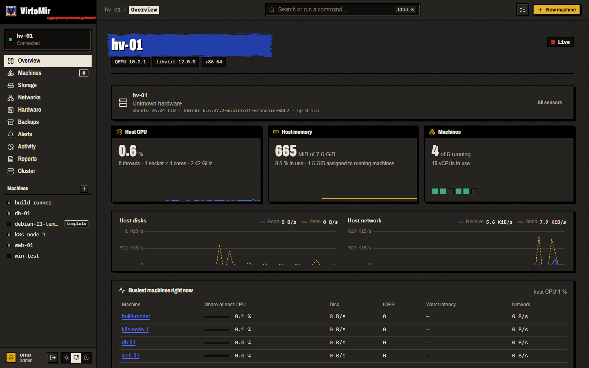

**Try it:** click through the [online demo](https://onurbaydas.github.io/VirtoMir/demo/) (made-up hosts, nothing to install), or get a throwaway test host in a VM with one command: [Try VirtoMir without touching your servers](docs/try-in-a-vm.md).

## Why?

| Tool | Focus |
|---|---|
| Cockpit (machines) | Easy, but focuses on basic settings — advanced tuning requires `virsh` / XML |
| virt-manager | Detailed, but a desktop application without web access |
| Proxmox VE | Powerful, but it *is* the operating system |

VirtoMir sits in the middle: as straightforward as Cockpit, as thorough as raw libvirt XML, with a modern web interface.

## How the interface is organised

What you use every day on one host is always in front: **Overview, Machines, Storage, Networks, Backups, Alerts and Hardware**. Everything else is one click deeper, never gone:

- The sidebar's **Operations** group (insights, reports, compliance, content library, activity), **Datacenter** group (cluster, Ceph, SDN, physical network, Kubernetes, bare metal; open by default once hosts are joined) and **Self-service** group (projects, catalog) fold open on demand. Experimental pages are marked *beta*. The command palette (Ctrl+K) reaches every page.
- A machine has six tabs: **Overview, Console, Settings, Hardware, Snapshots, Backups**. Its firewall, change history and XML are under **Advanced**.
- The new-machine wizard asks only what every machine needs. Projects, resource pools, GPU pools, SDN subnets, IP pools and storage policies appear when they are set up.
- Host-wide settings (updates, sign-in with LDAP/OIDC, quotas, integrations, the host setup) are on **Host settings**, the gear in the sidebar footer (admins only). Your own role, two-step sign-in and API tokens are on **Account**.

## Features

### Machines

- Live overview of host and machines, updated every second
- New-machine wizard: install from an ISO, start from a **cloud image with cloud-init** (user, password, SSH keys), or boot an existing disk. Linux, Windows (UEFI + Secure Boot + TPM 2.0) and "other" profiles with sensible defaults
- Start, shut down, reboot, pause, force off, hard reset, **save to disk** (resume exactly where it was) — one by one or **in bulk**
- Rename, **clone** (full copies, new identity, runs in the background), delete (optionally with its own disks — never shared ones)
- **Templates**: turn a prepared machine into a template and create new machines from it in seconds — **linked clones** (store only their own changes) or full copies, with optional cloud-init
- **Console in the browser**: graphical over VNC (noVNC) or **SPICE** (spice-html5: resolution follows the window, shared clipboard with the guest agent) and serial, also full-screen
- **Settings form** for CPU (topology, model), memory (balloon), boot order, firmware — with a **"review changes" XML diff** before saving; vCPUs and memory are applied live where possible
- **Tuning**: CPU and emulator pinning, huge pages, NUMA memory policy
- **XML editor** for everything else, validated by libvirt
- **Configuration history**: every version of a machine's definition, recorded from libvirt's events — also changes made with `virsh`, live-only changes on running machines, and a warning when `/etc/libvirt/qemu/*.xml` was edited but not loaded — with a diff and one-click restore
- **Hardware**: add/remove disks and network adapters (hot-plug), insert/eject ISOs, **grow disks**
- **Storage QoS & SLAs**: guarantee and cap I/O bandwidth (`read_bytes_sec`, `write_bytes_sec`) and IOPS (`read_iops_sec`, `write_iops_sec`, burst ceilings) per virtual disk using QEMU `<iotune>`, applied live without guest downtime
- **Confidential Computing**: machines with encrypted memory (**AMD SEV / SEV-SNP**, **Intel TDX**) on hosts whose CPU and firmware offer it; VirtoMir reads what the host supports from libvirt and only offers that
- **System Containers**: Linux system containers on libvirt LXC next to the virtual machines — Debian, Ubuntu or Alpine from images.linuxcontainers.org (checked against SHA-256), unprivileged (container root is an unprivileged user on the host), on the same virtual networks, with live CPU and memory, the text console, start, shut down, reboot and delete (needs `libvirt-daemon-driver-lxc`)
- **PCI/USB passthrough** with an IOMMU group view and safety checks (devices the host needs are refused, with the reason)
- More devices from the Hardware tab: **shared folders** (virtiofs), **vGPU slices** (mediated devices, created on the Hardware page), **clipboard sharing**, video model and **up to 4 monitors**, watchdog, TPM 2.0, random number generator — hot-plugged where possible, otherwise from the next start (and it says which)
- Expert **QEMU command line** (extra arguments and environment), clearly marked as such
- **Import**: OVA appliances, a libvirt domain XML, or a disk image already on the host
- **From VMware** (experimental): read the inventory of a vCenter or a standalone ESXi host and convert its machines with `virt-v2v` — not tested on real VMware hardware yet
- **Snapshots** as a tree: take, revert, delete
- **Backups**: live (no downtime) or offline, restore as a new machine; **automatic snapshots and backups** on a schedule with retention; the Backups page lists the machines without automatic backups (one click protects them) and the automatic backups whose last run failed
- **Off-site copies** with restic — encrypted and deduplicated, to S3 (or MinIO, Wasabi, Ceph RGW …), Backblaze B2, Azure, Google Cloud Storage, SFTP, a REST server or a disk; every scheduled backup can be copied right after it is made, with its own retention, and brought back with one click
- **Firewall per machine**: in/out rules by protocol, port and IPv4/IPv6 address, default policies and anti-spoofing — enforced on the host (libvirt network filters), so the guest cannot switch it off; applied live
- **As code**: the new-machine form shows its exact API request (curl, Ansible) and an equivalent `virt-install`

### Monitoring

- Per machine: CPU, per-vCPU load, disk throughput / IOPS / latency, network traffic, guest-reported memory
- Host CPU, memory, physical disk and network throughput
- **History** for 1 h, 6 h, 24 h, 7 days and 30 days — kept by VirtoMir itself, no Prometheus needed
- …and a **Prometheus endpoint** (`/api/v1/metrics`) for those who have one, with ready-made **Grafana dashboards** (host overview, one machine) and **Prometheus alert rules** in [`contrib/`](contrib/README.md); the whole API is described by **OpenAPI** (`/api/v1/openapi.json`)
- **Alerts** with sensible defaults (host overloaded, machine crashed, pool filling up, libvirt down) — to a webhook, Slack, Discord, ntfy or e-mail
- **Host hardware**: vendor, model, BIOS, temperatures, fans and power from the host's own sensors; GPUs with load, memory, temperature and power (NVIDIA, AMD)
- **Busiest machines** right now, and "would N more machines fit?" from live numbers (with an N+1 check in a cluster)
- **Reports**: capacity, machine inventory and backup compliance over the whole cluster — HTML (prints to PDF), CSV or JSON, on demand or on a schedule
- **Insights**: capacity forecasts (when a host or pool runs full), right-sizing suggestions for machines that ask for more than they use, and alerts when a machine's metrics leave their usual range
- **Compliance**: security checks of every host (sVirt confinement, SSH root login, host firewall, kernel pointer hiding, core dumps, time sync) with the FIPS mode shown, and a tamper-evident activity log that can be verified
- **Transparent Memory Deduplication (KSM)**: monitor and control Kernel Samepage Merging (`/sys/kernel/mm/ksm`), automatically sharing identical memory pages across virtual machines and displaying live saved GiB
- **Distributed SIEM / Syslog Forwarding**: stream audit trail and security events in real time to enterprise SIEM platforms (Splunk, Graylog, ELK) in standard **RFC 5424** format over UDP, TCP, or TLS

### Storage & networks

- Storage pools and volumes, **ISO / cloud image upload** with progress, grow volumes
- Virtual networks (NAT, isolated, routed, bridged) with **IPv4 and IPv6** (SLAAC, DHCPv6, NAT66), DHCP leases with machine names, **reserved addresses**
- **Cross-Host VXLAN Overlay (SDN)**: one layer-2 network spanning several hosts, tunnelled over their existing network (UDP 4789) without switch changes; created cluster-wide, every member gets the others as peers and one host is the gateway (NAT, DHCP); VirtoMir keeps the tunnel devices in place, also after a reboot
- **Software-defined networking on OVN** *(experimental, not yet run on a real OVN cluster)*: per-project **VPCs** with subnets, OVN-native DHCP and a distributed router, static routes, an **external gateway** with SNAT, **floating IPs**, **security groups** (stateful rules, default deny, rules between groups), **load balancers** with TCP/UDP health checks and **IPsec** for the Geneve tunnels; a machine's adapter can be put on a VPC subnet when it is created or later
- **Asynchronous ZFS Storage Replication**: datasets and zvols replicated to another host on a schedule with incremental `zfs send -i | ssh … zfs receive`, old replication snapshots pruned on both sides; a copy of the data elsewhere without a SAN
- **Host wiring** at a glance: physical ports, bonds, VLANs, bridges and which machines are plugged in
- **Create bridges, bonds and VLAN interfaces on the host** — through netplan, NetworkManager or systemd-networkd, whichever the host uses; a bridge can take over the host's own address. Every change must be confirmed within two minutes, or the host undoes it by itself (so a change that cuts you off heals itself)
- **Packet capture** on any host interface (tcpdump): watch it live or download a `.pcap` for Wireshark
- **Download images from a URL** straight into a pool, verified against a SHA-256; find **unused disk images**
- **NFS, iSCSI and Ceph RBD storage**, and one pool on every host of a cluster in a single step
- **Content library**: ISO images, cloud images and templates kept in versions, synced to the other hosts and deployed as new machines from there
- **LVM and ZFS**: use an existing volume group or zpool, or build a new volume group from empty disks (a disk with data on it is refused, never overwritten)
- **VLANs** on Open vSwitch bridges (per network or per adapter), and one network on every host in a single step
- **Hyper-converged Ceph** *(experimental)*: bootstrap a Ceph cluster on the VirtoMir hosts with cephadm, add members and their disks as OSDs (only empty disks: anything with partitions, a file system, an LVM/ZFS/RAID label, held open by the kernel or used by a storage pool is refused), watch health, capacity, placement groups and the OSD tree, create replicated or erasure-coded RBD pools that become storage pools on every host, and set `noout` while a host is serviced; Ceph health raises alerts
- **Storage policies**: name the pool new disks go to by intent ("fast", "cold"), with a cluster-wide default
- **Storage efficiency**: what ZFS and Ceph compression and deduplication save, and their settings (dedup only after confirming its memory cost); compact a stopped machine's disk image (virt-sparsify); new disks pass the guest's TRIM to the host
- **Storage tiers**: label pools NVMe, SSD or HDD and move a disk to a tier, live
- **NVMe over TCP** *(experimental)*: discover and connect storage targets (reconnected after a reboot) and turn their namespaces into pools
- **IP pools**: fixed addresses for machines made from cloud images (set through cloud-init), the same pools on every host so addresses never collide, reservations for anything else
- **Dynamic DNS**: machines with a pool address get A/AAAA and PTR records (RFC 2136 updates signed with TSIG — BIND, Knot, PowerDNS, Windows DNS), removed when the machine is deleted
- **BGP and EVPN through FRR** *(experimental)*: announce a host's networks to your routers, and its VXLAN overlays with EVPN; VirtoMir writes only its own section of FRR's configuration and shows the sessions
- **SR-IOV** *(experimental)*: set the virtual functions of a network card (kept across reboots) and make a network of it, where every machine gets its own virtual function

### Several hosts

- Install VirtoMir on each host and join them with a **one-time join code** — no shared database, no extra services; if one host is down, the others carry on
- Manage every host from any of them: **cluster overview** with live host cards and all machines in one list, host switcher, consoles and live charts of any host
- **Single-Pane Fleet Deck & DRS**: every machine of the cluster in one list, and a Distributed Resource Scheduler that measures the load skew, honours affinity/anti-affinity rules, recommends live migrations you apply with one click — or, fully automated, carries them out itself — and suggests the best host for a new machine
- **Move machines between hosts**: stopped ones are copied, running ones are **live-migrated** — without copying disks on shared NFS storage, or copying them live
- Alerts, activity and backups of all hosts in one place, history charts of every host side by side; roles apply on every host
- Alert rules, notifications and the backup location saved **the same on every host** in one step
- A **CPU model every host supports**, so machines can live-migrate between different CPUs
- **High availability**: protected machines are restarted on another host when theirs dies — with quorum (and an optional witness), and only after the dead host is certainly off: through its BMC (IPMI or Redfish), its hardware watchdog, or an admin's confirmation. Priorities, preferred hosts, a "what if this host died" preview
- **Maintenance**: move every running machine off a host in one go
- **Rolling cluster upgrade**: pre-checks (quorum, room to evacuate, versions), then one host at a time — machines live-migrate away, VirtoMir (and optionally the OS packages, with a reboot) is updated, the host comes back and takes its machines again; pause, resume or abort between steps
- **GPU pools**: the cluster's GPUs grouped by how machines get them (whole card by passthrough, a vGPU type, a MIG profile); a new machine asks for "2 of l40s" and is placed on the member that has them free, within its project's GPU quota
- **Resource pools**: nested limits on vCPUs, memory and disk space per storage pool, enforced on every create, resize and move
- **Placement rules**: keep machines together or apart, or on hosts with a label (rack, zone) — as a must or a should; checked on create, move, DRS and HA
- **Disaster recovery** *(experimental)*: protection groups replicated to another host, recovery plans with boot order, test failover on clones, real failover and failback

### Projects & self-service

- **Projects**: tenants with members and roles, limits on machines, vCPUs, memory, disk and GPUs, and the pools and networks they may use; operators of a project manage only its machines
- **Self-service catalog**: blueprints people order machines from, with approval, leases that expire (and can be extended) and showback prices

### Security

- Sign in with your Linux account (**PAM**); only root and members of the `libvirt` group
- **Roles** from Linux groups: admin (`libvirt`), operator (`virtomir-operator`: run machines, console, snapshots, backups) and viewer (`virtomir-viewer`)
- **LDAP / Active Directory** and **OpenID Connect** ("Sign in with …") besides local accounts, roles from directory groups
- **Two-step sign-in** with any authenticator app (TOTP), with recovery codes; admins can reset it
- **Quotas and self-service**: operators create and manage their own machines within a limit on machines, vCPUs, memory and disk space
- **API tokens** for scripts and automation, limited to their owner's role
- HTTPS by default (self-signed certificate created on first start, or your own)
- Session timeouts, lockout after failed sign-ins, CSRF protection, **activity log** of every change (CSV export)
- **Updates** from the GitHub releases in the UI (Host settings → Updates): downloaded, checked against the published SHA-256 and its OpenPGP signature, and installed with apt

### Automation

- The whole **REST API**, described by OpenAPI, with API tokens
- An **Ansible collection** (machines, networks, storage pools, projects, placement rules, snapshots; check mode and idempotent) in [`integrations/ansible`](integrations/ansible)
- A **Terraform provider** (machines, networks, pools, projects, placement rules) in [`integrations/terraform-provider-virtomir`](integrations/terraform-provider-virtomir)

| | |
|---|---|
| 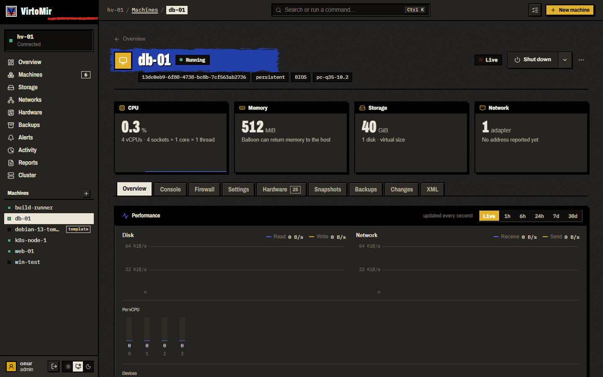 | 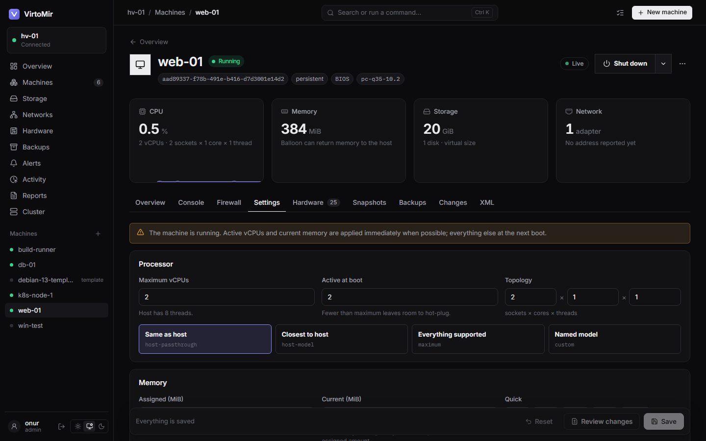 |
| 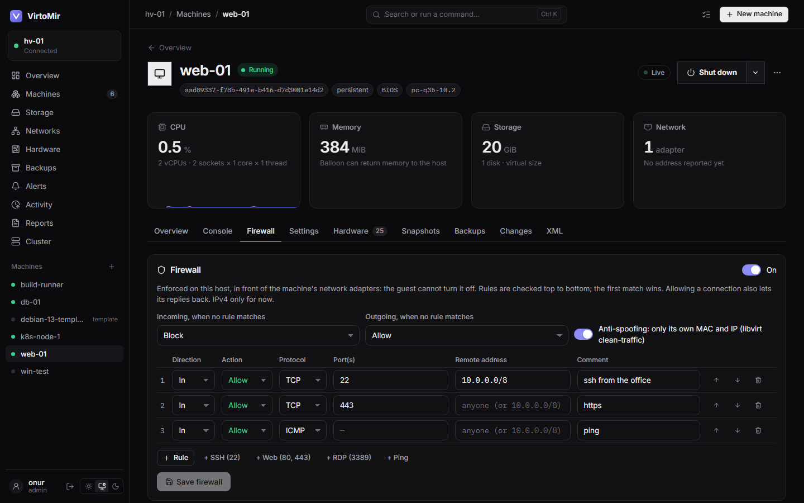 | 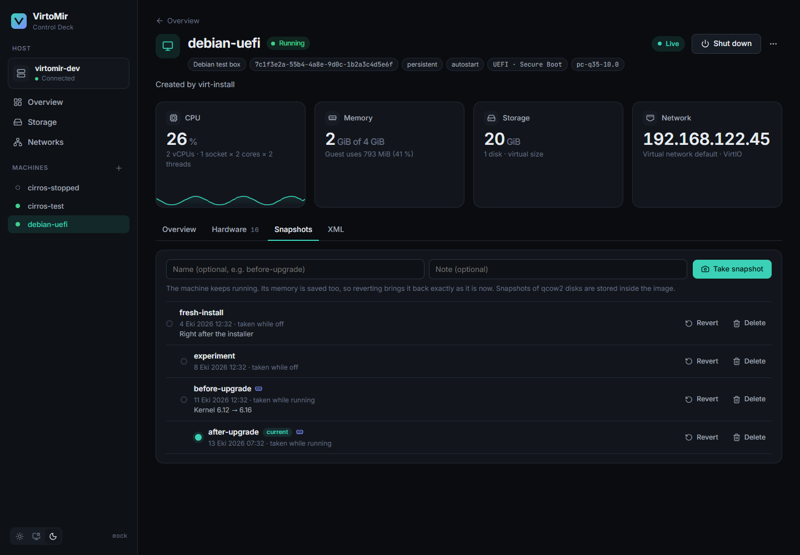 |
| 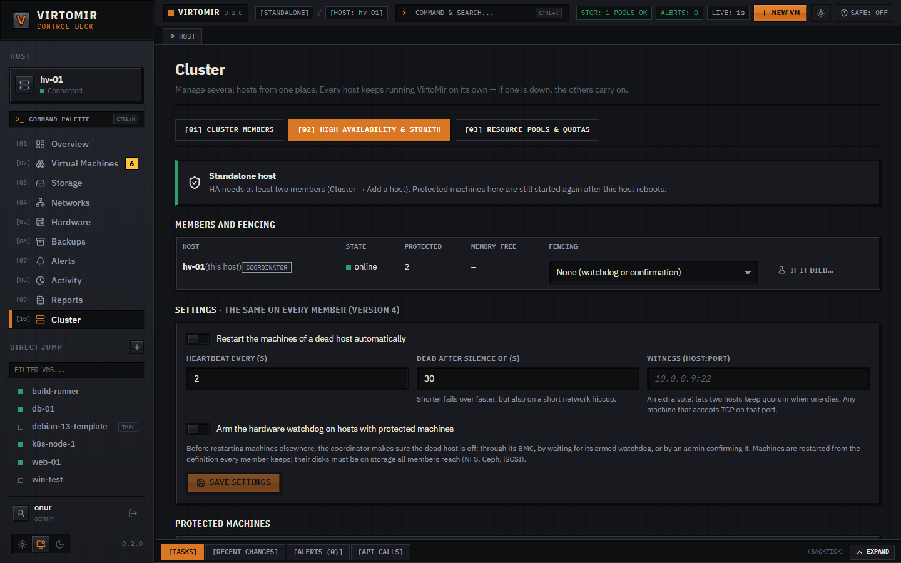 | 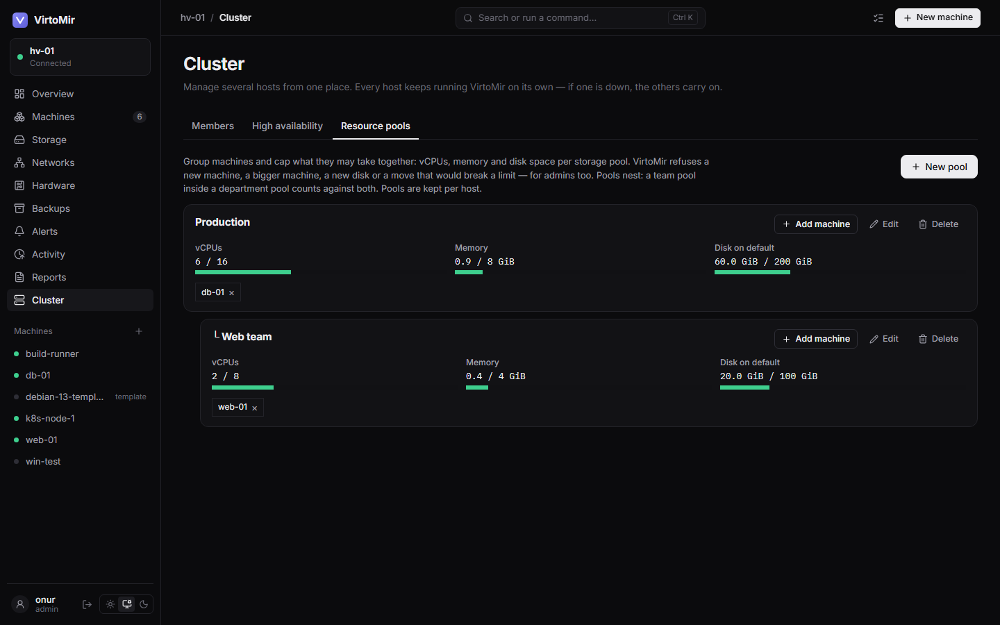 |
| 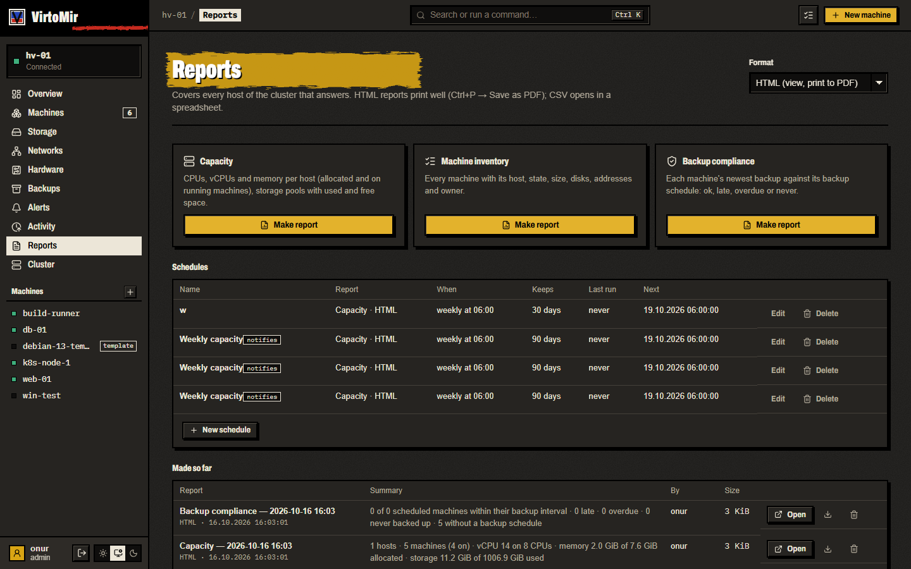 | 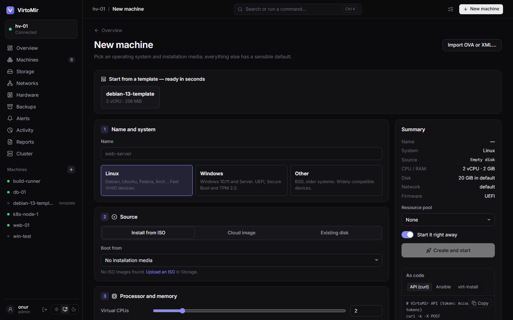 |
| 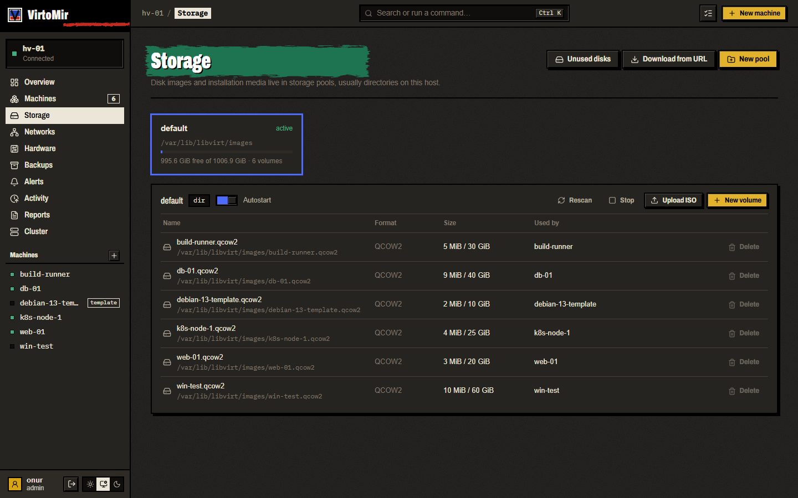 | 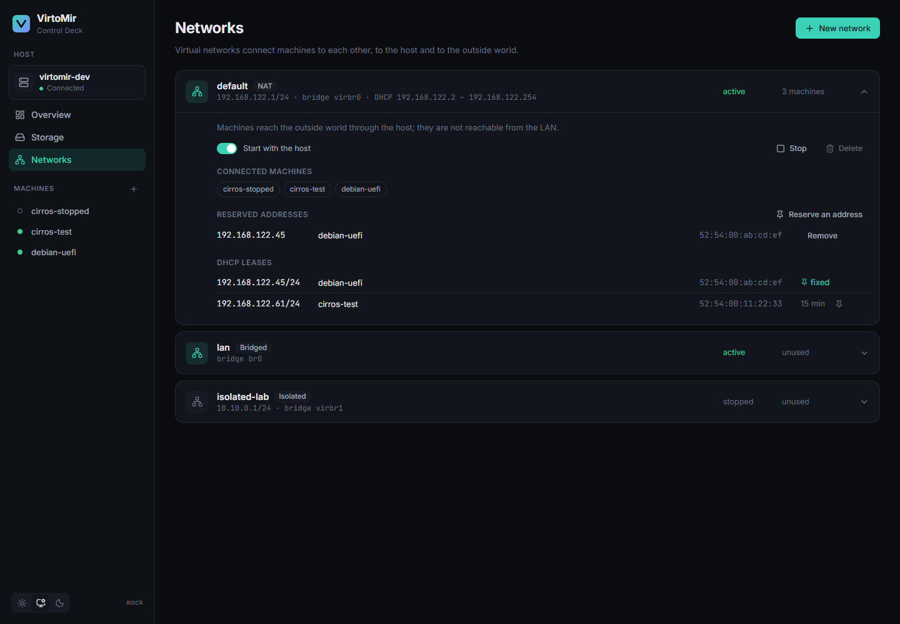 |
| 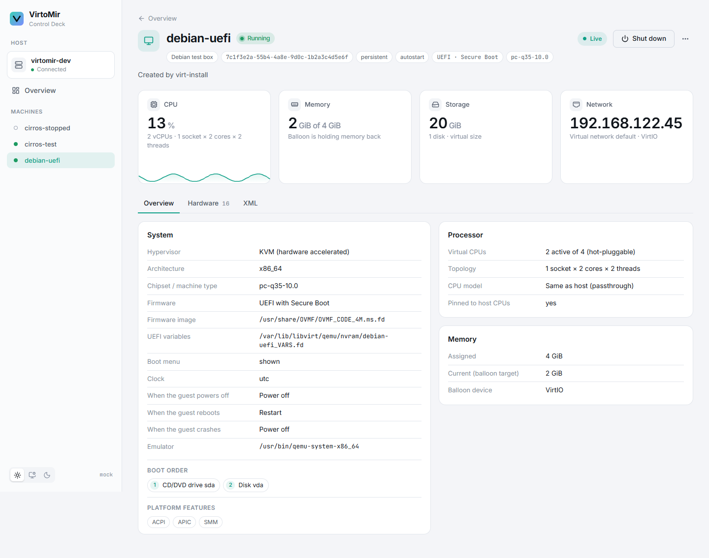 | 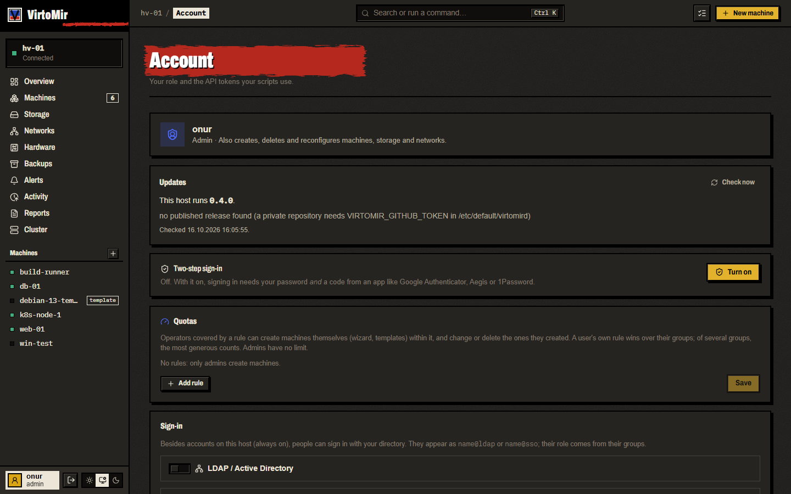 |

<p align="center">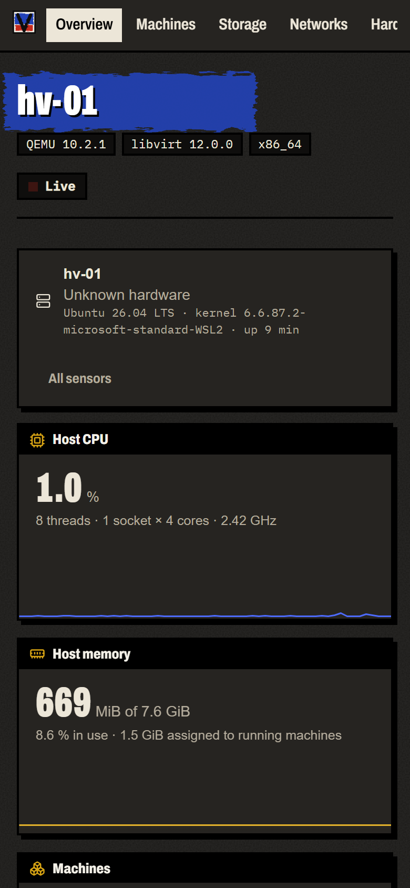</p>

- **English and Turkish** (Türkçe) user interface — the browser's language by default, switchable in the sidebar and on the Account page

<sub>Screenshots from VirtoMir 0.6 on a test host (Ubuntu 26.04, libvirt 12) with real, small machines; the host name is shown as hv-01. Dark, light and "match system" themes; works on phones too.</sub>

## What it does on your host

Before you install it on a hypervisor you care about — or [try it in a throwaway VM](docs/try-in-a-vm.md) first:

- **Runs as root**, as one service (`virtomird`), because it talks to the system libvirt socket and checks passwords through PAM.
- **Listens on port 8420 (HTTPS)** — on all addresses when installed from a package or with `install.sh`, only on `127.0.0.1` when the binary is started by hand. Change it in `/etc/default/virtomird` (`/etc/sysconfig/virtomird` on Fedora/RHEL), e.g. to `127.0.0.1:8420` behind your own reverse proxy.
- **Keeps its own state in `/var/lib/virtomir`** (certificate, history, settings, activity log). No database and no agents inside your machines.
- **Never touches your existing machines on its own.** It reads what libvirt has and changes only what you ask for, directly or through something you set up (schedules, high availability); changes made through VirtoMir are in the activity log.
- **Removes cleanly:** `sudo apt purge virtomir` (or `sudo ./install.sh --uninstall --purge`) deletes the service and `/var/lib/virtomir`; your machines, disks and networks stay.
- **Security problems:** please report them privately, see [SECURITY.md](SECURITY.md).

## Install

### Signed package repository (apt / dnf)

Releases are published to a signed repository, so updates come with `apt upgrade` / `dnf upgrade`:

```sh
# Debian / Ubuntu
sudo install -d -m 0755 /etc/apt/keyrings
sudo curl -fsSL -o /etc/apt/keyrings/virtomir.asc https://onurbaydas.github.io/VirtoMir/virtomir.asc
echo "deb [signed-by=/etc/apt/keyrings/virtomir.asc] https://onurbaydas.github.io/VirtoMir/apt stable main" | sudo tee /etc/apt/sources.list.d/virtomir.list
sudo apt update && sudo apt install virtomir

# Fedora / RHEL 10 (experimental)
sudo curl -fsSL -o /etc/yum.repos.d/virtomir.repo https://onurbaydas.github.io/VirtoMir/virtomir.repo
sudo dnf install virtomir
```

The repository is built by `scripts/build-repos.sh` in the release workflow (`InRelease` and `repomd.xml` signed, every `.rpm` signed).

### Debian / Ubuntu package

```sh
sudo apt install ./virtomir_1.1.1_amd64.deb   # or _arm64.deb; pulls libvirt and QEMU if missing
```

Every package does the host setup itself: it pulls in libvirt and QEMU/KVM, starts libvirt and its `default` NAT network, opens port 8420 in ufw or firewalld when one is on, and starts `virtomird` (self-signed HTTPS). Nothing is left to type. The first admin to sign in is walked through what the host still needs (storage, a backup location, a first image). Sign in as `root` or with your own account if you are an administrator (groups `sudo`, `wheel` or `libvirt`); members of `virtomir-operator` and `virtomir-viewer` get fewer rights. Flags (listen address, own certificate) go in `/etc/default/virtomird`, then `sudo systemctl restart virtomird`. `sudo apt purge virtomir` also deletes `/var/lib/virtomir`; your machines are never touched. Later versions install from the UI (Host settings → Updates). Build the package yourself with `scripts/build-deb.sh <version>` on Debian/Ubuntu (Go, Node, gcc, libpam0g-dev).

### Fedora / RHEL package (experimental)

```sh
sudo dnf install ./virtomir-1.1.1-1.x86_64.rpm   # or .aarch64.rpm; Fedora 40+ / RHEL 10
```

Same service and port; flags go in `/etc/sysconfig/virtomird`. Update with `dnf`, not from the UI. Built with `scripts/build-rpm.sh <version>`.

### Tarball

Requirements: a Linux host with **systemd**. If libvirt and QEMU/KVM are missing, the installer adds them with apt or dnf.

```sh
tar xzf virtomir_v1.1.1_linux_amd64.tar.gz
sudo ./virtomir_v1.1.1_linux_amd64/install.sh
```

The installer puts `virtomird` in `/usr/local/bin`, adds a PAM service (`/etc/pam.d/virtomir`) and a systemd unit, opens the port in ufw or firewalld, starts it and prints the address — usually `https://<host>:8420/`. Your browser asks you to accept the self-signed certificate once.

- Sign in as `root` or as an administrator (groups `sudo`, `wheel` or `libvirt`).
- Only local access, behind your own reverse proxy: `sudo ./install.sh --listen 127.0.0.1:8420`
- Upgrade: run the installer of the new release. Remove: `sudo ./install.sh --uninstall` (your VMs are not touched).
- From GitHub directly: `sudo ./install.sh --download` (uses the `gh` CLI for private repositories).

### Configuration

`virtomird` flags (edit `ExecStart` in `/etc/systemd/system/virtomird.service`):

| Flag | Default | Meaning |
|---|---|---|
| `-listen` | `127.0.0.1:8420` (installer: `0.0.0.0:8420`) | address and port |
| `-auth` | `pam` | `none` disables sign-in — development only |
| `-auth-group` | `libvirt,wheel,sudo` | besides root, who may sign in as admin (comma-separated groups) |
| `-operator-group` | `virtomir-operator` | members may run machines but not change them |
| `-viewer-group` | `virtomir-viewer` | members may look but change nothing |
| `-tls` | `auto` | `auto` (self-signed in `-state-dir`), `files` (`-tls-cert`, `-tls-key`), `off` (behind a TLS proxy) |
| `-state-dir` | `/var/lib/virtomir` | certificate, metric history, alerts, schedules, activity log, tokens, cluster membership, configuration history, quotas, LDAP/OIDC settings; default backup location (`backups/`) |
| `-name` | hostname | how this host is called in a cluster |
| `-libvirt-socket` | `/var/run/libvirt/libvirt-sock` | |

## Build from source

```sh
git clone https://github.com/onurbaydas/VirtoMir && cd VirtoMir
(cd web && npm ci && npm run build)                            # web UI, embedded into the binary
CGO_ENABLED=1 go build -tags pam -o virtomird ./cmd/virtomird  # needs gcc + libpam0g-dev
# or everything incl. a release tarball:
sh scripts/build-release.sh v0.6.0-dev
```

Without `-tags pam` the binary builds anywhere (also cross-compiled from Windows/macOS), but can only run with `-auth none`.

Tags `v*` build and publish a release through GitHub Actions (`.github/workflows/release.yml`).

## Development

- Go (daemon, `cmd/` + `internal/`) and Svelte 5 + TypeScript (UI, `web/`).
- `go test ./...` and `cd web && npm run check` run anywhere, no libvirt needed.
- `scripts/dev-run.ps1` builds on Windows and runs on a Hyper-V dev host created by `dev/hyperv/New-VirtoMirDevHost.ps1` (Debian 13 with nested KVM).
- Work on the UI without any host: `cd web && npm run dev:demo` (the same pretend cluster as the [online demo](https://onurbaydas.github.io/VirtoMir/demo/)).
- How to contribute: [CONTRIBUTING.md](CONTRIBUTING.md). VirtoMir is developed with the help of AI coding agents; [AGENTS.md](AGENTS.md) is their entry point, and the best map of the code for people too.

## How it's built, and where help is needed

VirtoMir is built by one person, together with AI coding agents (their working rules are in [AGENTS.md](AGENTS.md)). That is how it grew this fast, and it is also why it needs more eyes than a typical side project. It makes no claim to be finished or proven; with the help of others it can become far more than one person could build. Help means the most here:

- **Run it** on Debian, Fedora or an older Ubuntu and tell us what breaks
- **Review the security-sensitive parts**: it runs as root and handles sign-in (`internal/auth`, `internal/api`); please report problems privately, see [SECURITY.md](SECURITY.md)
- **Test the paths we cannot reach**: GPU passthrough, Ceph, real BMCs, VMware
- **Criticise** the code or the idea — honest criticism helps too
- **Contribute code**: start with a [good first issue](https://github.com/onurbaydas/VirtoMir/issues?q=is%3Aissue+is%3Aopen+label%3A%22good+first+issue%22), see [CONTRIBUTING.md](CONTRIBUTING.md)

## Roadmap

The feature set is complete; **no new features are being added**. The work now goes into the everyday single-host features:

- **Data safety**: nothing in use is ever deleted, operations on one machine never overlap, damaged settings files are kept aside instead of being replaced, failed backups always raise an alert.
- **Clear everyday flows**: the new-machine wizard, the console, storage, networks, backups and the first-run setup, with plain errors and no dead ends.
- **Less in the way**: advanced and multi-host features one click deeper and only shown once they are set up.
- **Tests** for the risky paths (delete, restore, snapshot revert).

These arrived last and need the most real-world testing:

- **Kubernetes clusters** on VirtoMir machines (kubeadm through cloud-init, one or three control planes behind kube-vip, flannel or calico, scaling, minor upgrades node by node) and a **CSI driver** for VirtoMir storage pools ([integrations/virtomir-csi](integrations/virtomir-csi)).
- **Bare-metal onboarding**: new hosts installed over the network (iPXE, Debian 13 preseed, VirtoMir from the apt repository) that join the cluster on their first boot; BMCs boot them through Redfish or IPMI.
- A **Packer builder** ([integrations/packer-plugin-virtomir](integrations/packer-plugin-virtomir)), a **Kubernetes operator** ([integrations/virtomir-operator](integrations/virtomir-operator)) and Terraform data sources.
- Hyper-converged Ceph, storage efficiency, SR-IOV, IP pools and dynamic DNS.

Tested on nested KVM, not yet on real hardware. Reports in [#1](https://github.com/onurbaydas/VirtoMir/issues/1) help the most. What is left of BGP/EVPN and IPAM stays in the open [`enhancement`](https://github.com/onurbaydas/VirtoMir/issues?q=is%3Aissue+is%3Aopen+label%3Aenhancement) issues.

**Pace:** active development is paused for a while. Issues and pull requests stay welcome and will be reviewed, though answers may take longer than usual.

Ideas and questions: [Discussions](https://github.com/onurbaydas/VirtoMir/discussions). Found a bug or tried it on your hardware? [Open an issue](https://github.com/onurbaydas/VirtoMir/issues/new/choose) or report your setup in [#1 (Testers wanted)](https://github.com/onurbaydas/VirtoMir/issues/1) — test reports from setups we cannot reach (real BMCs, Ceph, GPUs, other distributions) help the most.

## License

VirtoMir is free software: **GNU Affero General Public License v3.0 or later** — see [LICENSE](LICENSE). You may use, study, change and share it; if you offer a changed VirtoMir to others over a network, you must offer them its source code too.

Copyright © 2026 Onur Baydas. For a commercial license without the AGPL's obligations, contact the author through GitHub. Contributions are welcome under the [Contributor License Agreement](CLA.md), which keeps both licenses possible.
