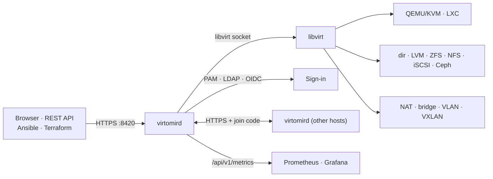

<div dir="rtl">

<p align="center"></p>

<h1 align="center">VirtoMir</h1>

<p align="center"><strong>A Detailed Control Deck for Virtual Environments.</strong><br>
لوحة تحكم ويب حديثة لـ KVM / QEMU / libvirt تُثبَّت على نظام Linux الذي تستخدمه بالفعل.</p>

<p align="center">
<a href="../../README.md">English</a> ·
<a href="README.tr.md">Türkçe</a> ·
<a href="README.de.md">Deutsch</a> ·
<a href="README.fr.md">Français</a> ·
<a href="README.es.md">Español</a> ·
<a href="README.pt-BR.md">Português</a> ·
<a href="README.it.md">Italiano</a> ·
<a href="README.pl.md">Polski</a> ·
<a href="README.nl.md">Nederlands</a> ·
<a href="README.ru.md">Русский</a> ·
<a href="README.uk.md">Українська</a> ·
<a href="README.zh-CN.md">简体中文</a> ·
<a href="README.zh-TW.md">繁體中文</a> ·
<a href="README.ja.md">日本語</a> ·
<a href="README.ko.md">한국어</a> ·
العربية
</p>

<p align="center">
  <a href="https://github.com/onurbaydas/VirtoMir/releases/latest"></a>
  <a href="https://github.com/onurbaydas/VirtoMir/actions/workflows/ci.yml"></a>
  <a href="../../LICENSE"></a>
  
  <a href="https://scorecard.dev/viewer/?uri=github.com/onurbaydas/VirtoMir"></a>
  <a href="https://registry.terraform.io/providers/onurbaydas/virtomir/latest"></a>
</p>

<p align="center">
  <a href="https://github.com/onurbaydas/VirtoMir/stargazers"></a>
  <a href="https://github.com/onurbaydas/VirtoMir/fork"></a>
  <a href="https://github.com/onurbaydas/VirtoMir/subscription"></a>
</p>

<p align="center">
  <a href="https://onurbaydas.github.io/VirtoMir/demo/"><b>▶ عرض مباشر</b></a> ·
  <a href="#install">التثبيت</a> ·
  <a href="../try-in-a-vm.md">جرّبه في آلة افتراضية</a> ·
  <a href="../features.md">كل الميزات</a> ·
  <a href="#contribute">ساهم</a> ·
  <a href="https://github.com/onurbaydas/VirtoMir/discussions">النقاشات</a>
</p>

<table align="center">
<tr><td align="center"><h3>1</h3></td><td align="center"><h3>0</h3></td><td align="center"><h3>0</h3></td><td align="center"><h3>90+</h3></td><td align="center"><h3>16</h3></td><td align="center"><h3>1 s</h3></td></tr>
<tr><td align="center"><sub>ملف تنفيذي بواجهة مدمجة</sub></td><td align="center"><sub>قواعد بيانات</sub></td><td align="center"><sub>وكلاء داخل أجهزتك</sub></td><td align="center"><sub>ميزة</sub></td><td align="center"><sub>لغة لملف README</sub></td><td align="center"><sub>رسوم حيّة</sub></td></tr>
</table>

> يحافظ المجتمع على هذه الترجمة، وقد تتأخر عن [ملف README الإنجليزي](../../README.md).

<p align="center"></p>

يحاول VirtoMir أن يكون أمرين في آن واحد:

- **سهل بلا عناء.** أنشئ آلة افتراضية وشغّلها دون أن تعرف الكثير عن المحاكاة الافتراضية.
- **مفصّل إلى حدّ مخيف.** كل إعداد في libvirt متاح وقابل للتعديل، ونعم، قابل للكسر أيضًا.

ملف تنفيذي واحد بواجهة ويب مدمجة: لا توزيعة مخصّصة، ولا قاعدة بيانات، ولا وكلاء داخل أجهزتك. ثبّته على مضيف يشغّل KVM، وافتح `https://<host>:8420/` وسجّل الدخول بحساب Linux الخاص بك.

> **الحالة: 1.2.** جُرّب على Ubuntu 26.04 وFedora 44، على مضيفات منفردة وعناقيد صغيرة. لم تُجرَّب الإتاحة العالية بعد على عتاد BMC حقيقي، واستيراد VMware تجريبي. منذ الإصدار 1.0 لا تُضاف ميزات جديدة: يذهب العمل إلى جعل الاستخدام اليومي على مضيف واحد متينًا. جرّبه قبل أن تأتمنه على بيئة الإنتاج، وأخبرنا بما يتعطّل في [#1](https://github.com/onurbaydas/VirtoMir/issues/1).

> [!TIP]
> **أعجبك الاتجاه؟ امنحه ⭐.** يبني VirtoMir شخص واحد: النجوم هي ما يجعل الآخرين يجدونه، وهي ما يُبقي المشروع حيًّا. لتصلك أخبار الإصدارات الجديدة: **Watch → Custom → Releases**.

> [!NOTE]
> **جرّبته؟ أخبرنا في 30 ثانية. (دون حساب)** [افتح نموذج الملاحظات السريعة](https://tally.so/r/db904z)، واختر 😀 أو 😐 أو 😞 أو 💡، وأضف جملة إن شئت. داخل VirtoMir، يفتح الزر 💬 أسفل الشريط الجانبي النموذج نفسه مع إصداراتك معبّأة مسبقًا. إن كان لديك حساب GitHub، يمكنك أيضًا استخدام [نموذج issue](https://github.com/onurbaydas/VirtoMir/issues/new?template=quick_feedback.yml).

## جرّبه في 30 ثانية

| | |
|---|---|
| **مجرد نظرة** | تصفّح [العرض التجريبي على الإنترنت](https://onurbaydas.github.io/VirtoMir/demo/): مضيفات وهمية، لا شيء لتثبيته. |
| **مضيف مؤقت** | أمر واحد يمنحك آلة افتراضية للاختبار وبداخلها VirtoMir: [جرّب VirtoMir دون لمس خوادمك](../try-in-a-vm.md). |
| **Debian / Ubuntu** | `sudo apt install ./virtomir_1.2.2_amd64.deb` — [أحدث إصدار](https://github.com/onurbaydas/VirtoMir/releases/latest) |
| **Fedora / RHEL** | `sudo dnf install ./virtomir-1.2.2-1.x86_64.rpm` — [أحدث إصدار](https://github.com/onurbaydas/VirtoMir/releases/latest) |

تثبّت الحزمة libvirt وQEMU/KVM إن لم تكن موجودة، وتفتح المنفذ 8420 وتشغّل الخدمة. لا يبقى شيء لتكتبه.

## لماذا VirtoMir؟

| | **VirtoMir** | Cockpit Machines | virt-manager | Proxmox VE |
|---|:---:|:---:|:---:|:---:|
| يُثبَّت على Linux الموجود لديك | ✅ | ✅ | ✅ | ❌ هو نظام التشغيل نفسه |
| في المتصفح | ✅ | ✅ | ❌ تطبيق سطح مكتب | ✅ |
| كل إعدادات libvirt، مع مقارنة XML قبل الحفظ | ✅ | ➖ إعدادات أساسية | ✅ | ➖ ليس libvirt |
| سجلّ لكل تغيير، واستعادة بنقرة واحدة | ✅ | ❌ | ❌ | ❌ |
| رسوم بيانية حيّة وسجلّ 30 يومًا مدمج | ✅ | ➖ | ❌ | ✅ |
| لقطات، ونسخ احتياطية مجدولة، ونسخ خارج الموقع | ✅ | ➖ لقطات | ➖ لقطات | ✅ |
| عدة مضيفات، ونقل حيّ، وإتاحة عالية | ✅ | ❌ | ➖ نقل | ✅ |

يقع VirtoMir في المنتصف: بسيط مثل Cockpit، وشامل مثل XML الخام في libvirt.

## أبرز الميزات

<table>
<tr>
<td width="50%" valign="top">
<h3>🖥️ الأجهزة بكل تفاصيلها</h3>
معالج لا يسأل إلا عمّا يحتاجه كل جهاز (ملف ISO، أو صورة سحابية مع cloud-init، أو قرص موجود)، ووراءه كل إعدادات libvirt: طوبولوجيا المعالج وتثبيته، والصفحات الضخمة، وNUMA، وتمرير PCI/USB، وvGPU، وTPM، وSecure Boot، وطرفية في المتصفح عبر VNC أو SPICE.
<br><br>
</td>
<td width="50%" valign="top">
<h3>🕰️ ما الذي تغيّر، ومتى</h3>
تُحفظ كل نسخة من تعريف الجهاز، بما في ذلك التغييرات التي تتم عبر <code>virsh</code>. يجمع الخط الزمني أحداث دورة الحياة والتغييرات واللقطات والنسخ الاحتياطية والتنبيهات في قائمة واحدة: الجواب على «كان يعمل بالأمس».
<br><br>
</td>
</tr>
<tr>
<td valign="top">
<h3>💾 التخزين والشبكات</h3>
مجمّعات تخزين من مجلدات وLVM وZFS وNFS وiSCSI وCeph؛ وتُكتشف أهداف NFS وSMB وiSCSI في الشبكة المحلية وتُوصل بنقرة. شبكات NAT وجسور (حتى عبر Wi-Fi) وVLAN وVXLAN، وتغييرات على شبكة المضيف تتراجع من تلقاء نفسها إذا فقدت الاتصال.
<br><br>
</td>
<td valign="top">
<h3>🛟 نسخ احتياطية تعود فعلًا</h3>
نسخ حيّة دون توقف، وجداول مع سياسة احتفاظ، واستعادة كجهاز جديد، وتحقّق من المجاميع الاختبارية. نسخ خارج الموقع عبر restic إلى S3 أو B2 أو Azure أو SFTP أو قرص، مشفّرة ومُزالة التكرار.
<br><br>
</td>
</tr>
<tr>
<td valign="top">
<h3>🌐 عدة مضيفات، عرض واحد</h3>
اربط المضيفات برمز لمرة واحدة: لا قاعدة بيانات مشتركة ولا خدمات إضافية. نقل حيّ، ومُجدول يوازن الحمل، ووضع صيانة، وتحديثات متتالية، وإتاحة عالية مع النصاب والعزل.
<br><br>
</td>
<td valign="top">
<h3>🔐 مصمَّم لمضيف مشترك</h3>
تسجيل دخول بحسابات Linux (PAM) أو LDAP/AD أو OpenID Connect، وتحقّق بخطوتين، وأدوار، ومشاريع بحصص، ورموز API، وسجلّ نشاط يكشف أي عبث. HTTPS افتراضيًا.
<br><br>
</td>
</tr>
</table>

كل ما تبقّى، من التنبيهات والتقارير إلى عناقيد Kubernetes واستيراد VMware، موجود في **[قائمة الميزات الكاملة](../features.md)** (بالإنجليزية).

## كيف يعمل



- **خدمة واحدة، `virtomird`**، تعمل بصلاحيات root لأنها تتحدث مع مقبس libvirt الخاص بالنظام وتتحقق من كلمات المرور عبر PAM.
- **حالتها الخاصة في `/var/lib/virtomir`**: الشهادة، وسجلّ المقاييس، والإعدادات، وسجلّ النشاط. لا قاعدة بيانات.
- **لا تلمس أجهزتك الموجودة من تلقاء نفسها أبدًا.** تقرأ ما لدى libvirt ولا تغيّر إلا ما تطلبه؛ وكل تغيير مسجّل في سجلّ النشاط.
- **تُزال بنظافة:** يحذف `sudo apt purge virtomir` الخدمة وحالتها؛ وتبقى أجهزتك وأقراصك وشبكاتك.

<a id="install"></a>
## التثبيت

```sh
# Debian / Ubuntu
sudo install -d -m 0755 /etc/apt/keyrings
sudo curl -fsSL -o /etc/apt/keyrings/virtomir.asc https://onurbaydas.github.io/VirtoMir/virtomir.asc
echo "deb [signed-by=/etc/apt/keyrings/virtomir.asc] https://onurbaydas.github.io/VirtoMir/apt stable main" | sudo tee /etc/apt/sources.list.d/virtomir.list
sudo apt update && sudo apt install virtomir

# Fedora / RHEL 10
sudo curl -fsSL -o /etc/yum.repos.d/virtomir.repo https://onurbaydas.github.io/VirtoMir/virtomir.repo
sudo dnf install virtomir
```

ثم افتح `https://<host>:8420/` وسجّل الدخول بحساب `root` أو كمسؤول (المجموعات `sudo` أو `wheel` أو `libvirt`). يطلب منك المتصفح مرة واحدة قبول الشهادة الموقّعة ذاتيًا. ويُرشَد أول مسؤول إلى ما ينقص المضيف: التخزين، ومكان للنسخ الاحتياطية، وأول صورة.

الحزم، والأرشيف tar، والإعداد، والبناء من المصدر: [ملف README الإنجليزي](../../README.md#install).

يُرجى الإبلاغ عن المشكلات الأمنية بشكل خاص، انظر [SECURITY.md](../../SECURITY.md).

<a id="contribute"></a>
## نبحث عن مساعدة

يبني VirtoMir شخص واحد، بمساعدة وكلاء برمجة بالذكاء الاصطناعي. لهذا نما بهذه السرعة، ولهذا يحتاج إلى أعين أكثر من أي مشروع جانبي معتاد.

- 🧪 **شغّله** على Debian، أو إصدار أقدم من Ubuntu، أو Rocky/Alma، أو Arch، وأخبرنا بما يتعطّل.
- 🔍 **راجع الأجزاء الحساسة أمنيًا**: يعمل بصلاحيات root ويتولى تسجيل الدخول (`internal/auth`، `internal/api`).
- 🔧 **اختبر ما لا نستطيع الوصول إليه**: تمرير GPU، وCeph، وBMC حقيقية، وVMware.
- 🌍 **ترجِم**: الواجهة ([`web/src/lib/locales`](../../web/src/lib/locales)) أو ملف README هذا ([`docs/i18n`](.)).
- 💻 **اكتب كودًا**: لا حاجة إلى خادم، فالأمر `cd web && npm install && npm run dev:demo` يشغّل الواجهة كاملة على عنقود محاكى. ابدأ بـ [good first issue](https://github.com/onurbaydas/VirtoMir/issues?q=is%3Aissue+is%3Aopen+label%3A%22good+first+issue%22)، وانظر [CONTRIBUTING.md](../../CONTRIBUTING.md).

أفكار وأسئلة: [النقاشات](https://github.com/onurbaydas/VirtoMir/discussions). وجدت خطأً؟ [افتح issue](https://github.com/onurbaydas/VirtoMir/issues/new/choose).

## شكر

<p><br>شكرًا لـ Mega Bilgisayar.</p>

<p align="center">
  <b>إن كان VirtoMir مفيدًا لك، فنجمة واحدة تساعد الآخرين على إيجاده.</b><br><br>
  <a href="https://github.com/onurbaydas/VirtoMir/stargazers"></a>
  <a href="https://github.com/onurbaydas/VirtoMir/fork"></a>
  <a href="https://github.com/onurbaydas/VirtoMir/subscription"></a>
</p>

## الترخيص

VirtoMir برمجية حرة: **رخصة جنو أفيرو العمومية v3.0 أو أحدث**، انظر [LICENSE](../../LICENSE). يمكنك استخدامه ودراسته وتعديله ومشاركته؛ وإذا قدّمت نسخة معدّلة من VirtoMir للآخرين عبر شبكة، فعليك أن تقدّم لهم شيفرتها المصدرية أيضًا.

Copyright © 2026 Onur Baydas. للحصول على ترخيص تجاري دون التزامات AGPL، تواصل مع المؤلف عبر GitHub. المساهمات مرحّب بها وفق [اتفاقية ترخيص المساهمين](../../CLA.md)، التي تُبقي الترخيصين ممكنين.

</div>
