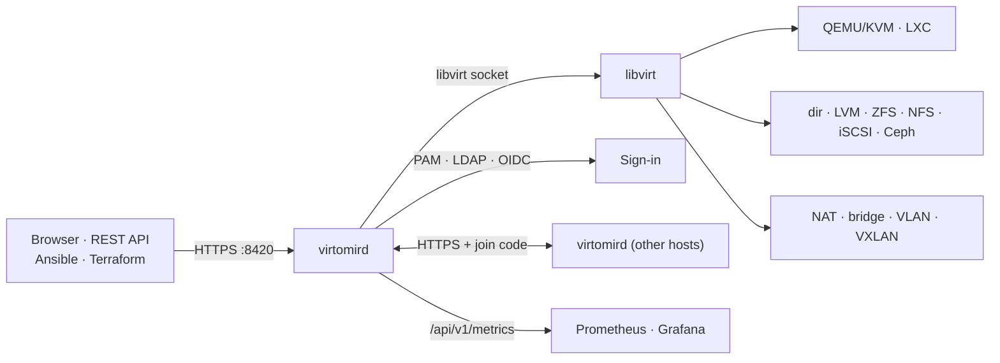

<p align="center"></p>

<h1 align="center">VirtoMir</h1>

<p align="center"><strong>A Detailed Control Deck for Virtual Environments.</strong><br>
Eine moderne Weboberfläche für KVM / QEMU / libvirt, die sich auf dem Linux installiert, das du schon betreibst.</p>

<p align="center">
<a href="../../README.md">English</a> ·
<a href="README.tr.md">Türkçe</a> ·
Deutsch ·
<a href="README.fr.md">Français</a> ·
<a href="README.es.md">Español</a> ·
<a href="README.pt-BR.md">Português</a> ·
<a href="README.it.md">Italiano</a> ·
<a href="README.pl.md">Polski</a> ·
<a href="README.nl.md">Nederlands</a> ·
<a href="README.ru.md">Русский</a> ·
<a href="README.uk.md">Українська</a> ·
<a href="README.zh-CN.md">简体中文</a> ·
<a href="README.zh-TW.md">繁體中文</a> ·
<a href="README.ja.md">日本語</a> ·
<a href="README.ko.md">한국어</a> ·
<a href="README.ar.md">العربية</a>
</p>

<p align="center">
  <a href="https://github.com/onurbaydas/VirtoMir/releases/latest"></a>
  <a href="https://github.com/onurbaydas/VirtoMir/actions/workflows/ci.yml"></a>
  <a href="../../LICENSE"></a>
  
</p>

<p align="center">
  <a href="https://github.com/onurbaydas/VirtoMir/stargazers"></a>
  <a href="https://github.com/onurbaydas/VirtoMir/fork"></a>
  <a href="https://github.com/onurbaydas/VirtoMir/subscription"></a>
</p>

<p align="center">
  <a href="https://onurbaydas.github.io/VirtoMir/demo/"><b>▶ Live-Demo</b></a> ·
  <a href="#install">Installation</a> ·
  <a href="../try-in-a-vm.md">In einer VM ausprobieren</a> ·
  <a href="../features.md">Alle Funktionen</a> ·
  <a href="#contribute">Mitmachen</a> ·
  <a href="https://github.com/onurbaydas/VirtoMir/discussions">Diskussionen</a>
</p>

<table align="center">
<tr><td align="center"><h3>1</h3></td><td align="center"><h3>0</h3></td><td align="center"><h3>0</h3></td><td align="center"><h3>90+</h3></td><td align="center"><h3>16</h3></td><td align="center"><h3>1 s</h3></td></tr>
<tr><td align="center"><sub>Binary, UI eingebaut</sub></td><td align="center"><sub>Datenbanken</sub></td><td align="center"><sub>Agenten in den VMs</sub></td><td align="center"><sub>Funktionen</sub></td><td align="center"><sub>README-Sprachen</sub></td><td align="center"><sub>Live-Diagramme</sub></td></tr>
</table>

> Diese Übersetzung wird von der Community gepflegt und kann hinter der [englischen README](../../README.md) zurückliegen.

<p align="center"></p>

VirtoMir versucht, zwei Dinge zugleich zu sein:

- **Mühelos.** Eine VM anlegen und betreiben, ohne viel über Virtualisierung zu wissen.
- **Erschreckend detailliert.** Jede libvirt-Einstellung ist erreichbar, änderbar und, ja, auch kaputtbar.

Ein einziges Binary mit eingebauter Weboberfläche: keine eigene Distribution, keine Datenbank, keine Agenten in deinen Maschinen. Auf einem Host mit KVM installieren, `https://<host>:8420/` öffnen und mit dem Linux-Konto anmelden.

> **Stand: 1.2.** Getestet auf Ubuntu 26.04 und Fedora 44, auf einzelnen Hosts und kleinen Clustern. Hochverfügbarkeit wurde noch nicht mit echter BMC-Hardware erprobt, der VMware-Import ist experimentell. Seit 1.0 kommen keine neuen Funktionen hinzu: Die Arbeit fließt in einen soliden Alltag auf einem Host. Teste es, bevor du ihm Produktion anvertraust, und berichte in [#1](https://github.com/onurbaydas/VirtoMir/issues/1), was nicht funktioniert.

> [!TIP]
> **Gefällt dir die Richtung? Gib einen ⭐.** VirtoMir wird von einer Person gebaut: Über Sterne finden andere das Projekt, und sie halten es am Leben. Über neue Versionen informiert dich **Watch → Custom → Releases**.

## In 30 Sekunden ausprobieren

| | |
|---|---|
| **Nur ansehen** | Durch die [Online-Demo](https://onurbaydas.github.io/VirtoMir/demo/) klicken: erfundene Hosts, nichts zu installieren. |
| **Wegwerf-Host** | Ein Befehl ergibt eine Test-VM mit VirtoMir: [VirtoMir ausprobieren, ohne die eigenen Server anzufassen](../try-in-a-vm.md). |
| **Debian / Ubuntu** | `sudo apt install ./virtomir_1.2.1_amd64.deb` — [neuestes Release](https://github.com/onurbaydas/VirtoMir/releases/latest) |
| **Fedora / RHEL** | `sudo dnf install ./virtomir-1.2.1-1.x86_64.rpm` — [neuestes Release](https://github.com/onurbaydas/VirtoMir/releases/latest) |

Das Paket installiert libvirt und QEMU/KVM, falls sie fehlen, öffnet Port 8420 und startet den Dienst. Sonst ist nichts einzutippen.

## Warum VirtoMir?

| | **VirtoMir** | Cockpit Machines | virt-manager | Proxmox VE |
|---|:---:|:---:|:---:|:---:|
| Installiert sich auf dem vorhandenen Linux | ✅ | ✅ | ✅ | ❌ ist selbst das OS |
| Im Browser | ✅ | ✅ | ❌ Desktop-App | ✅ |
| Jede libvirt-Einstellung, mit XML-Diff vor dem Speichern | ✅ | ➖ Grundeinstellungen | ✅ | ➖ kein libvirt |
| Verlauf jeder Änderung, Wiederherstellung mit einem Klick | ✅ | ❌ | ❌ | ❌ |
| Live-Diagramme und 30 Tage Verlauf eingebaut | ✅ | ➖ | ❌ | ✅ |
| Snapshots, geplante Backups, Kopien außer Haus | ✅ | ➖ Snapshots | ➖ Snapshots | ✅ |
| Mehrere Hosts, Live-Migration, Hochverfügbarkeit | ✅ | ❌ | ➖ Migration | ✅ |

VirtoMir liegt in der Mitte: so einfach wie Cockpit, so gründlich wie rohes libvirt-XML.

## Höhepunkte

<table>
<tr>
<td width="50%" valign="top">
<h3>🖥️ Maschinen bis ins Detail</h3>
Ein Assistent, der nur fragt, was jede Maschine braucht (ISO, Cloud-Image mit cloud-init oder eine vorhandene Platte), und dahinter jede Einstellung, die libvirt kennt: CPU-Topologie und Pinning, Huge Pages, NUMA, PCI/USB-Passthrough, vGPU, TPM, Secure Boot, eine Konsole im Browser über VNC oder SPICE.
<br><br>
</td>
<td width="50%" valign="top">
<h3>🕰️ Was hat sich wann geändert</h3>
Jede Version der Definition einer Maschine wird aufbewahrt, auch Änderungen per <code>virsh</code>. Die Zeitleiste zeigt Lebenszyklus-Ereignisse, Änderungen, Snapshots, Backups und Alarme in einer Liste: die Antwort auf „gestern ging es noch“.
<br><br>
</td>
</tr>
<tr>
<td valign="top">
<h3>💾 Speicher und Netzwerke</h3>
Verzeichnis-, LVM-, ZFS-, NFS-, iSCSI- und Ceph-Pools; NFS-, SMB- und iSCSI-Ziele im LAN werden gefunden und mit einem Klick verbunden. NAT, Bridges (auch über WLAN), VLAN und VXLAN, und Änderungen am Host-Netzwerk, die sich selbst zurücknehmen, wenn die Verbindung verloren geht.
<br><br>
</td>
<td valign="top">
<h3>🛟 Backups, die zurückkommen</h3>
Live-Backups ohne Ausfallzeit, Zeitpläne mit Aufbewahrung, Wiederherstellung als neue Maschine, geprüfte Prüfsummen. Kopien außer Haus mit restic nach S3, B2, Azure, SFTP oder auf eine Platte, verschlüsselt und dedupliziert.
<br><br>
</td>
</tr>
<tr>
<td valign="top">
<h3>🌐 Mehrere Hosts, eine Ansicht</h3>
Hosts mit einem Einmal-Code verbinden: keine gemeinsame Datenbank, keine zusätzlichen Dienste. Live-Migration, ein Scheduler, der die Last verteilt, Wartungsmodus, rollende Updates und Hochverfügbarkeit mit Quorum und Fencing.
<br><br>
</td>
<td valign="top">
<h3>🔐 Für geteilte Hosts gemacht</h3>
Anmeldung mit Linux-Konten (PAM), LDAP/AD oder OpenID Connect, Zwei-Faktor-Anmeldung, Rollen, Projekte mit Kontingenten, API-Tokens und ein manipulationssicheres Aktivitätsprotokoll. HTTPS von Haus aus.
<br><br>
</td>
</tr>
</table>

Alles Weitere, von Alarmen und Berichten bis zu Kubernetes-Clustern und dem VMware-Import, steht in der **[vollständigen Funktionsliste](../features.md)** (Englisch).

## So funktioniert es



- **Ein Dienst, `virtomird`**, läuft als root, weil er mit dem libvirt-Socket des Systems spricht und Passwörter über PAM prüft.
- **Eigener Zustand in `/var/lib/virtomir`**: Zertifikat, Metrikverlauf, Einstellungen, Aktivitätsprotokoll. Keine Datenbank.
- **Fasst vorhandene Maschinen nie von sich aus an.** Es liest, was libvirt hat, und ändert nur, worum du bittest; jede Änderung steht im Aktivitätsprotokoll.
- **Lässt sich sauber entfernen:** `sudo apt purge virtomir` löscht den Dienst und seinen Zustand; Maschinen, Platten und Netzwerke bleiben.

<a id="install"></a>
## Installation

```sh
# Debian / Ubuntu
sudo install -d -m 0755 /etc/apt/keyrings
sudo curl -fsSL -o /etc/apt/keyrings/virtomir.asc https://onurbaydas.github.io/VirtoMir/virtomir.asc
echo "deb [signed-by=/etc/apt/keyrings/virtomir.asc] https://onurbaydas.github.io/VirtoMir/apt stable main" | sudo tee /etc/apt/sources.list.d/virtomir.list
sudo apt update && sudo apt install virtomir

# Fedora / RHEL 10
sudo curl -fsSL -o /etc/yum.repos.d/virtomir.repo https://onurbaydas.github.io/VirtoMir/virtomir.repo
sudo dnf install virtomir
```

Dann `https://<host>:8420/` öffnen und als `root` oder als Administrator (Gruppen `sudo`, `wheel` oder `libvirt`) anmelden. Der Browser fragt einmal nach dem selbstsignierten Zertifikat. Der erste Administrator wird durch das geführt, was dem Host noch fehlt: Speicher, ein Backup-Ort, ein erstes Image.

Pakete, Tarball, Konfiguration und Bauen aus dem Quellcode: [englische README](../../README.md#install).

Sicherheitsprobleme bitte vertraulich melden, siehe [SECURITY.md](../../SECURITY.md).

<a id="contribute"></a>
## Hilfe gesucht

VirtoMir wird von einer Person gebaut, zusammen mit KI-Coding-Agenten. Deshalb ist es so schnell gewachsen, und deshalb braucht es mehr Augen als ein typisches Nebenprojekt.

- 🧪 **Betreiben** auf Debian, einem älteren Ubuntu, Rocky/Alma oder Arch, und berichten, was kaputtgeht.
- 🔍 **Die sicherheitskritischen Teile prüfen**: es läuft als root und verwaltet die Anmeldung (`internal/auth`, `internal/api`).
- 🔧 **Testen, was wir nicht erreichen**: GPU-Passthrough, Ceph, echte BMCs, VMware.
- 🌍 **Übersetzen**: die Oberfläche ([`web/src/lib/locales`](../../web/src/lib/locales)) oder diese README ([`docs/i18n`](.)).
- 💻 **Code schreiben**: kein Server nötig, `cd web && npm install && npm run dev:demo` startet die ganze Oberfläche gegen einen simulierten Cluster. Beginne mit einem [good first issue](https://github.com/onurbaydas/VirtoMir/issues?q=is%3Aissue+is%3Aopen+label%3A%22good+first+issue%22), siehe [CONTRIBUTING.md](../../CONTRIBUTING.md).

Ideen und Fragen: [Diskussionen](https://github.com/onurbaydas/VirtoMir/discussions). Einen Fehler gefunden? [Issue eröffnen](https://github.com/onurbaydas/VirtoMir/issues/new/choose).

## Dank

<p><br>Mit Dank an Mega Bilgisayar.</p>

<p align="center">
  <b>Wenn dir VirtoMir nützt, hilft ein Stern anderen, es zu finden.</b><br><br>
  <a href="https://github.com/onurbaydas/VirtoMir/stargazers"></a>
  <a href="https://github.com/onurbaydas/VirtoMir/fork"></a>
  <a href="https://github.com/onurbaydas/VirtoMir/subscription"></a>
</p>

## Lizenz

VirtoMir ist freie Software: **GNU Affero General Public License v3.0 oder später**, siehe [LICENSE](../../LICENSE). Du darfst es nutzen, untersuchen, ändern und weitergeben; wer ein geändertes VirtoMir anderen über ein Netzwerk anbietet, muss ihnen auch den Quellcode anbieten.

Copyright © 2026 Onur Baydas. Für eine kommerzielle Lizenz ohne die Pflichten der AGPL den Autor über GitHub kontaktieren. Beiträge sind unter der [Contributor License Agreement](../../CLA.md) willkommen, die beide Lizenzen möglich hält.
