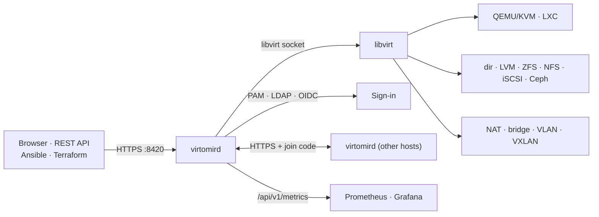

<p align="center"></p>

<h1 align="center">VirtoMir</h1>

<p align="center"><strong>A Detailed Control Deck for Virtual Environments.</strong><br>
Un panel de control web moderno para KVM / QEMU / libvirt que se instala en el Linux que ya usas.</p>

<p align="center">
<a href="../../README.md">English</a> ·
<a href="README.tr.md">Türkçe</a> ·
<a href="README.de.md">Deutsch</a> ·
<a href="README.fr.md">Français</a> ·
Español ·
<a href="README.pt-BR.md">Português</a> ·
<a href="README.it.md">Italiano</a> ·
<a href="README.pl.md">Polski</a> ·
<a href="README.nl.md">Nederlands</a> ·
<a href="README.ru.md">Русский</a> ·
<a href="README.uk.md">Українська</a> ·
<a href="README.zh-CN.md">简体中文</a> ·
<a href="README.zh-TW.md">繁體中文</a> ·
<a href="README.ja.md">日本語</a> ·
<a href="README.ko.md">한국어</a> ·
<a href="README.ar.md">العربية</a>
</p>

<p align="center">
  <a href="https://github.com/onurbaydas/VirtoMir/releases/latest"></a>
  <a href="https://github.com/onurbaydas/VirtoMir/actions/workflows/ci.yml"></a>
  <a href="../../LICENSE"></a>
  
</p>

<p align="center">
  <a href="https://github.com/onurbaydas/VirtoMir/stargazers"></a>
  <a href="https://github.com/onurbaydas/VirtoMir/fork"></a>
  <a href="https://github.com/onurbaydas/VirtoMir/subscription"></a>
</p>

<p align="center">
  <a href="https://onurbaydas.github.io/VirtoMir/demo/"><b>▶ Demo en vivo</b></a> ·
  <a href="#install">Instalación</a> ·
  <a href="../try-in-a-vm.md">Probar en una VM</a> ·
  <a href="../features.md">Todas las funciones</a> ·
  <a href="#contribute">Contribuir</a> ·
  <a href="https://github.com/onurbaydas/VirtoMir/discussions">Discusiones</a>
</p>

<table align="center">
<tr><td align="center"><h3>1</h3></td><td align="center"><h3>0</h3></td><td align="center"><h3>0</h3></td><td align="center"><h3>90+</h3></td><td align="center"><h3>16</h3></td><td align="center"><h3>1 s</h3></td></tr>
<tr><td align="center"><sub>binario, UI incluida</sub></td><td align="center"><sub>bases de datos</sub></td><td align="center"><sub>agentes en tus VM</sub></td><td align="center"><sub>funciones</sub></td><td align="center"><sub>idiomas del README</sub></td><td align="center"><sub>gráficas en vivo</sub></td></tr>
</table>

> Esta traducción la mantiene la comunidad y puede ir por detrás del [README en inglés](../../README.md).

<p align="center"></p>

VirtoMir intenta ser dos cosas a la vez:

- **Sin esfuerzo.** Crea y ejecuta una VM sin saber mucho de virtualización.
- **Terriblemente detallado.** Cada ajuste de libvirt es accesible, editable y, sí, rompible.

Un único binario con la interfaz web incluida: sin distribución propia, sin base de datos, sin agentes dentro de tus máquinas. Instálalo en un host con KVM, abre `https://<host>:8420/` e inicia sesión con tu cuenta de Linux.

> **Estado: 1.2.** Probado en Ubuntu 26.04 y Fedora 44, en hosts individuales y clústeres pequeños. La alta disponibilidad aún no se ha probado con hardware BMC real, y la importación desde VMware es experimental. Desde la 1.0 no se añaden funciones nuevas: el trabajo va a que el uso diario en un host sea sólido. Pruébalo antes de confiarle producción y cuéntanos qué falla en [#1](https://github.com/onurbaydas/VirtoMir/issues/1).

> [!TIP]
> **¿Te gusta hacia dónde va? Dale una ⭐.** VirtoMir lo construye una sola persona: las estrellas hacen que otros lo encuentren y lo mantienen vivo. Para enterarte de nuevas versiones: **Watch → Custom → Releases**.

> [!NOTE]
> **¿Lo probaste? Cuéntanoslo en 30 segundos.** [Abre el formulario de opinión rápida](https://github.com/onurbaydas/VirtoMir/issues/new?template=quick_feedback.yml), elige 😀 😐 😞 o 💡 y añade una frase si quieres. Dentro de VirtoMir, el botón 💬 al pie de la barra lateral abre el mismo formulario con tus versiones ya rellenadas.

## Pruébalo en 30 segundos

| | |
|---|---|
| **Solo mirar** | Recorre la [demo en línea](https://onurbaydas.github.io/VirtoMir/demo/): hosts inventados, nada que instalar. |
| **Host desechable** | Un comando te da una VM de prueba con VirtoMir dentro: [Prueba VirtoMir sin tocar tus servidores](../try-in-a-vm.md). |
| **Debian / Ubuntu** | `sudo apt install ./virtomir_1.2.1_amd64.deb` — [última versión](https://github.com/onurbaydas/VirtoMir/releases/latest) |
| **Fedora / RHEL** | `sudo dnf install ./virtomir-1.2.1-1.x86_64.rpm` — [última versión](https://github.com/onurbaydas/VirtoMir/releases/latest) |

El paquete instala libvirt y QEMU/KVM si faltan, abre el puerto 8420 y arranca el servicio. No queda nada más que teclear.

## ¿Por qué VirtoMir?

| | **VirtoMir** | Cockpit Machines | virt-manager | Proxmox VE |
|---|:---:|:---:|:---:|:---:|
| Se instala en el Linux que ya tienes | ✅ | ✅ | ✅ | ❌ es el SO |
| En el navegador | ✅ | ✅ | ❌ app de escritorio | ✅ |
| Cada ajuste de libvirt, con un diff XML antes de guardar | ✅ | ➖ ajustes básicos | ✅ | ➖ no es libvirt |
| Historial de cada cambio, restauración con un clic | ✅ | ❌ | ❌ | ❌ |
| Gráficas en vivo y 30 días de historial incluidos | ✅ | ➖ | ❌ | ✅ |
| Snapshots, copias programadas, copias externas | ✅ | ➖ snapshots | ➖ snapshots | ✅ |
| Varios hosts, migración en vivo, alta disponibilidad | ✅ | ❌ | ➖ migración | ✅ |

VirtoMir está en el medio: tan sencillo como Cockpit, tan completo como el XML de libvirt en bruto.

## Lo más destacado

<table>
<tr>
<td width="50%" valign="top">
<h3>🖥️ Máquinas a fondo</h3>
Un asistente que solo pregunta lo que toda máquina necesita (ISO, imagen cloud con cloud-init o un disco existente) y, detrás, todos los ajustes de libvirt: topología y anclaje de CPU, huge pages, NUMA, passthrough PCI/USB, vGPU, TPM, Secure Boot y consola en el navegador por VNC o SPICE.
<br><br>
</td>
<td width="50%" valign="top">
<h3>🕰️ Qué cambió y cuándo</h3>
Se guarda cada versión de la definición de una máquina, también los cambios hechos con <code>virsh</code>. La línea de tiempo reúne eventos del ciclo de vida, cambios, snapshots, copias y alertas en una lista: la respuesta a «ayer funcionaba».
<br><br>
</td>
</tr>
<tr>
<td valign="top">
<h3>💾 Almacenamiento y redes</h3>
Pools de directorio, LVM, ZFS, NFS, iSCSI y Ceph; los destinos NFS, SMB e iSCSI de la red local se encuentran y conectan con un clic. Redes NAT, puente (también por Wi-Fi), VLAN y VXLAN, y cambios en la red del host que se deshacen solos si pierdes la conexión.
<br><br>
</td>
<td valign="top">
<h3>🛟 Copias que vuelven</h3>
Copias en vivo sin parada, programaciones con retención, restauración como máquina nueva y sumas de verificación comprobadas. Copias externas con restic a S3, B2, Azure, SFTP o un disco, cifradas y deduplicadas.
<br><br>
</td>
</tr>
<tr>
<td valign="top">
<h3>🌐 Varios hosts, una vista</h3>
Une hosts con un código de un solo uso: sin base de datos compartida ni servicios extra. Migración en vivo, un planificador que reparte la carga, modo mantenimiento, actualizaciones escalonadas y alta disponibilidad con quórum y fencing.
<br><br>
</td>
<td valign="top">
<h3>🔐 Pensado para un host compartido</h3>
Inicio de sesión con cuentas de Linux (PAM), LDAP/AD u OpenID Connect, verificación en dos pasos, roles, proyectos con cuotas, tokens de API y un registro de actividad a prueba de manipulaciones. HTTPS por defecto.
<br><br>
</td>
</tr>
</table>

Todo lo demás, desde alertas e informes hasta clústeres de Kubernetes y la importación desde VMware, está en la **[lista completa de funciones](../features.md)** (en inglés).

## Cómo funciona



- **Un servicio, `virtomird`**, que se ejecuta como root porque habla con el socket de libvirt del sistema y comprueba contraseñas mediante PAM.
- **Su propio estado en `/var/lib/virtomir`**: certificado, historial de métricas, ajustes, registro de actividad. Sin base de datos.
- **Nunca toca tus máquinas existentes por su cuenta.** Lee lo que tiene libvirt y solo cambia lo que pides; cada cambio queda en el registro de actividad.
- **Se elimina limpiamente:** `sudo apt purge virtomir` borra el servicio y su estado; tus máquinas, discos y redes se quedan.

<a id="install"></a>
## Instalación

```sh
# Debian / Ubuntu
sudo install -d -m 0755 /etc/apt/keyrings
sudo curl -fsSL -o /etc/apt/keyrings/virtomir.asc https://onurbaydas.github.io/VirtoMir/virtomir.asc
echo "deb [signed-by=/etc/apt/keyrings/virtomir.asc] https://onurbaydas.github.io/VirtoMir/apt stable main" | sudo tee /etc/apt/sources.list.d/virtomir.list
sudo apt update && sudo apt install virtomir

# Fedora / RHEL 10
sudo curl -fsSL -o /etc/yum.repos.d/virtomir.repo https://onurbaydas.github.io/VirtoMir/virtomir.repo
sudo dnf install virtomir
```

Luego abre `https://<host>:8420/` e inicia sesión como `root` o como administrador (grupos `sudo`, `wheel` o `libvirt`). El navegador te pide una vez aceptar el certificado autofirmado. Al primer administrador se le guía por lo que aún le falta al host: almacenamiento, un lugar para copias, una primera imagen.

Paquetes, tarball, configuración y compilación desde el código: [README en inglés](../../README.md#install).

Informa de problemas de seguridad en privado, consulta [SECURITY.md](../../SECURITY.md).

<a id="contribute"></a>
## Se busca ayuda

VirtoMir lo construye una sola persona junto con agentes de programación con IA. Por eso creció tan rápido, y por eso necesita más ojos que un proyecto personal típico.

- 🧪 **Ejecútalo** en Debian, un Ubuntu más antiguo, Rocky/Alma o Arch, y cuéntanos qué falla.
- 🔍 **Revisa las partes sensibles**: se ejecuta como root y gestiona el inicio de sesión (`internal/auth`, `internal/api`).
- 🔧 **Prueba lo que no podemos alcanzar**: passthrough de GPU, Ceph, BMC reales, VMware.
- 🌍 **Traduce**: la interfaz ([`web/src/lib/locales`](../../web/src/lib/locales)) o este README ([`docs/i18n`](.)).
- 💻 **Escribe código**: no hace falta servidor, `cd web && npm install && npm run dev:demo` ejecuta toda la interfaz contra un clúster simulado. Empieza con un [good first issue](https://github.com/onurbaydas/VirtoMir/issues?q=is%3Aissue+is%3Aopen+label%3A%22good+first+issue%22), consulta [CONTRIBUTING.md](../../CONTRIBUTING.md).

Ideas y preguntas: [Discusiones](https://github.com/onurbaydas/VirtoMir/discussions). ¿Encontraste un fallo? [Abre una issue](https://github.com/onurbaydas/VirtoMir/issues/new/choose).

## Agradecimientos

<p><br>Gracias a Mega Bilgisayar.</p>

<p align="center">
  <b>Si VirtoMir te resulta útil, una estrella ayuda a que otros lo encuentren.</b><br><br>
  <a href="https://github.com/onurbaydas/VirtoMir/stargazers"></a>
  <a href="https://github.com/onurbaydas/VirtoMir/fork"></a>
  <a href="https://github.com/onurbaydas/VirtoMir/subscription"></a>
</p>

## Licencia

VirtoMir es software libre: **GNU Affero General Public License v3.0 o posterior**, consulta [LICENSE](../../LICENSE). Puedes usarlo, estudiarlo, modificarlo y compartirlo; si ofreces un VirtoMir modificado a otros a través de una red, debes ofrecerles también su código fuente.

Copyright © 2026 Onur Baydas. Para una licencia comercial sin las obligaciones de la AGPL, contacta con el autor a través de GitHub. Las contribuciones son bienvenidas bajo el [Contributor License Agreement](../../CLA.md), que mantiene ambas licencias posibles.
