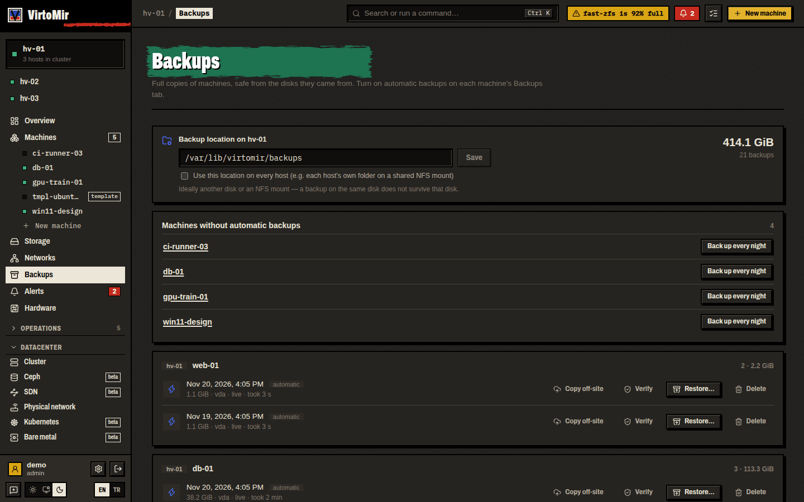
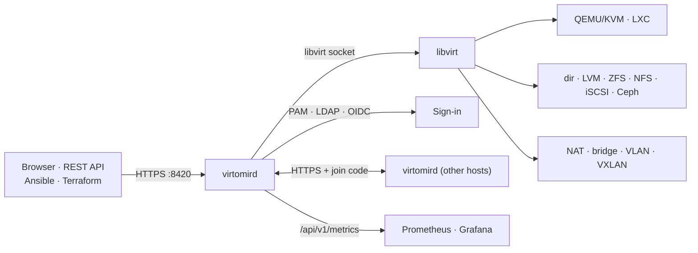

<p align="center"></p>

<h1 align="center">VirtoMir</h1>

<p align="center"><strong>A Detailed Control Deck for Virtual Environments.</strong><br>
Un panneau de contrôle web moderne pour KVM / QEMU / libvirt, qui s'installe sur le Linux que vous utilisez déjà.</p>

<p align="center">
<a href="../../README.md">English</a> ·
<a href="README.tr.md">Türkçe</a> ·
<a href="README.de.md">Deutsch</a> ·
Français ·
<a href="README.es.md">Español</a> ·
<a href="README.pt-BR.md">Português</a> ·
<a href="README.it.md">Italiano</a> ·
<a href="README.pl.md">Polski</a> ·
<a href="README.nl.md">Nederlands</a> ·
<a href="README.ru.md">Русский</a> ·
<a href="README.uk.md">Українська</a> ·
<a href="README.zh-CN.md">简体中文</a> ·
<a href="README.zh-TW.md">繁體中文</a> ·
<a href="README.ja.md">日本語</a> ·
<a href="README.ko.md">한국어</a> ·
<a href="README.ar.md">العربية</a>
</p>

<p align="center">
  <a href="https://github.com/onurbaydas/VirtoMir/releases/latest"></a>
  <a href="https://github.com/onurbaydas/VirtoMir/actions/workflows/ci.yml"></a>
  <a href="../../LICENSE"></a>
  
</p>

<p align="center">
  <a href="https://github.com/onurbaydas/VirtoMir/stargazers"></a>
  <a href="https://github.com/onurbaydas/VirtoMir/fork"></a>
  <a href="https://github.com/onurbaydas/VirtoMir/subscription"></a>
</p>

<p align="center">
  <a href="https://onurbaydas.github.io/VirtoMir/demo/"><b>▶ Démo en ligne</b></a> ·
  <a href="#install">Installation</a> ·
  <a href="../try-in-a-vm.md">Essayer dans une VM</a> ·
  <a href="../features.md">Toutes les fonctionnalités</a> ·
  <a href="#contribute">Contribuer</a> ·
  <a href="https://github.com/onurbaydas/VirtoMir/discussions">Discussions</a>
</p>

<table align="center">
<tr><td align="center"><h3>1</h3></td><td align="center"><h3>0</h3></td><td align="center"><h3>0</h3></td><td align="center"><h3>90+</h3></td><td align="center"><h3>16</h3></td><td align="center"><h3>1 s</h3></td></tr>
<tr><td align="center"><sub>binaire, UI intégrée</sub></td><td align="center"><sub>base de données</sub></td><td align="center"><sub>agent dans vos VM</sub></td><td align="center"><sub>fonctionnalités</sub></td><td align="center"><sub>langues du README</sub></td><td align="center"><sub>graphiques en direct</sub></td></tr>
</table>

> Cette traduction est maintenue par la communauté et peut être en retard sur le [README anglais](../../README.md).

<p align="center"></p>

VirtoMir essaie d'être deux choses à la fois :

- **Sans effort.** Créer et faire tourner une VM sans connaître grand-chose à la virtualisation.
- **Terriblement détaillé.** Chaque réglage de libvirt est accessible, modifiable et, oui, cassable.

Un seul binaire avec l'interface web intégrée : pas de distribution dédiée, pas de base de données, pas d'agents dans vos machines. Installez-le sur un hôte qui fait tourner KVM, ouvrez `https://<hôte>:8420/` et connectez-vous avec votre compte Linux.

> **État : 1.2.** Testé sur Ubuntu 26.04 et Fedora 44, sur des hôtes seuls et de petits clusters. La haute disponibilité n'a pas encore été essayée sur du vrai matériel BMC, et l'import VMware est expérimental. Depuis la 1.0, aucune nouvelle fonctionnalité n'est ajoutée : le travail sert à rendre l'usage quotidien sur un hôte solide. Testez-le avant de lui confier la production, et signalez ce qui casse dans [#1](https://github.com/onurbaydas/VirtoMir/issues/1).

> [!TIP]
> **Vous aimez la direction ? Laissez une ⭐.** VirtoMir est construit par une seule personne : les étoiles permettent aux autres de le trouver et le font vivre. Pour être prévenu des nouvelles versions : **Watch → Custom → Releases**.

> [!NOTE]
> **Vous l'avez essayé ? Dites-le-nous en 30 secondes. (sans compte)** [Ouvrez le formulaire de retour rapide](https://tally.so/r/db904z), choisissez 😀 😐 😞 ou 💡 et ajoutez une phrase si vous voulez. Dans VirtoMir, le bouton 💬 en bas de la barre latérale ouvre le même formulaire avec vos versions déjà remplies. Avec un compte GitHub, [le formulaire d'issue](https://github.com/onurbaydas/VirtoMir/issues/new?template=quick_feedback.yml) marche aussi.

## Essayer en 30 secondes

| | |
|---|---|
| **Juste regarder** | Parcourez la [démo en ligne](https://onurbaydas.github.io/VirtoMir/demo/) : des hôtes fictifs, rien à installer. |
| **Hôte jetable** | Une commande vous donne une VM de test avec VirtoMir : [Essayer VirtoMir sans toucher à vos serveurs](../try-in-a-vm.md). |
| **Debian / Ubuntu** | `sudo apt install ./virtomir_1.2.2_amd64.deb` — [dernière version](https://github.com/onurbaydas/VirtoMir/releases/latest) |
| **Fedora / RHEL** | `sudo dnf install ./virtomir-1.2.2-1.x86_64.rpm` — [dernière version](https://github.com/onurbaydas/VirtoMir/releases/latest) |

Le paquet installe libvirt et QEMU/KVM s'ils manquent, ouvre le port 8420 et démarre le service. Il ne reste rien à taper.

## Pourquoi VirtoMir ?

| | **VirtoMir** | Cockpit Machines | virt-manager | Proxmox VE |
|---|:---:|:---:|:---:|:---:|
| S'installe sur le Linux que vous avez déjà | ✅ | ✅ | ✅ | ❌ c'est l'OS |
| Dans le navigateur | ✅ | ✅ | ❌ appli de bureau | ✅ |
| Chaque réglage libvirt, avec un diff XML avant d'enregistrer | ✅ | ➖ réglages de base | ✅ | ➖ pas libvirt |
| Historique de chaque modification, restauration en un clic | ✅ | ❌ | ❌ | ❌ |
| Graphiques en direct et 30 jours d'historique intégrés | ✅ | ➖ | ❌ | ✅ |
| Snapshots, sauvegardes planifiées, copies hors site | ✅ | ➖ snapshots | ➖ snapshots | ✅ |
| Plusieurs hôtes, migration à chaud, haute disponibilité | ✅ | ❌ | ➖ migration | ✅ |

VirtoMir se situe entre les deux : aussi simple que Cockpit, aussi complet que le XML libvirt brut.

## Points forts

<table>
<tr>
<td width="50%" valign="top">
<h3>🖥️ Des machines en profondeur</h3>
Un assistant qui ne demande que ce dont chaque machine a besoin (ISO, image cloud avec cloud-init ou disque existant), et derrière, tous les réglages de libvirt : topologie et épinglage CPU, huge pages, NUMA, passthrough PCI/USB, vGPU, TPM, Secure Boot, console dans le navigateur via VNC ou SPICE.
<br><br>
</td>
<td width="50%" valign="top">
<h3>🕰️ Ce qui a changé, et quand</h3>
Chaque version de la définition d'une machine est conservée, y compris les changements faits avec <code>virsh</code>. La chronologie réunit événements de cycle de vie, modifications, snapshots, sauvegardes et alertes en une seule liste : la réponse à « ça marchait hier ».
<br><br>
</td>
</tr>
<tr>
<td valign="top">
<h3>💾 Stockage et réseaux</h3>
Pools répertoire, LVM, ZFS, NFS, iSCSI et Ceph ; les cibles NFS, SMB et iSCSI du réseau local sont trouvées et connectées en un clic. Réseaux NAT, pontés (aussi en Wi-Fi), VLAN et VXLAN, et des changements du réseau de l'hôte qui s'annulent d'eux-mêmes si vous perdez la connexion.
<br><br>
</td>
<td valign="top">
<h3>🛟 Des sauvegardes qui reviennent</h3>
Sauvegardes à chaud sans interruption, planifications avec rétention, restauration en nouvelle machine, sommes de contrôle vérifiées. Copies hors site avec restic vers S3, B2, Azure, SFTP ou un disque, chiffrées et dédupliquées.
<br><br>
</td>
</tr>
<tr>
<td valign="top">
<h3>🌐 Plusieurs hôtes, une seule vue</h3>
Reliez des hôtes avec un code à usage unique : pas de base partagée, pas de service en plus. Migration à chaud, un ordonnanceur qui équilibre la charge, mode maintenance, mises à jour progressives, et haute disponibilité avec quorum et fencing.
<br><br>
</td>
<td valign="top">
<h3>🔐 Pensé pour un hôte partagé</h3>
Connexion avec les comptes Linux (PAM), LDAP/AD ou OpenID Connect, connexion en deux étapes, rôles, projets avec quotas, jetons d'API et un journal d'activité infalsifiable. HTTPS par défaut.
<br><br>
</td>
</tr>
</table>

Tout le reste, des alertes et rapports aux clusters Kubernetes et à l'import VMware, se trouve dans la **[liste complète des fonctionnalités](../features.md)** (en anglais).

## Fonctionnement



- **Un seul service, `virtomird`**, qui tourne en root car il parle au socket libvirt du système et vérifie les mots de passe via PAM.
- **Son propre état dans `/var/lib/virtomir`** : certificat, historique des métriques, réglages, journal d'activité. Pas de base de données.
- **Il ne touche jamais de lui-même à vos machines existantes.** Il lit ce que libvirt contient et ne change que ce que vous demandez ; chaque changement figure dans le journal d'activité.
- **Il se retire proprement :** `sudo apt purge virtomir` supprime le service et son état ; vos machines, disques et réseaux restent.

<a id="install"></a>
## Installation

```sh
# Debian / Ubuntu
sudo install -d -m 0755 /etc/apt/keyrings
sudo curl -fsSL -o /etc/apt/keyrings/virtomir.asc https://onurbaydas.github.io/VirtoMir/virtomir.asc
echo "deb [signed-by=/etc/apt/keyrings/virtomir.asc] https://onurbaydas.github.io/VirtoMir/apt stable main" | sudo tee /etc/apt/sources.list.d/virtomir.list
sudo apt update && sudo apt install virtomir

# Fedora / RHEL 10
sudo curl -fsSL -o /etc/yum.repos.d/virtomir.repo https://onurbaydas.github.io/VirtoMir/virtomir.repo
sudo dnf install virtomir
```

Ouvrez ensuite `https://<hôte>:8420/` et connectez-vous en `root` ou en administrateur (groupes `sudo`, `wheel` ou `libvirt`). Le navigateur vous demande une fois d'accepter le certificat auto-signé. Le premier administrateur est guidé à travers ce qui manque encore à l'hôte : stockage, emplacement des sauvegardes, première image.

Paquets, archive tar, configuration et compilation depuis les sources : [README anglais](../../README.md#install).

Merci de signaler les problèmes de sécurité en privé, voir [SECURITY.md](../../SECURITY.md).

<a id="contribute"></a>
## On cherche de l'aide

VirtoMir est construit par une seule personne, avec des agents de programmation IA. C'est ce qui l'a fait grandir si vite, et c'est aussi pourquoi il a besoin de plus de regards qu'un projet perso habituel.

- 🧪 **Faites-le tourner** sur Debian, un Ubuntu plus ancien, Rocky/Alma ou Arch, et dites-nous ce qui casse.
- 🔍 **Relisez les parties sensibles** : il tourne en root et gère la connexion (`internal/auth`, `internal/api`).
- 🔧 **Testez ce que nous ne pouvons pas atteindre** : passthrough GPU, Ceph, vrais BMC, VMware.
- 🌍 **Traduisez** : l'interface ([`web/src/lib/locales`](../../web/src/lib/locales)) ou ce README ([`docs/i18n`](.)).
- 💻 **Écrivez du code** : pas besoin de serveur, `cd web && npm install && npm run dev:demo` lance toute l'interface sur un cluster simulé. Commencez par un [good first issue](https://github.com/onurbaydas/VirtoMir/issues?q=is%3Aissue+is%3Aopen+label%3A%22good+first+issue%22), voir [CONTRIBUTING.md](../../CONTRIBUTING.md).

Idées et questions : [Discussions](https://github.com/onurbaydas/VirtoMir/discussions). Un bug ? [Ouvrez une issue](https://github.com/onurbaydas/VirtoMir/issues/new/choose).

## Remerciements

<p><br>Merci à Mega Bilgisayar.</p>

<p align="center">
  <b>Si VirtoMir vous est utile, une étoile aide les autres à le trouver.</b><br><br>
  <a href="https://github.com/onurbaydas/VirtoMir/stargazers"></a>
  <a href="https://github.com/onurbaydas/VirtoMir/fork"></a>
  <a href="https://github.com/onurbaydas/VirtoMir/subscription"></a>
</p>

## Licence

VirtoMir est un logiciel libre : **GNU Affero General Public License v3.0 ou ultérieure**, voir [LICENSE](../../LICENSE). Vous pouvez l'utiliser, l'étudier, le modifier et le partager ; si vous proposez un VirtoMir modifié à d'autres via un réseau, vous devez aussi leur proposer son code source.

Copyright © 2026 Onur Baydas. Pour une licence commerciale sans les obligations de l'AGPL, contactez l'auteur via GitHub. Les contributions sont les bienvenues sous le [Contributor License Agreement](../../CLA.md), qui garde les deux licences possibles.
