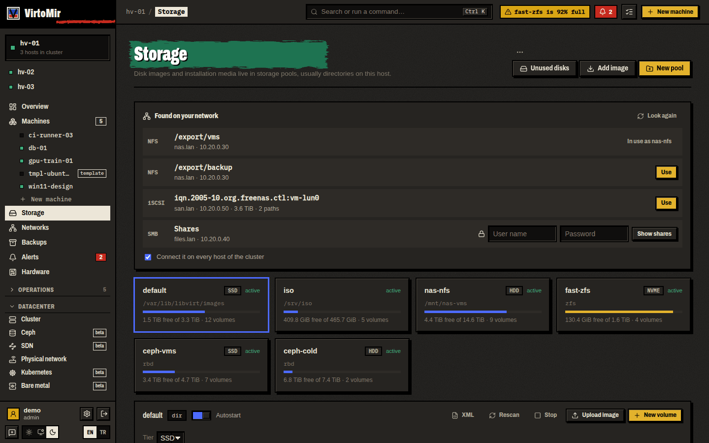
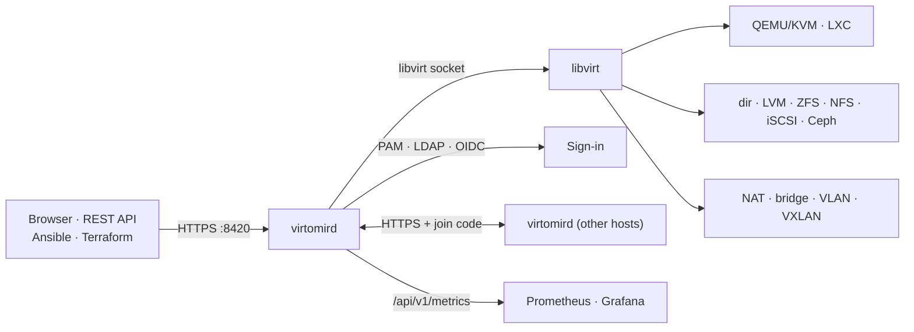

<p align="center"></p>

<h1 align="center">VirtoMir</h1>

<p align="center"><strong>A Detailed Control Deck for Virtual Environments.</strong><br>
Un pannello di controllo web moderno per KVM / QEMU / libvirt che si installa sul Linux che usi già.</p>

<p align="center">
<a href="../../README.md">English</a> ·
<a href="README.tr.md">Türkçe</a> ·
<a href="README.de.md">Deutsch</a> ·
<a href="README.fr.md">Français</a> ·
<a href="README.es.md">Español</a> ·
<a href="README.pt-BR.md">Português</a> ·
Italiano ·
<a href="README.pl.md">Polski</a> ·
<a href="README.nl.md">Nederlands</a> ·
<a href="README.ru.md">Русский</a> ·
<a href="README.uk.md">Українська</a> ·
<a href="README.zh-CN.md">简体中文</a> ·
<a href="README.zh-TW.md">繁體中文</a> ·
<a href="README.ja.md">日本語</a> ·
<a href="README.ko.md">한국어</a> ·
<a href="README.ar.md">العربية</a>
</p>

<p align="center">
  <a href="https://github.com/onurbaydas/VirtoMir/releases/latest"></a>
  <a href="https://github.com/onurbaydas/VirtoMir/actions/workflows/ci.yml"></a>
  <a href="../../LICENSE"></a>
  
</p>

<p align="center">
  <a href="https://github.com/onurbaydas/VirtoMir/stargazers"></a>
  <a href="https://github.com/onurbaydas/VirtoMir/fork"></a>
  <a href="https://github.com/onurbaydas/VirtoMir/subscription"></a>
</p>

<p align="center">
  <a href="https://onurbaydas.github.io/VirtoMir/demo/"><b>▶ Demo dal vivo</b></a> ·
  <a href="#install">Installazione</a> ·
  <a href="../try-in-a-vm.md">Provalo in una VM</a> ·
  <a href="../features.md">Tutte le funzioni</a> ·
  <a href="#contribute">Contribuire</a> ·
  <a href="https://github.com/onurbaydas/VirtoMir/discussions">Discussioni</a>
</p>

<table align="center">
<tr><td align="center"><h3>1</h3></td><td align="center"><h3>0</h3></td><td align="center"><h3>0</h3></td><td align="center"><h3>90+</h3></td><td align="center"><h3>16</h3></td><td align="center"><h3>1 s</h3></td></tr>
<tr><td align="center"><sub>binario, UI inclusa</sub></td><td align="center"><sub>database</sub></td><td align="center"><sub>agenti nelle VM</sub></td><td align="center"><sub>funzioni</sub></td><td align="center"><sub>lingue del README</sub></td><td align="center"><sub>grafici dal vivo</sub></td></tr>
</table>

> Questa traduzione è curata dalla comunità e può essere indietro rispetto al [README inglese](../../README.md).

<p align="center"></p>

VirtoMir cerca di essere due cose insieme:

- **Senza fatica.** Crea e avvia una VM senza sapere molto di virtualizzazione.
- **Spaventosamente dettagliato.** Ogni impostazione di libvirt è raggiungibile, modificabile e, sì, anche rompibile.

Un unico binario con l'interfaccia web incorporata: nessuna distribuzione dedicata, nessun database, nessun agente dentro le tue macchine. Installalo su un host con KVM, apri `https://<host>:8420/` e accedi con il tuo account Linux.

> **Stato: 1.2.** Testato su Ubuntu 26.04 e Fedora 44, su host singoli e piccoli cluster. L'alta disponibilità non è ancora stata provata su vero hardware BMC e l'importazione da VMware è sperimentale. Dalla 1.0 non si aggiungono nuove funzioni: il lavoro va a rendere solido l'uso quotidiano su un host. Provalo prima di affidargli la produzione e racconta cosa si rompe in [#1](https://github.com/onurbaydas/VirtoMir/issues/1).

> [!TIP]
> **Ti piace la direzione? Lascia una ⭐.** VirtoMir è costruito da una sola persona: le stelle aiutano gli altri a trovarlo e lo tengono in vita. Per sapere delle nuove versioni: **Watch → Custom → Releases**.

> [!NOTE]
> **L'hai provato? Raccontacelo in 30 secondi.** [Apri il modulo di feedback rapido](https://github.com/onurbaydas/VirtoMir/issues/new?template=quick_feedback.yml), scegli 😀 😐 😞 o 💡 e aggiungi una frase se vuoi. Dentro VirtoMir, il pulsante 💬 in fondo alla barra laterale apre lo stesso modulo con le tue versioni già compilate.

## Provalo in 30 secondi

| | |
|---|---|
| **Solo guardare** | Esplora la [demo online](https://onurbaydas.github.io/VirtoMir/demo/): host inventati, niente da installare. |
| **Host usa e getta** | Un comando ti dà una VM di prova con VirtoMir dentro: [Prova VirtoMir senza toccare i tuoi server](../try-in-a-vm.md). |
| **Debian / Ubuntu** | `sudo apt install ./virtomir_1.2.1_amd64.deb` — [ultima versione](https://github.com/onurbaydas/VirtoMir/releases/latest) |
| **Fedora / RHEL** | `sudo dnf install ./virtomir-1.2.1-1.x86_64.rpm` — [ultima versione](https://github.com/onurbaydas/VirtoMir/releases/latest) |

Il pacchetto installa libvirt e QEMU/KVM se mancano, apre la porta 8420 e avvia il servizio. Non resta altro da digitare.

## Perché VirtoMir?

| | **VirtoMir** | Cockpit Machines | virt-manager | Proxmox VE |
|---|:---:|:---:|:---:|:---:|
| Si installa sul Linux che hai già | ✅ | ✅ | ✅ | ❌ è il sistema operativo |
| Nel browser | ✅ | ✅ | ❌ app desktop | ✅ |
| Ogni impostazione di libvirt, con un diff XML prima di salvare | ✅ | ➖ impostazioni di base | ✅ | ➖ non è libvirt |
| Cronologia di ogni modifica, ripristino con un clic | ✅ | ❌ | ❌ | ❌ |
| Grafici dal vivo e 30 giorni di cronologia inclusi | ✅ | ➖ | ❌ | ✅ |
| Snapshot, backup pianificati, copie esterne | ✅ | ➖ snapshot | ➖ snapshot | ✅ |
| Più host, migrazione a caldo, alta disponibilità | ✅ | ❌ | ➖ migrazione | ✅ |

VirtoMir sta nel mezzo: semplice come Cockpit, completo come l'XML grezzo di libvirt.

## In evidenza

<table>
<tr>
<td width="50%" valign="top">
<h3>🖥️ Macchine in profondità</h3>
Una procedura guidata che chiede solo ciò che serve a ogni macchina (ISO, immagine cloud con cloud-init o un disco esistente) e, dietro, ogni impostazione di libvirt: topologia e pinning della CPU, huge pages, NUMA, passthrough PCI/USB, vGPU, TPM, Secure Boot, console nel browser via VNC o SPICE.
<br><br>
</td>
<td width="50%" valign="top">
<h3>🕰️ Cosa è cambiato, e quando</h3>
Ogni versione della definizione di una macchina viene conservata, anche le modifiche fatte con <code>virsh</code>. La timeline riunisce eventi del ciclo di vita, modifiche, snapshot, backup e avvisi in un elenco: la risposta a «ieri funzionava».
<br><br>
</td>
</tr>
<tr>
<td valign="top">
<h3>💾 Storage e reti</h3>
Pool di directory, LVM, ZFS, NFS, iSCSI e Ceph; le destinazioni NFS, SMB e iSCSI della rete locale vengono trovate e collegate con un clic. Reti NAT, bridge (anche su Wi-Fi), VLAN e VXLAN, e modifiche alla rete dell'host che si annullano da sole se perdi la connessione.
<br><br>
</td>
<td valign="top">
<h3>🛟 Backup che tornano</h3>
Backup a caldo senza interruzioni, pianificazioni con conservazione, ripristino come nuova macchina, checksum verificati. Copie esterne con restic verso S3, B2, Azure, SFTP o un disco, cifrate e deduplicate.
<br><br>
</td>
</tr>
<tr>
<td valign="top">
<h3>🌐 Più host, una vista</h3>
Unisci gli host con un codice monouso: nessun database condiviso, nessun servizio aggiuntivo. Migrazione a caldo, uno scheduler che bilancia il carico, modalità manutenzione, aggiornamenti a rotazione e alta disponibilità con quorum e fencing.
<br><br>
</td>
<td valign="top">
<h3>🔐 Pensato per un host condiviso</h3>
Accesso con account Linux (PAM), LDAP/AD o OpenID Connect, verifica in due passaggi, ruoli, progetti con quote, token API e un registro attività a prova di manomissione. HTTPS di default.
<br><br>
</td>
</tr>
</table>

Tutto il resto, da avvisi e report ai cluster Kubernetes e all'importazione da VMware, è nell'**[elenco completo delle funzioni](../features.md)** (in inglese).

## Come funziona



- **Un solo servizio, `virtomird`**, gira come root perché parla con il socket libvirt di sistema e controlla le password tramite PAM.
- **Il proprio stato in `/var/lib/virtomir`**: certificato, storico delle metriche, impostazioni, registro attività. Nessun database.
- **Non tocca mai da solo le macchine esistenti.** Legge ciò che c'è in libvirt e cambia solo quello che chiedi; ogni modifica è nel registro attività.
- **Si rimuove in modo pulito:** `sudo apt purge virtomir` elimina il servizio e il suo stato; macchine, dischi e reti restano.

<a id="install"></a>
## Installazione

```sh
# Debian / Ubuntu
sudo install -d -m 0755 /etc/apt/keyrings
sudo curl -fsSL -o /etc/apt/keyrings/virtomir.asc https://onurbaydas.github.io/VirtoMir/virtomir.asc
echo "deb [signed-by=/etc/apt/keyrings/virtomir.asc] https://onurbaydas.github.io/VirtoMir/apt stable main" | sudo tee /etc/apt/sources.list.d/virtomir.list
sudo apt update && sudo apt install virtomir

# Fedora / RHEL 10
sudo curl -fsSL -o /etc/yum.repos.d/virtomir.repo https://onurbaydas.github.io/VirtoMir/virtomir.repo
sudo dnf install virtomir
```

Poi apri `https://<host>:8420/` e accedi come `root` o come amministratore (gruppi `sudo`, `wheel` o `libvirt`). Il browser chiede una volta di accettare il certificato autofirmato. Il primo amministratore viene guidato attraverso ciò che manca ancora all'host: storage, una posizione per i backup, una prima immagine.

Pacchetti, tarball, configurazione e compilazione dai sorgenti: [README inglese](../../README.md#install).

Segnala i problemi di sicurezza in privato, vedi [SECURITY.md](../../SECURITY.md).

<a id="contribute"></a>
## Cerchiamo aiuto

VirtoMir è costruito da una persona sola, insieme ad agenti di programmazione IA. Per questo è cresciuto così in fretta, e per questo ha bisogno di più occhi di un tipico progetto personale.

- 🧪 **Fallo girare** su Debian, un Ubuntu più vecchio, Rocky/Alma o Arch, e dicci cosa si rompe.
- 🔍 **Rivedi le parti delicate**: gira come root e gestisce l'accesso (`internal/auth`, `internal/api`).
- 🔧 **Prova ciò che non possiamo raggiungere**: passthrough GPU, Ceph, BMC reali, VMware.
- 🌍 **Traduci**: l'interfaccia ([`web/src/lib/locales`](../../web/src/lib/locales)) o questo README ([`docs/i18n`](.)).
- 💻 **Scrivi codice**: non serve un server, `cd web && npm install && npm run dev:demo` avvia tutta l'interfaccia su un cluster simulato. Inizia da un [good first issue](https://github.com/onurbaydas/VirtoMir/issues?q=is%3Aissue+is%3Aopen+label%3A%22good+first+issue%22), vedi [CONTRIBUTING.md](../../CONTRIBUTING.md).

Idee e domande: [Discussioni](https://github.com/onurbaydas/VirtoMir/discussions). Trovato un bug? [Apri una issue](https://github.com/onurbaydas/VirtoMir/issues/new/choose).

## Ringraziamenti

<p><br>Grazie a Mega Bilgisayar.</p>

<p align="center">
  <b>Se VirtoMir ti è utile, una stella aiuta altri a trovarlo.</b><br><br>
  <a href="https://github.com/onurbaydas/VirtoMir/stargazers"></a>
  <a href="https://github.com/onurbaydas/VirtoMir/fork"></a>
  <a href="https://github.com/onurbaydas/VirtoMir/subscription"></a>
</p>

## Licenza

VirtoMir è software libero: **GNU Affero General Public License v3.0 o successiva**, vedi [LICENSE](../../LICENSE). Puoi usarlo, studiarlo, modificarlo e condividerlo; se offri un VirtoMir modificato ad altri tramite una rete, devi offrire loro anche il codice sorgente.

Copyright © 2026 Onur Baydas. Per una licenza commerciale senza gli obblighi della AGPL, contatta l'autore tramite GitHub. I contributi sono benvenuti sotto il [Contributor License Agreement](../../CLA.md), che mantiene possibili entrambe le licenze.
