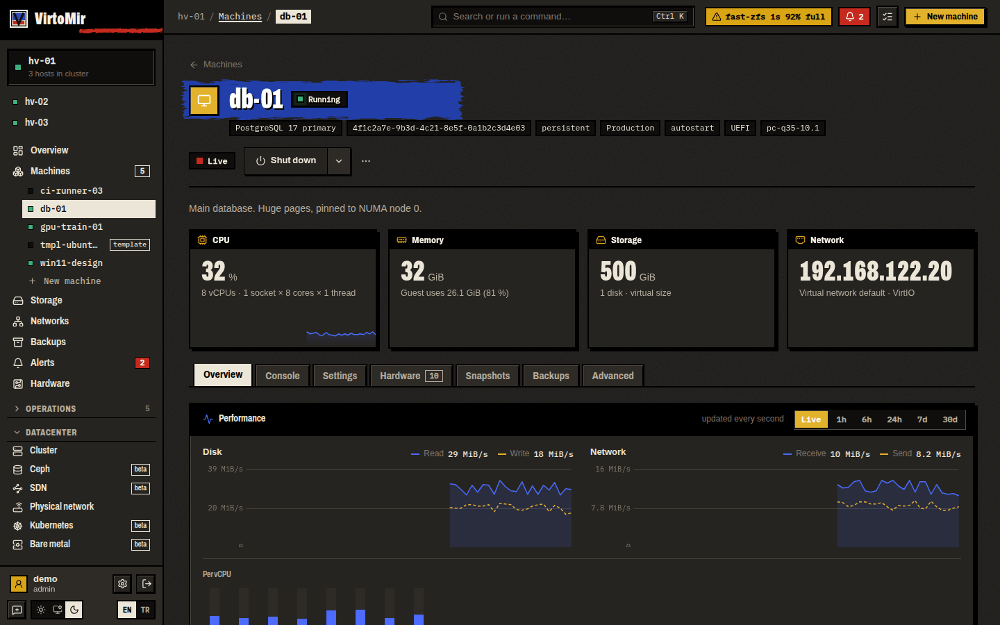
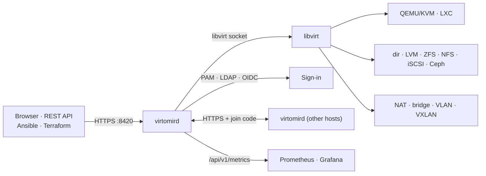

<p align="center"></p>

<h1 align="center">VirtoMir</h1>

<p align="center"><strong>A Detailed Control Deck for Virtual Environments.</strong><br>
KVM / QEMU / libvirt のためのモダンな Web コントロールパネル。いま使っている Linux にそのままインストールできます。</p>

<p align="center">
<a href="../../README.md">English</a> ·
<a href="README.tr.md">Türkçe</a> ·
<a href="README.de.md">Deutsch</a> ·
<a href="README.fr.md">Français</a> ·
<a href="README.es.md">Español</a> ·
<a href="README.pt-BR.md">Português</a> ·
<a href="README.it.md">Italiano</a> ·
<a href="README.pl.md">Polski</a> ·
<a href="README.nl.md">Nederlands</a> ·
<a href="README.ru.md">Русский</a> ·
<a href="README.uk.md">Українська</a> ·
<a href="README.zh-CN.md">简体中文</a> ·
<a href="README.zh-TW.md">繁體中文</a> ·
日本語 ·
<a href="README.ko.md">한국어</a> ·
<a href="README.ar.md">العربية</a>
</p>

<p align="center">
  <a href="https://github.com/onurbaydas/VirtoMir/releases/latest"></a>
  <a href="https://github.com/onurbaydas/VirtoMir/actions/workflows/ci.yml"></a>
  <a href="../../LICENSE"></a>
  
</p>

<p align="center">
  <a href="https://github.com/onurbaydas/VirtoMir/stargazers"></a>
  <a href="https://github.com/onurbaydas/VirtoMir/fork"></a>
  <a href="https://github.com/onurbaydas/VirtoMir/subscription"></a>
</p>

<p align="center">
  <a href="https://onurbaydas.github.io/VirtoMir/demo/"><b>▶ ライブデモ</b></a> ·
  <a href="#install">インストール</a> ·
  <a href="../try-in-a-vm.md">VM で試す</a> ·
  <a href="../features.md">全機能</a> ·
  <a href="#contribute">コントリビュート</a> ·
  <a href="https://github.com/onurbaydas/VirtoMir/discussions">ディスカッション</a>
</p>

<table align="center">
<tr><td align="center"><h3>1</h3></td><td align="center"><h3>0</h3></td><td align="center"><h3>0</h3></td><td align="center"><h3>90+</h3></td><td align="center"><h3>16</h3></td><td align="center"><h3>1 s</h3></td></tr>
<tr><td align="center"><sub>バイナリ（UI 内蔵）</sub></td><td align="center"><sub>データベース</sub></td><td align="center"><sub>VM 内エージェント</sub></td><td align="center"><sub>機能</sub></td><td align="center"><sub>README の言語</sub></td><td align="center"><sub>ライブグラフ</sub></td></tr>
</table>

> この翻訳はコミュニティが管理しており、[英語版 README](../../README.md) より古い場合があります。

<p align="center"></p>

VirtoMir は二つのことを同時に目指しています。

- **手間いらず。** 仮想化にあまり詳しくなくても VM を作って動かせます。
- **怖いほど詳細。** libvirt のあらゆる設定にたどり着け、編集でき、そう、壊すこともできます。

Web UI を内蔵した単一のバイナリです。専用ディストリビューションも、データベースも、VM 内のエージェントもいりません。KVM が動くホストにインストールし、`https://<ホスト>:8420/` を開いて Linux アカウントでサインインするだけです。

> **状況: 1.2。** Ubuntu 26.04 と Fedora 44 で、単一ホストと小規模クラスタでテスト済みです。高可用性はまだ実機の BMC で試しておらず、VMware からのインポートは実験的です。1.0 以降は新機能を追加せず、単一ホストでの日常的な使い勝手を固めることに注力しています。本番で使う前に必ず試し、問題があれば [#1](https://github.com/onurbaydas/VirtoMir/issues/1) で教えてください。

> [!TIP]
> **この方向性が気に入ったら ⭐ を。** VirtoMir は一人で開発しています。スターがあると他の人に見つけてもらえ、プロジェクトが続きます。新しいバージョンの通知は **Watch → Custom → Releases** から。

## 30 秒で試す

| | |
|---|---|
| **見るだけ** | [オンラインデモ](https://onurbaydas.github.io/VirtoMir/demo/) を触ってみてください。架空のホストで、インストールは不要です。 |
| **使い捨てホスト** | コマンド一つで VirtoMir 入りのテスト VM が手に入ります: [サーバーに触れずに VirtoMir を試す](../try-in-a-vm.md)。 |
| **Debian / Ubuntu** | `sudo apt install ./virtomir_1.2.1_amd64.deb` — [最新リリース](https://github.com/onurbaydas/VirtoMir/releases/latest) |
| **Fedora / RHEL** | `sudo dnf install ./virtomir-1.2.1-1.x86_64.rpm` — [最新リリース](https://github.com/onurbaydas/VirtoMir/releases/latest) |

パッケージは libvirt と QEMU/KVM が無ければ導入し、ポート 8420 を開けてサービスを起動します。ほかに入力するものはありません。

## なぜ VirtoMir？

| | **VirtoMir** | Cockpit Machines | virt-manager | Proxmox VE |
|---|:---:|:---:|:---:|:---:|
| いまの Linux にインストールできる | ✅ | ✅ | ✅ | ❌ それ自体が OS |
| ブラウザで使える | ✅ | ✅ | ❌ デスクトップアプリ | ✅ |
| libvirt の全設定、保存前に XML の差分を表示 | ✅ | ➖ 基本設定のみ | ✅ | ➖ libvirt ではない |
| すべての変更履歴、ワンクリックで復元 | ✅ | ❌ | ❌ | ❌ |
| ライブグラフと 30 日分の履歴を内蔵 | ✅ | ➖ | ❌ | ✅ |
| スナップショット、定期バックアップ、オフサイトコピー | ✅ | ➖ スナップショット | ➖ スナップショット | ✅ |
| 複数ホスト、ライブマイグレーション、高可用性 | ✅ | ❌ | ➖ マイグレーション | ✅ |

VirtoMir はその中間にあります。Cockpit のように簡単で、生の libvirt XML のように網羅的です。

## ハイライト

<table>
<tr>
<td width="50%" valign="top">
<h3>🖥️ マシンを深く</h3>
どのマシンにも必要なことだけを尋ねるウィザード（ISO、cloud-init 付きクラウドイメージ、既存ディスク）と、その奥にある libvirt の全設定: CPU トポロジーとピン留め、Huge Pages、NUMA、PCI/USB パススルー、vGPU、TPM、セキュアブート、VNC または SPICE によるブラウザコンソール。
<br><br>
</td>
<td width="50%" valign="top">
<h3>🕰️ 何が、いつ変わったか</h3>
マシン定義のすべてのバージョンを保存します。<code>virsh</code> で行った変更も含みます。タイムラインはライフサイクルイベント、変更、スナップショット、バックアップ、アラートを一つのリストにまとめます。「昨日は動いていたのに」への答えです。
<br><br>
</td>
</tr>
<tr>
<td valign="top">
<h3>💾 ストレージとネットワーク</h3>
ディレクトリ、LVM、ZFS、NFS、iSCSI、Ceph のプール。LAN 上の NFS・SMB・iSCSI ターゲットを見つけ、ワンクリックで接続します。NAT、ブリッジ（Wi-Fi でも）、VLAN、VXLAN のネットワーク、そして接続が切れたら自動で元に戻るホストのネットワーク変更。
<br><br>
</td>
<td valign="top">
<h3>🛟 ちゃんと戻ってくるバックアップ</h3>
停止なしのライブバックアップ、保持ルール付きのスケジュール、新しいマシンとしての復元、チェックサムの検証。restic による S3、B2、Azure、SFTP、ディスクへのオフサイトコピーは暗号化と重複排除付きです。
<br><br>
</td>
</tr>
<tr>
<td valign="top">
<h3>🌐 複数ホストを一つの画面で</h3>
使い捨ての参加コードでホストをつなぎます。共有データベースも追加サービスも不要です。ライブマイグレーション、負荷を均すスケジューラー、メンテナンスモード、ローリングアップグレード、クォーラムとフェンシングによる高可用性。
<br><br>
</td>
<td valign="top">
<h3>🔐 共有ホストのために</h3>
Linux アカウント（PAM）、LDAP/AD、OpenID Connect でのサインイン、2 段階認証、ロール、クォータ付きプロジェクト、API トークン、改ざんを検知できるアクティビティログ。HTTPS が標準です。
<br><br>
</td>
</tr>
</table>

アラートやレポートから Kubernetes クラスタ、VMware インポートまで、その他すべては **[全機能リスト](../features.md)**（英語）にあります。

## しくみ



- **サービスは `virtomird` 一つだけ**。システムの libvirt ソケットと通信し、PAM でパスワードを確認するため root で動きます。
- **自分の状態は `/var/lib/virtomir` に保存**: 証明書、メトリクス履歴、設定、アクティビティログ。データベースはありません。
- **既存のマシンに勝手に触れることはありません。** libvirt にあるものを読み、頼まれたことだけを変更します。すべての変更はアクティビティログに残ります。
- **きれいに削除できます:** `sudo apt purge virtomir` はサービスと状態を削除し、マシン、ディスク、ネットワークは残ります。

<a id="install"></a>
## インストール

```sh
# Debian / Ubuntu
sudo install -d -m 0755 /etc/apt/keyrings
sudo curl -fsSL -o /etc/apt/keyrings/virtomir.asc https://onurbaydas.github.io/VirtoMir/virtomir.asc
echo "deb [signed-by=/etc/apt/keyrings/virtomir.asc] https://onurbaydas.github.io/VirtoMir/apt stable main" | sudo tee /etc/apt/sources.list.d/virtomir.list
sudo apt update && sudo apt install virtomir

# Fedora / RHEL 10
sudo curl -fsSL -o /etc/yum.repos.d/virtomir.repo https://onurbaydas.github.io/VirtoMir/virtomir.repo
sudo dnf install virtomir
```

その後 `https://<ホスト>:8420/` を開き、`root` または管理者（`sudo`、`wheel`、`libvirt` グループ）としてサインインします。自己署名証明書の受け入れを一度だけ求められます。最初の管理者には、ホストにまだ足りないもの（ストレージ、バックアップ先、最初のイメージ）が順に案内されます。

パッケージ、tarball、設定、ソースからのビルド: [英語版 README](../../README.md#install) を参照してください。

セキュリティの問題は非公開で報告してください。[SECURITY.md](../../SECURITY.md) を参照。

<a id="contribute"></a>
## 協力者募集

VirtoMir は一人の開発者が AI コーディングエージェントと一緒に作っています。だからこそ速く成長し、だからこそ一般的な個人プロジェクトより多くの目が必要です。

- 🧪 **動かしてみる**: Debian、古い Ubuntu、Rocky/Alma、Arch で試し、何が壊れたか教えてください。
- 🔍 **セキュリティ上重要な部分をレビュー**: root で動き、サインインを扱います（`internal/auth`、`internal/api`）。
- 🔧 **私たちが手の届かないものをテスト**: GPU パススルー、Ceph、実機の BMC、VMware。
- 🌍 **翻訳**: UI（[`web/src/lib/locales`](../../web/src/lib/locales)）またはこの README（[`docs/i18n`](.)）。
- 💻 **コードを書く**: サーバーは不要です。`cd web && npm install && npm run dev:demo` で UI 全体が模擬クラスタ上で動きます。[good first issue](https://github.com/onurbaydas/VirtoMir/issues?q=is%3Aissue+is%3Aopen+label%3A%22good+first+issue%22) から始め、[CONTRIBUTING.md](../../CONTRIBUTING.md) を参照してください。

アイデアや質問: [ディスカッション](https://github.com/onurbaydas/VirtoMir/discussions)。バグを見つけたら [issue を作成](https://github.com/onurbaydas/VirtoMir/issues/new/choose) してください。

## 謝辞

<p><br>Mega Bilgisayar に感謝します。</p>

<p align="center">
  <b>VirtoMir が役に立ったら、スターで他の人にも届けてください。</b><br><br>
  <a href="https://github.com/onurbaydas/VirtoMir/stargazers"></a>
  <a href="https://github.com/onurbaydas/VirtoMir/fork"></a>
  <a href="https://github.com/onurbaydas/VirtoMir/subscription"></a>
</p>

## ライセンス

VirtoMir はフリーソフトウェアです: **GNU Affero General Public License v3.0 以降**。[LICENSE](../../LICENSE) を参照してください。使用、研究、改変、共有ができます。改変した VirtoMir をネットワーク越しに他者へ提供する場合は、そのソースコードも提供する必要があります。

Copyright © 2026 Onur Baydas. AGPL の義務を負わない商用ライセンスについては、GitHub から作者に連絡してください。コントリビューションは、両方のライセンスを可能にする [Contributor License Agreement](../../CLA.md) のもとで歓迎します。
