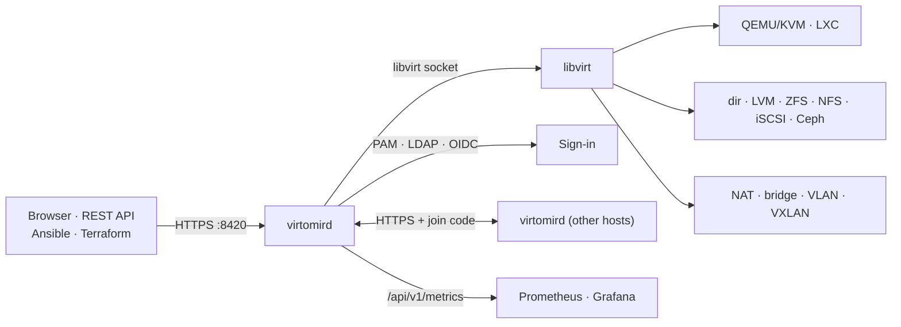

<p align="center"></p>

<h1 align="center">VirtoMir</h1>

<p align="center"><strong>A Detailed Control Deck for Virtual Environments.</strong><br>
KVM / QEMU / libvirt를 위한 현대적인 웹 제어판. 이미 쓰고 있는 Linux에 그대로 설치됩니다.</p>

<p align="center">
<a href="../../README.md">English</a> ·
<a href="README.tr.md">Türkçe</a> ·
<a href="README.de.md">Deutsch</a> ·
<a href="README.fr.md">Français</a> ·
<a href="README.es.md">Español</a> ·
<a href="README.pt-BR.md">Português</a> ·
<a href="README.it.md">Italiano</a> ·
<a href="README.pl.md">Polski</a> ·
<a href="README.nl.md">Nederlands</a> ·
<a href="README.ru.md">Русский</a> ·
<a href="README.uk.md">Українська</a> ·
<a href="README.zh-CN.md">简体中文</a> ·
<a href="README.zh-TW.md">繁體中文</a> ·
<a href="README.ja.md">日本語</a> ·
한국어 ·
<a href="README.ar.md">العربية</a>
</p>

<p align="center">
  <a href="https://github.com/onurbaydas/VirtoMir/releases/latest"></a>
  <a href="https://github.com/onurbaydas/VirtoMir/actions/workflows/ci.yml"></a>
  <a href="../../LICENSE"></a>
  
  <a href="https://scorecard.dev/viewer/?uri=github.com/onurbaydas/VirtoMir"></a>
  <a href="https://www.bestpractices.dev/projects/16980"></a>
  <a href="https://registry.terraform.io/providers/onurbaydas/virtomir/latest"></a>
</p>

<p align="center">
  <a href="https://github.com/onurbaydas/VirtoMir/stargazers"></a>
  <a href="https://github.com/onurbaydas/VirtoMir/fork"></a>
  <a href="https://github.com/onurbaydas/VirtoMir/subscription"></a>
</p>

<p align="center">
  <a href="https://onurbaydas.github.io/VirtoMir/demo/"><b>▶ 라이브 데모</b></a> ·
  <a href="#install">설치</a> ·
  <a href="../try-in-a-vm.md">VM에서 체험하기</a> ·
  <a href="../features.md">전체 기능</a> ·
  <a href="#contribute">기여하기</a> ·
  <a href="https://github.com/onurbaydas/VirtoMir/discussions">토론</a>
</p>

<table align="center">
<tr><td align="center"><h3>1</h3></td><td align="center"><h3>0</h3></td><td align="center"><h3>0</h3></td><td align="center"><h3>90+</h3></td><td align="center"><h3>16</h3></td><td align="center"><h3>1 s</h3></td></tr>
<tr><td align="center"><sub>바이너리, UI 내장</sub></td><td align="center"><sub>데이터베이스</sub></td><td align="center"><sub>VM 안의 에이전트</sub></td><td align="center"><sub>기능</sub></td><td align="center"><sub>README 언어</sub></td><td align="center"><sub>실시간 차트</sub></td></tr>
</table>

> 이 번역은 커뮤니티가 관리하며 [영어 README](../../README.md)보다 늦을 수 있습니다.

<p align="center"></p>

VirtoMir는 두 가지를 동시에 해내려고 합니다.

- **손쉬움.** 가상화를 잘 몰라도 VM을 만들고 실행할 수 있습니다.
- **무서울 만큼 세밀함.** libvirt의 모든 설정에 접근하고, 고치고, 네, 망가뜨릴 수도 있습니다.

웹 UI가 내장된 단일 바이너리입니다. 전용 배포판도, 데이터베이스도, 가상 머신 안의 에이전트도 필요 없습니다. KVM이 돌아가는 호스트에 설치하고 `https://<호스트>:8420/`을 연 뒤 Linux 계정으로 로그인하면 됩니다.

> **상태: 1.2.** Ubuntu 26.04와 Fedora 44에서 단일 호스트와 소규모 클러스터로 테스트했습니다. 고가용성은 아직 실제 BMC 하드웨어에서 시험하지 않았고, VMware 가져오기는 실험적입니다. 1.0부터는 새 기능을 추가하지 않고 단일 호스트의 일상적인 사용을 단단하게 만드는 데 집중합니다. 운영 환경에 맡기기 전에 꼭 테스트하고, 문제가 있으면 [#1](https://github.com/onurbaydas/VirtoMir/issues/1)에 알려 주세요.

> [!TIP]
> **방향이 마음에 드시나요? ⭐을 눌러 주세요.** VirtoMir는 한 사람이 만듭니다. 스타 덕분에 다른 사람들이 프로젝트를 찾고, 프로젝트가 이어집니다. 새 버전 소식은 **Watch → Custom → Releases**에서 받을 수 있습니다.

> [!NOTE]
> **써 보셨나요? 30초만 내 주세요. (계정 필요 없음)** [빠른 피드백 양식을 열고](https://tally.so/r/db904z) 😀 😐 😞 💡 중 하나를 고른 뒤, 원하면 한 문장 덧붙여 주세요. VirtoMir 안에서는 사이드바 아래의 💬 버튼이 버전 정보가 채워진 같은 양식을 엽니다. GitHub 계정이 있다면 [이슈 양식](https://github.com/onurbaydas/VirtoMir/issues/new?template=quick_feedback.yml)도 됩니다.

## 30초 만에 체험

| | |
|---|---|
| **구경만** | [온라인 데모](https://onurbaydas.github.io/VirtoMir/demo/)를 눌러 보세요. 가상의 호스트라 설치할 것이 없습니다. |
| **일회용 호스트** | 명령 하나로 VirtoMir가 들어 있는 테스트 VM을 만듭니다: [서버를 건드리지 않고 VirtoMir 체험하기](../try-in-a-vm.md). |
| **Debian / Ubuntu** | `sudo apt install ./virtomir_1.2.3_amd64.deb` — [최신 릴리스](https://github.com/onurbaydas/VirtoMir/releases/latest) |
| **Fedora / RHEL** | `sudo dnf install ./virtomir-1.2.3-1.x86_64.rpm` — [최신 릴리스](https://github.com/onurbaydas/VirtoMir/releases/latest) |

패키지는 libvirt와 QEMU/KVM이 없으면 설치하고, 8420 포트를 열고, 서비스를 시작합니다. 더 입력할 것은 없습니다.

## 왜 VirtoMir인가?

| | **VirtoMir** | Cockpit Machines | virt-manager | Proxmox VE |
|---|:---:|:---:|:---:|:---:|
| 이미 쓰는 Linux에 설치 | ✅ | ✅ | ✅ | ❌ 그 자체가 OS |
| 브라우저에서 사용 | ✅ | ✅ | ❌ 데스크톱 앱 | ✅ |
| libvirt의 모든 설정, 저장 전 XML 차이 표시 | ✅ | ➖ 기본 설정만 | ✅ | ➖ libvirt 아님 |
| 모든 변경 이력, 클릭 한 번으로 복원 | ✅ | ❌ | ❌ | ❌ |
| 실시간 차트와 30일 이력 내장 | ✅ | ➖ | ❌ | ✅ |
| 스냅샷, 예약 백업, 외부 사본 | ✅ | ➖ 스냅샷 | ➖ 스냅샷 | ✅ |
| 여러 호스트, 라이브 마이그레이션, 고가용성 | ✅ | ❌ | ➖ 마이그레이션 | ✅ |

VirtoMir는 그 중간에 있습니다. Cockpit처럼 간단하고, 날것의 libvirt XML처럼 빠짐없습니다.

## 주요 특징

<table>
<tr>
<td width="50%" valign="top">
<h3>🖥️ 머신을 깊이 있게</h3>
모든 머신에 꼭 필요한 것만 묻는 마법사(ISO, cloud-init 클라우드 이미지, 기존 디스크)와 그 뒤의 libvirt 전체 설정: CPU 토폴로지와 고정, Huge Pages, NUMA, PCI/USB 패스스루, vGPU, TPM, 보안 부팅, VNC 또는 SPICE를 통한 브라우저 콘솔.
<br><br>
</td>
<td width="50%" valign="top">
<h3>🕰️ 무엇이, 언제 바뀌었나</h3>
머신 정의의 모든 버전을 보관합니다. <code>virsh</code>로 한 변경도 포함됩니다. 타임라인은 수명 주기 이벤트, 변경, 스냅샷, 백업, 경고를 한 목록에 모아 "어제는 됐는데"에 답합니다.
<br><br>
</td>
</tr>
<tr>
<td valign="top">
<h3>💾 스토리지와 네트워크</h3>
디렉터리, LVM, ZFS, NFS, iSCSI, Ceph 풀. LAN의 NFS, SMB, iSCSI 대상을 찾아 클릭 한 번으로 연결합니다. NAT, 브리지(Wi-Fi에서도), VLAN, VXLAN 네트워크, 그리고 연결이 끊기면 스스로 되돌아가는 호스트 네트워크 변경.
<br><br>
</td>
<td valign="top">
<h3>🛟 제대로 돌아오는 백업</h3>
중단 없는 라이브 백업, 보존 규칙이 있는 일정, 새 머신으로 복원, 체크섬 검증. restic으로 S3, B2, Azure, SFTP, 디스크에 암호화·중복 제거된 외부 사본을 둡니다.
<br><br>
</td>
</tr>
<tr>
<td valign="top">
<h3>🌐 여러 호스트, 하나의 화면</h3>
일회용 참가 코드로 호스트를 연결합니다. 공유 데이터베이스도 추가 서비스도 필요 없습니다. 라이브 마이그레이션, 부하를 고르게 하는 스케줄러, 유지 보수 모드, 롤링 업그레이드, 쿼럼과 펜싱을 갖춘 고가용성.
<br><br>
</td>
<td valign="top">
<h3>🔐 공유 호스트를 위해</h3>
Linux 계정(PAM), LDAP/AD, OpenID Connect 로그인, 2단계 인증, 역할, 할당량이 있는 프로젝트, API 토큰, 변조를 감지하는 활동 로그. 기본은 HTTPS입니다.
<br><br>
</td>
</tr>
</table>

경고와 보고서부터 Kubernetes 클러스터, VMware 가져오기까지 나머지는 모두 **[전체 기능 목록](../features.md)**(영어)에 있습니다.

## 동작 방식



- **서비스는 `virtomird` 하나**뿐이며, 시스템 libvirt 소켓과 통신하고 PAM으로 비밀번호를 확인하므로 root로 실행됩니다.
- **자체 상태는 `/var/lib/virtomir`에 저장**: 인증서, 지표 이력, 설정, 활동 로그. 데이터베이스는 없습니다.
- **기존 머신을 스스로 건드리지 않습니다.** libvirt에 있는 것을 읽고 요청한 것만 바꾸며, 모든 변경은 활동 로그에 남습니다.
- **깔끔하게 제거됩니다:** `sudo apt purge virtomir`는 서비스와 상태를 지우고, 머신·디스크·네트워크는 그대로 둡니다.

<a id="install"></a>
## 설치

```sh
# Debian / Ubuntu
sudo install -d -m 0755 /etc/apt/keyrings
sudo curl -fsSL -o /etc/apt/keyrings/virtomir.asc https://onurbaydas.github.io/VirtoMir/virtomir.asc
echo "deb [signed-by=/etc/apt/keyrings/virtomir.asc] https://onurbaydas.github.io/VirtoMir/apt stable main" | sudo tee /etc/apt/sources.list.d/virtomir.list
sudo apt update && sudo apt install virtomir

# Fedora / RHEL 10
sudo curl -fsSL -o /etc/yum.repos.d/virtomir.repo https://onurbaydas.github.io/VirtoMir/virtomir.repo
sudo dnf install virtomir
```

그다음 `https://<호스트>:8420/`을 열고 `root` 또는 관리자(`sudo`, `wheel`, `libvirt` 그룹)로 로그인합니다. 브라우저가 자체 서명 인증서를 한 번 수락하라고 묻습니다. 처음 로그인한 관리자에게는 호스트에 아직 없는 것(스토리지, 백업 위치, 첫 이미지)을 차례로 안내합니다.

패키지, tarball, 설정, 소스에서 빌드: [영어 README](../../README.md#install)를 참고하세요.

보안 문제는 비공개로 알려 주세요. [SECURITY.md](../../SECURITY.md)를 참고하세요.

<a id="contribute"></a>
## 도움을 구합니다

VirtoMir는 한 사람이 AI 코딩 에이전트와 함께 만들고 있습니다. 그래서 이렇게 빨리 자랐고, 그래서 보통의 개인 프로젝트보다 더 많은 눈이 필요합니다.

- 🧪 **실행해 보기**: Debian, 오래된 Ubuntu, Rocky/Alma, Arch에서 돌려 보고 무엇이 깨지는지 알려 주세요.
- 🔍 **보안에 민감한 부분 검토**: root로 실행되고 로그인을 처리합니다(`internal/auth`, `internal/api`).
- 🔧 **우리가 닿지 못하는 환경 테스트**: GPU 패스스루, Ceph, 실제 BMC, VMware.
- 🌍 **번역**: UI([`web/src/lib/locales`](../../web/src/lib/locales)) 또는 이 README([`docs/i18n`](.)).
- 💻 **코드 작성**: 서버가 필요 없습니다. `cd web && npm install && npm run dev:demo`로 모의 클러스터에서 UI 전체가 돌아갑니다. [good first issue](https://github.com/onurbaydas/VirtoMir/issues?q=is%3Aissue+is%3Aopen+label%3A%22good+first+issue%22)부터 시작하고 [CONTRIBUTING.md](../../CONTRIBUTING.md)를 참고하세요.

아이디어와 질문: [토론](https://github.com/onurbaydas/VirtoMir/discussions). 버그를 찾았나요? [이슈 열기](https://github.com/onurbaydas/VirtoMir/issues/new/choose).

## 감사의 말

<p><br>Mega Bilgisayar에 감사드립니다.</p>

<p align="center">
  <b>VirtoMir가 유용하다면 스타 하나가 다른 사람들이 찾는 데 도움이 됩니다.</b><br><br>
  <a href="https://github.com/onurbaydas/VirtoMir/stargazers"></a>
  <a href="https://github.com/onurbaydas/VirtoMir/fork"></a>
  <a href="https://github.com/onurbaydas/VirtoMir/subscription"></a>
</p>

## 라이선스

VirtoMir는 자유 소프트웨어입니다: **GNU Affero General Public License v3.0 이상**, [LICENSE](../../LICENSE)를 참고하세요. 사용, 연구, 수정, 공유할 수 있으며, 수정한 VirtoMir를 네트워크로 다른 사람에게 제공한다면 소스 코드도 함께 제공해야 합니다.

Copyright © 2026 Onur Baydas. AGPL 의무가 없는 상용 라이선스는 GitHub를 통해 작성자에게 문의하세요. 기여는 두 라이선스를 모두 가능하게 하는 [기여자 라이선스 계약](../../CLA.md)에 따라 환영합니다.
