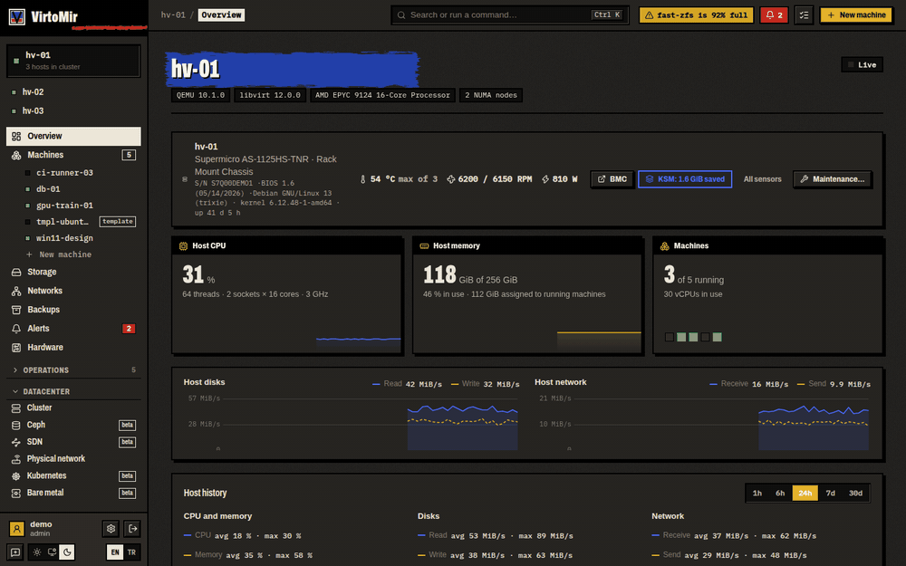
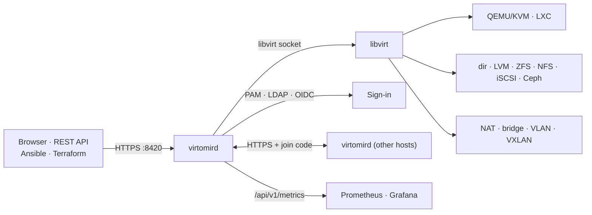

<p align="center"></p>

<h1 align="center">VirtoMir</h1>

<p align="center"><strong>A Detailed Control Deck for Virtual Environments.</strong><br>
Een modern webbeheerpaneel voor KVM / QEMU / libvirt dat zich installeert op de Linux die je al draait.</p>

<p align="center">
<a href="../../README.md">English</a> ·
<a href="README.tr.md">Türkçe</a> ·
<a href="README.de.md">Deutsch</a> ·
<a href="README.fr.md">Français</a> ·
<a href="README.es.md">Español</a> ·
<a href="README.pt-BR.md">Português</a> ·
<a href="README.it.md">Italiano</a> ·
<a href="README.pl.md">Polski</a> ·
Nederlands ·
<a href="README.ru.md">Русский</a> ·
<a href="README.uk.md">Українська</a> ·
<a href="README.zh-CN.md">简体中文</a> ·
<a href="README.zh-TW.md">繁體中文</a> ·
<a href="README.ja.md">日本語</a> ·
<a href="README.ko.md">한국어</a> ·
<a href="README.ar.md">العربية</a>
</p>

<p align="center">
  <a href="https://github.com/onurbaydas/VirtoMir/releases/latest"></a>
  <a href="https://github.com/onurbaydas/VirtoMir/actions/workflows/ci.yml"></a>
  <a href="../../LICENSE"></a>
  
  <a href="https://scorecard.dev/viewer/?uri=github.com/onurbaydas/VirtoMir"></a>
</p>

<p align="center">
  <a href="https://github.com/onurbaydas/VirtoMir/stargazers"></a>
  <a href="https://github.com/onurbaydas/VirtoMir/fork"></a>
  <a href="https://github.com/onurbaydas/VirtoMir/subscription"></a>
</p>

<p align="center">
  <a href="https://onurbaydas.github.io/VirtoMir/demo/"><b>▶ Live demo</b></a> ·
  <a href="#install">Installatie</a> ·
  <a href="../try-in-a-vm.md">Probeer in een VM</a> ·
  <a href="../features.md">Alle functies</a> ·
  <a href="#contribute">Bijdragen</a> ·
  <a href="https://github.com/onurbaydas/VirtoMir/discussions">Discussies</a>
</p>

<table align="center">
<tr><td align="center"><h3>1</h3></td><td align="center"><h3>0</h3></td><td align="center"><h3>0</h3></td><td align="center"><h3>90+</h3></td><td align="center"><h3>16</h3></td><td align="center"><h3>1 s</h3></td></tr>
<tr><td align="center"><sub>binary, UI ingebouwd</sub></td><td align="center"><sub>databases</sub></td><td align="center"><sub>agents in je VM's</sub></td><td align="center"><sub>functies</sub></td><td align="center"><sub>README-talen</sub></td><td align="center"><sub>live grafieken</sub></td></tr>
</table>

> Deze vertaling wordt door de community bijgehouden en kan achterlopen op de [Engelse README](../../README.md).

<p align="center"></p>

VirtoMir probeert twee dingen tegelijk te zijn:

- **Moeiteloos.** Maak en draai een VM zonder veel van virtualisatie te weten.
- **Angstaanjagend gedetailleerd.** Elke libvirt-instelling is bereikbaar, aanpasbaar en, ja, ook stuk te maken.

Eén binary met de webinterface ingebouwd: geen eigen distributie, geen database, geen agents in je machines. Installeer het op een host met KVM, open `https://<host>:8420/` en log in met je Linux-account.

> **Status: 1.2.** Getest op Ubuntu 26.04 en Fedora 44, op losse hosts en kleine clusters. Hoge beschikbaarheid is nog niet op echte BMC-hardware geprobeerd en de VMware-import is experimenteel. Sinds 1.0 komen er geen nieuwe functies bij: het werk gaat naar dagelijks gebruik op één host dat solide is. Test het voordat je er productie aan toevertrouwt en meld in [#1](https://github.com/onurbaydas/VirtoMir/issues/1) wat er misgaat.

> [!TIP]
> **Bevalt de richting? Geef een ⭐.** VirtoMir wordt door één persoon gebouwd: via sterren vinden anderen het, en ze houden het project gaande. Voor nieuwe versies: **Watch → Custom → Releases**.

> [!NOTE]
> **Geprobeerd? Vertel het ons in 30 seconden. (zonder account)** [Open het snelle feedbackformulier](https://tally.so/r/db904z), kies 😀 😐 😞 of 💡 en voeg eventueel een zin toe. In VirtoMir opent de 💬-knop onderaan de zijbalk hetzelfde formulier met je versies al ingevuld. Met een GitHub-account kan ook [het issueformulier](https://github.com/onurbaydas/VirtoMir/issues/new?template=quick_feedback.yml).

## Probeer het in 30 seconden

| | |
|---|---|
| **Alleen kijken** | Klik door de [online demo](https://onurbaydas.github.io/VirtoMir/demo/): verzonnen hosts, niets te installeren. |
| **Wegwerphost** | Eén commando geeft je een test-VM met VirtoMir erin: [Probeer VirtoMir zonder je servers aan te raken](../try-in-a-vm.md). |
| **Debian / Ubuntu** | `sudo apt install ./virtomir_1.2.2_amd64.deb` — [nieuwste release](https://github.com/onurbaydas/VirtoMir/releases/latest) |
| **Fedora / RHEL** | `sudo dnf install ./virtomir-1.2.2-1.x86_64.rpm` — [nieuwste release](https://github.com/onurbaydas/VirtoMir/releases/latest) |

Het pakket installeert libvirt en QEMU/KVM als ze ontbreken, opent poort 8420 en start de dienst. Verder hoef je niets te typen.

## Waarom VirtoMir?

| | **VirtoMir** | Cockpit Machines | virt-manager | Proxmox VE |
|---|:---:|:---:|:---:|:---:|
| Installeert op de Linux die je al hebt | ✅ | ✅ | ✅ | ❌ is zelf het OS |
| In de browser | ✅ | ✅ | ❌ desktop-app | ✅ |
| Elke libvirt-instelling, met een XML-diff vóór het opslaan | ✅ | ➖ basisinstellingen | ✅ | ➖ geen libvirt |
| Geschiedenis van elke wijziging, herstellen met één klik | ✅ | ❌ | ❌ | ❌ |
| Live grafieken en 30 dagen geschiedenis ingebouwd | ✅ | ➖ | ❌ | ✅ |
| Snapshots, geplande back-ups, externe kopieën | ✅ | ➖ snapshots | ➖ snapshots | ✅ |
| Meerdere hosts, live migratie, hoge beschikbaarheid | ✅ | ❌ | ➖ migratie | ✅ |

VirtoMir zit in het midden: zo eenvoudig als Cockpit, zo grondig als ruwe libvirt-XML.

## Hoogtepunten

<table>
<tr>
<td width="50%" valign="top">
<h3>🖥️ Machines tot in detail</h3>
Een wizard die alleen vraagt wat elke machine nodig heeft (ISO, cloud-image met cloud-init of een bestaande schijf), en daarachter elke instelling die libvirt kent: CPU-topologie en pinning, huge pages, NUMA, PCI/USB-passthrough, vGPU, TPM, Secure Boot en een console in de browser via VNC of SPICE.
<br><br>
</td>
<td width="50%" valign="top">
<h3>🕰️ Wat er veranderde, en wanneer</h3>
Elke versie van de definitie van een machine wordt bewaard, ook wijzigingen via <code>virsh</code>. De tijdlijn zet levenscyclusgebeurtenissen, wijzigingen, snapshots, back-ups en meldingen in één lijst: het antwoord op „gisteren werkte het nog”.
<br><br>
</td>
</tr>
<tr>
<td valign="top">
<h3>💾 Opslag en netwerken</h3>
Map-, LVM-, ZFS-, NFS-, iSCSI- en Ceph-pools; NFS-, SMB- en iSCSI-doelen in het LAN worden gevonden en met één klik gekoppeld. NAT-, bridge- (ook via wifi), VLAN- en VXLAN-netwerken, en wijzigingen aan het netwerk van de host die zichzelf terugdraaien als je de verbinding kwijtraakt.
<br><br>
</td>
<td valign="top">
<h3>🛟 Back-ups die terugkomen</h3>
Live back-ups zonder downtime, schema's met bewaarbeleid, herstellen als nieuwe machine, gecontroleerde checksums. Externe kopieën met restic naar S3, B2, Azure, SFTP of een schijf, versleuteld en gededupliceerd.
<br><br>
</td>
</tr>
<tr>
<td valign="top">
<h3>🌐 Meerdere hosts, één overzicht</h3>
Koppel hosts met een eenmalige code: geen gedeelde database, geen extra diensten. Live migratie, een scheduler die de belasting verdeelt, onderhoudsmodus, rollende updates en hoge beschikbaarheid met quorum en fencing.
<br><br>
</td>
<td valign="top">
<h3>🔐 Gemaakt voor een gedeelde host</h3>
Inloggen met Linux-accounts (PAM), LDAP/AD of OpenID Connect, tweestapsverificatie, rollen, projecten met quota, API-tokens en een manipulatiebestendig activiteitenlog. Standaard HTTPS.
<br><br>
</td>
</tr>
</table>

Al het andere, van meldingen en rapporten tot Kubernetes-clusters en de VMware-import, staat in de **[volledige functielijst](../features.md)** (Engels).

## Hoe het werkt



- **Eén dienst, `virtomird`**, draait als root omdat hij met de libvirt-socket van het systeem praat en wachtwoorden via PAM controleert.
- **Eigen status in `/var/lib/virtomir`**: certificaat, metriekgeschiedenis, instellingen, activiteitenlog. Geen database.
- **Raakt bestaande machines nooit uit zichzelf aan.** Het leest wat libvirt heeft en wijzigt alleen wat jij vraagt; elke wijziging staat in het activiteitenlog.
- **Verdwijnt netjes:** `sudo apt purge virtomir` verwijdert de dienst en zijn status; je machines, schijven en netwerken blijven.

<a id="install"></a>
## Installatie

```sh
# Debian / Ubuntu
sudo install -d -m 0755 /etc/apt/keyrings
sudo curl -fsSL -o /etc/apt/keyrings/virtomir.asc https://onurbaydas.github.io/VirtoMir/virtomir.asc
echo "deb [signed-by=/etc/apt/keyrings/virtomir.asc] https://onurbaydas.github.io/VirtoMir/apt stable main" | sudo tee /etc/apt/sources.list.d/virtomir.list
sudo apt update && sudo apt install virtomir

# Fedora / RHEL 10
sudo curl -fsSL -o /etc/yum.repos.d/virtomir.repo https://onurbaydas.github.io/VirtoMir/virtomir.repo
sudo dnf install virtomir
```

Open daarna `https://<host>:8420/` en log in als `root` of als beheerder (groepen `sudo`, `wheel` of `libvirt`). De browser vraagt één keer om het zelfondertekende certificaat te accepteren. De eerste beheerder wordt door wat de host nog mist geleid: opslag, een back-uplocatie, een eerste image.

Pakketten, tarball, configuratie en bouwen vanuit de broncode: [Engelse README](../../README.md#install).

Meld beveiligingsproblemen vertrouwelijk, zie [SECURITY.md](../../SECURITY.md).

<a id="contribute"></a>
## Hulp gezocht

VirtoMir wordt gebouwd door één persoon, samen met AI-programmeeragents. Daardoor groeide het zo snel, en daardoor heeft het meer ogen nodig dan een gemiddeld hobbyproject.

- 🧪 **Draai het** op Debian, een oudere Ubuntu, Rocky/Alma of Arch, en vertel wat er stukgaat.
- 🔍 **Bekijk de gevoelige delen**: het draait als root en regelt het inloggen (`internal/auth`, `internal/api`).
- 🔧 **Test wat wij niet kunnen bereiken**: GPU-passthrough, Ceph, echte BMC's, VMware.
- 🌍 **Vertaal**: de interface ([`web/src/lib/locales`](../../web/src/lib/locales)) of deze README ([`docs/i18n`](.)).
- 💻 **Schrijf code**: geen server nodig, `cd web && npm install && npm run dev:demo` draait de hele interface tegen een gesimuleerd cluster. Begin met een [good first issue](https://github.com/onurbaydas/VirtoMir/issues?q=is%3Aissue+is%3Aopen+label%3A%22good+first+issue%22), zie [CONTRIBUTING.md](../../CONTRIBUTING.md).

Ideeën en vragen: [Discussies](https://github.com/onurbaydas/VirtoMir/discussions). Een bug gevonden? [Open een issue](https://github.com/onurbaydas/VirtoMir/issues/new/choose).

## Dank

<p><br>Met dank aan Mega Bilgisayar.</p>

<p align="center">
  <b>Als VirtoMir je helpt, zorgt een ster dat anderen het ook vinden.</b><br><br>
  <a href="https://github.com/onurbaydas/VirtoMir/stargazers"></a>
  <a href="https://github.com/onurbaydas/VirtoMir/fork"></a>
  <a href="https://github.com/onurbaydas/VirtoMir/subscription"></a>
</p>

## Licentie

VirtoMir is vrije software: **GNU Affero General Public License v3.0 of later**, zie [LICENSE](../../LICENSE). Je mag het gebruiken, bestuderen, wijzigen en delen; als je een gewijzigde VirtoMir via een netwerk aan anderen aanbiedt, moet je hun ook de broncode aanbieden.

Copyright © 2026 Onur Baydas. Neem voor een commerciële licentie zonder de verplichtingen van de AGPL contact op met de auteur via GitHub. Bijdragen zijn welkom onder de [Contributor License Agreement](../../CLA.md), die beide licenties mogelijk houdt.
