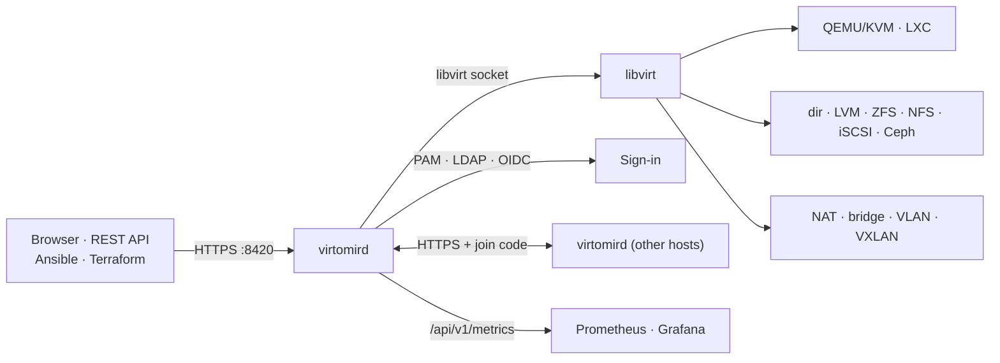

<p align="center"></p>

<h1 align="center">VirtoMir</h1>

<p align="center"><strong>A Detailed Control Deck for Virtual Environments.</strong><br>
Nowoczesny panel webowy dla KVM / QEMU / libvirt, który instaluje się na Linuksie, którego już używasz.</p>

<p align="center">
<a href="../../README.md">English</a> ·
<a href="README.tr.md">Türkçe</a> ·
<a href="README.de.md">Deutsch</a> ·
<a href="README.fr.md">Français</a> ·
<a href="README.es.md">Español</a> ·
<a href="README.pt-BR.md">Português</a> ·
<a href="README.it.md">Italiano</a> ·
Polski ·
<a href="README.nl.md">Nederlands</a> ·
<a href="README.ru.md">Русский</a> ·
<a href="README.uk.md">Українська</a> ·
<a href="README.zh-CN.md">简体中文</a> ·
<a href="README.zh-TW.md">繁體中文</a> ·
<a href="README.ja.md">日本語</a> ·
<a href="README.ko.md">한국어</a> ·
<a href="README.ar.md">العربية</a>
</p>

<p align="center">
  <a href="https://github.com/onurbaydas/VirtoMir/releases/latest"></a>
  <a href="https://github.com/onurbaydas/VirtoMir/actions/workflows/ci.yml"></a>
  <a href="../../LICENSE"></a>
  
  <a href="https://scorecard.dev/viewer/?uri=github.com/onurbaydas/VirtoMir"></a>
  <a href="https://www.bestpractices.dev/projects/16980"></a>
  <a href="https://registry.terraform.io/providers/onurbaydas/virtomir/latest"></a>
</p>

<p align="center">
  <a href="https://github.com/onurbaydas/VirtoMir/stargazers"></a>
  <a href="https://github.com/onurbaydas/VirtoMir/fork"></a>
  <a href="https://github.com/onurbaydas/VirtoMir/subscription"></a>
</p>

<p align="center">
  <a href="https://onurbaydas.github.io/VirtoMir/demo/"><b>▶ Demo na żywo</b></a> ·
  <a href="#install">Instalacja</a> ·
  <a href="../try-in-a-vm.md">Wypróbuj w maszynie wirtualnej</a> ·
  <a href="../features.md">Wszystkie funkcje</a> ·
  <a href="#contribute">Współtwórz</a> ·
  <a href="https://github.com/onurbaydas/VirtoMir/discussions">Dyskusje</a>
</p>

<table align="center">
<tr><td align="center"><h3>1</h3></td><td align="center"><h3>0</h3></td><td align="center"><h3>0</h3></td><td align="center"><h3>90+</h3></td><td align="center"><h3>16</h3></td><td align="center"><h3>1 s</h3></td></tr>
<tr><td align="center"><sub>plik binarny z UI</sub></td><td align="center"><sub>baz danych</sub></td><td align="center"><sub>agentów w VM</sub></td><td align="center"><sub>funkcji</sub></td><td align="center"><sub>języków README</sub></td><td align="center"><sub>wykresy na żywo</sub></td></tr>
</table>

> To tłumaczenie utrzymuje społeczność i może być nieaktualne względem [angielskiego README](../../README.md).

<p align="center"></p>

VirtoMir próbuje być dwiema rzeczami naraz:

- **Bezwysiłkowy.** Utworzysz i uruchomisz VM bez dużej wiedzy o wirtualizacji.
- **Przerażająco szczegółowy.** Każde ustawienie libvirt jest dostępne, edytowalne i, tak, można je zepsuć.

Jeden plik binarny z wbudowanym interfejsem webowym: bez osobnej dystrybucji, bez bazy danych, bez agentów w maszynach. Zainstaluj go na hoście z KVM, otwórz `https://<host>:8420/` i zaloguj się kontem Linuksa.

> **Stan: 1.2.** Przetestowany na Ubuntu 26.04 i Fedorze 44, na pojedynczych hostach i małych klastrach. Wysoka dostępność nie była jeszcze sprawdzana na prawdziwym sprzęcie BMC, a import z VMware jest eksperymentalny. Od wersji 1.0 nie dodajemy nowych funkcji: praca idzie w to, by codzienne użycie na jednym hoście było solidne. Przetestuj go, zanim powierzysz mu produkcję, i opisz w [#1](https://github.com/onurbaydas/VirtoMir/issues/1), co nie działa.

> [!TIP]
> **Podoba ci się kierunek? Zostaw ⭐.** VirtoMir tworzy jedna osoba: dzięki gwiazdkom inni go znajdują, a projekt trwa. O nowych wersjach powiadomi cię **Watch → Custom → Releases**.

> [!NOTE]
> **Wypróbowałeś? Napisz w 30 sekund. (bez konta)** [Otwórz szybki formularz opinii](https://tally.so/r/db904z), wybierz 😀 😐 😞 lub 💡 i dodaj zdanie, jeśli chcesz. W VirtoMir przycisk 💬 na dole paska bocznego otwiera ten sam formularz z wypełnionymi już wersjami. Z kontem GitHub możesz też użyć [formularza issue](https://github.com/onurbaydas/VirtoMir/issues/new?template=quick_feedback.yml).

## Wypróbuj w 30 sekund

| | |
|---|---|
| **Tylko popatrz** | Przeklikaj [demo online](https://onurbaydas.github.io/VirtoMir/demo/): zmyślone hosty, nic do instalowania. |
| **Host jednorazowy** | Jedno polecenie daje testową VM z VirtoMirem w środku: [Wypróbuj VirtoMir bez dotykania swoich serwerów](../try-in-a-vm.md). |
| **Debian / Ubuntu** | `sudo apt install ./virtomir_1.2.2_amd64.deb` — [najnowsze wydanie](https://github.com/onurbaydas/VirtoMir/releases/latest) |
| **Fedora / RHEL** | `sudo dnf install ./virtomir-1.2.2-1.x86_64.rpm` — [najnowsze wydanie](https://github.com/onurbaydas/VirtoMir/releases/latest) |

Pakiet doinstaluje libvirt i QEMU/KVM, jeśli ich brakuje, otworzy port 8420 i uruchomi usługę. Nic więcej nie trzeba wpisywać.

## Dlaczego VirtoMir?

| | **VirtoMir** | Cockpit Machines | virt-manager | Proxmox VE |
|---|:---:|:---:|:---:|:---:|
| Instaluje się na Linuksie, który już masz | ✅ | ✅ | ✅ | ❌ sam jest systemem |
| W przeglądarce | ✅ | ✅ | ❌ aplikacja desktopowa | ✅ |
| Każde ustawienie libvirt, z różnicą XML przed zapisem | ✅ | ➖ podstawowe ustawienia | ✅ | ➖ nie libvirt |
| Historia każdej zmiany, przywracanie jednym kliknięciem | ✅ | ❌ | ❌ | ❌ |
| Wykresy na żywo i 30 dni historii w zestawie | ✅ | ➖ | ❌ | ✅ |
| Migawki, zaplanowane kopie, kopie poza siedzibą | ✅ | ➖ migawki | ➖ migawki | ✅ |
| Wiele hostów, migracja na żywo, wysoka dostępność | ✅ | ❌ | ➖ migracja | ✅ |

VirtoMir jest pośrodku: tak prosty jak Cockpit, tak dokładny jak surowy XML libvirt.

## Najważniejsze

<table>
<tr>
<td width="50%" valign="top">
<h3>🖥️ Maszyny w szczegółach</h3>
Kreator, który pyta tylko o to, czego potrzebuje każda maszyna (ISO, obraz chmurowy z cloud-init albo istniejący dysk), a za nim każde ustawienie libvirt: topologia i przypinanie CPU, huge pages, NUMA, passthrough PCI/USB, vGPU, TPM, Secure Boot oraz konsola w przeglądarce przez VNC lub SPICE.
<br><br>
</td>
<td width="50%" valign="top">
<h3>🕰️ Co się zmieniło i kiedy</h3>
Każda wersja definicji maszyny jest przechowywana, także zmiany zrobione przez <code>virsh</code>. Oś czasu łączy zdarzenia cyklu życia, zmiany, migawki, kopie i alerty w jedną listę: odpowiedź na „wczoraj działało”.
<br><br>
</td>
</tr>
<tr>
<td valign="top">
<h3>💾 Pamięć masowa i sieci</h3>
Pule katalogowe, LVM, ZFS, NFS, iSCSI i Ceph; cele NFS, SMB i iSCSI w sieci lokalnej są wykrywane i podłączane jednym kliknięciem. Sieci NAT, mostkowane (także przez Wi-Fi), VLAN i VXLAN oraz zmiany w sieci hosta, które same się wycofują, gdy stracisz połączenie.
<br><br>
</td>
<td valign="top">
<h3>🛟 Kopie, które wracają</h3>
Kopie na żywo bez przestoju, harmonogramy z retencją, przywracanie jako nowa maszyna, sprawdzane sumy kontrolne. Kopie poza siedzibą przez restic do S3, B2, Azure, SFTP lub na dysk, szyfrowane i deduplikowane.
<br><br>
</td>
</tr>
<tr>
<td valign="top">
<h3>🌐 Wiele hostów, jeden widok</h3>
Łącz hosty jednorazowym kodem: bez wspólnej bazy, bez dodatkowych usług. Migracja na żywo, harmonogram równoważący obciążenie, tryb serwisowy, aktualizacje kroczące i wysoka dostępność z kworum i fencingiem.
<br><br>
</td>
<td valign="top">
<h3>🔐 Dla współdzielonego hosta</h3>
Logowanie kontami Linuksa (PAM), przez LDAP/AD lub OpenID Connect, logowanie dwuetapowe, role, projekty z limitami, tokeny API i dziennik aktywności odporny na manipulacje. Domyślnie HTTPS.
<br><br>
</td>
</tr>
</table>

Cała reszta, od alertów i raportów po klastry Kubernetes i import z VMware, jest na **[pełnej liście funkcji](../features.md)** (po angielsku).

## Jak to działa



- **Jedna usługa, `virtomird`**, działa jako root, bo rozmawia z systemowym gniazdem libvirt i sprawdza hasła przez PAM.
- **Własny stan w `/var/lib/virtomir`**: certyfikat, historia metryk, ustawienia, dziennik aktywności. Bez bazy danych.
- **Nigdy sam nie rusza istniejących maszyn.** Czyta to, co ma libvirt, i zmienia tylko to, o co poprosisz; każda zmiana trafia do dziennika aktywności.
- **Usuwa się czysto:** `sudo apt purge virtomir` kasuje usługę i jej stan; maszyny, dyski i sieci zostają.

<a id="install"></a>
## Instalacja

```sh
# Debian / Ubuntu
sudo install -d -m 0755 /etc/apt/keyrings
sudo curl -fsSL -o /etc/apt/keyrings/virtomir.asc https://onurbaydas.github.io/VirtoMir/virtomir.asc
echo "deb [signed-by=/etc/apt/keyrings/virtomir.asc] https://onurbaydas.github.io/VirtoMir/apt stable main" | sudo tee /etc/apt/sources.list.d/virtomir.list
sudo apt update && sudo apt install virtomir

# Fedora / RHEL 10
sudo curl -fsSL -o /etc/yum.repos.d/virtomir.repo https://onurbaydas.github.io/VirtoMir/virtomir.repo
sudo dnf install virtomir
```

Następnie otwórz `https://<host>:8420/` i zaloguj się jako `root` lub administrator (grupy `sudo`, `wheel` lub `libvirt`). Przeglądarka raz poprosi o akceptację certyfikatu z podpisem własnym. Pierwszy administrator zostanie przeprowadzony przez to, czego hostowi jeszcze brakuje: pamięć masową, miejsce na kopie, pierwszy obraz.

Pakiety, tarball, konfiguracja i budowanie ze źródeł: [angielskie README](../../README.md#install).

Problemy z bezpieczeństwem zgłaszaj prywatnie, zobacz [SECURITY.md](../../SECURITY.md).

<a id="contribute"></a>
## Szukamy pomocy

VirtoMir tworzy jedna osoba razem z agentami programistycznymi AI. Dlatego urósł tak szybko i dlatego potrzebuje więcej oczu niż typowy projekt po godzinach.

- 🧪 **Uruchom go** na Debianie, starszym Ubuntu, Rocky/Alma lub Archu i powiedz, co się psuje.
- 🔍 **Przejrzyj wrażliwe części**: działa jako root i obsługuje logowanie (`internal/auth`, `internal/api`).
- 🔧 **Przetestuj to, do czego nie mamy dostępu**: passthrough GPU, Ceph, prawdziwe BMC, VMware.
- 🌍 **Tłumacz**: interfejs ([`web/src/lib/locales`](../../web/src/lib/locales)) albo to README ([`docs/i18n`](.)).
- 💻 **Pisz kod**: serwer niepotrzebny, `cd web && npm install && npm run dev:demo` uruchamia cały interfejs na symulowanym klastrze. Zacznij od [good first issue](https://github.com/onurbaydas/VirtoMir/issues?q=is%3Aissue+is%3Aopen+label%3A%22good+first+issue%22), zobacz [CONTRIBUTING.md](../../CONTRIBUTING.md).

Pomysły i pytania: [Dyskusje](https://github.com/onurbaydas/VirtoMir/discussions). Znalazłeś błąd? [Otwórz zgłoszenie](https://github.com/onurbaydas/VirtoMir/issues/new/choose).

## Podziękowania

<p><br>Podziękowania dla Mega Bilgisayar.</p>

<p align="center">
  <b>Jeśli VirtoMir ci się przydaje, gwiazdka pomoże innym go znaleźć.</b><br><br>
  <a href="https://github.com/onurbaydas/VirtoMir/stargazers"></a>
  <a href="https://github.com/onurbaydas/VirtoMir/fork"></a>
  <a href="https://github.com/onurbaydas/VirtoMir/subscription"></a>
</p>

## Licencja

VirtoMir to wolne oprogramowanie: **GNU Affero General Public License v3.0 lub nowsza**, zobacz [LICENSE](../../LICENSE). Możesz go używać, badać, zmieniać i udostępniać; jeśli oferujesz innym zmieniony VirtoMir przez sieć, musisz udostępnić im również jego kod źródłowy.

Copyright © 2026 Onur Baydas. W sprawie licencji komercyjnej bez obowiązków AGPL skontaktuj się z autorem przez GitHub. Wkład jest mile widziany na zasadach [Contributor License Agreement](../../CLA.md), która utrzymuje możliwość obu licencji.
