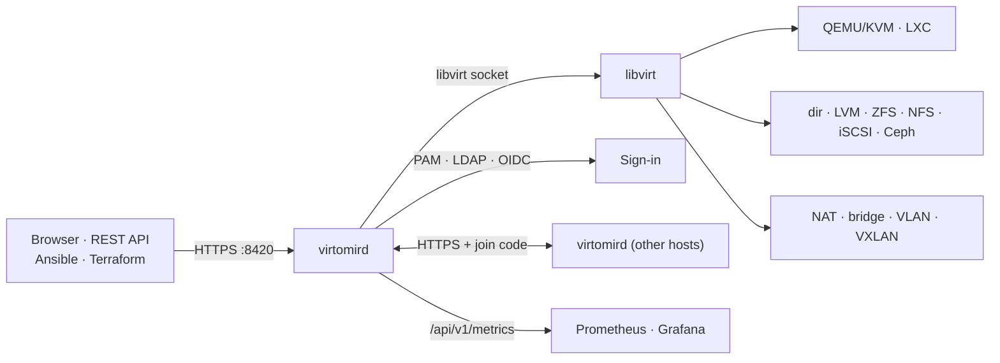

<p align="center"></p>

<h1 align="center">VirtoMir</h1>

<p align="center"><strong>A Detailed Control Deck for Virtual Environments.</strong><br>
Um painel de controle web moderno para KVM / QEMU / libvirt que se instala no Linux que você já usa.</p>

<p align="center">
<a href="../../README.md">English</a> ·
<a href="README.tr.md">Türkçe</a> ·
<a href="README.de.md">Deutsch</a> ·
<a href="README.fr.md">Français</a> ·
<a href="README.es.md">Español</a> ·
Português ·
<a href="README.it.md">Italiano</a> ·
<a href="README.pl.md">Polski</a> ·
<a href="README.nl.md">Nederlands</a> ·
<a href="README.ru.md">Русский</a> ·
<a href="README.uk.md">Українська</a> ·
<a href="README.zh-CN.md">简体中文</a> ·
<a href="README.zh-TW.md">繁體中文</a> ·
<a href="README.ja.md">日本語</a> ·
<a href="README.ko.md">한국어</a> ·
<a href="README.ar.md">العربية</a>
</p>

<p align="center">
  <a href="https://github.com/onurbaydas/VirtoMir/releases/latest"></a>
  <a href="https://github.com/onurbaydas/VirtoMir/actions/workflows/ci.yml"></a>
  <a href="../../LICENSE"></a>
  
  <a href="https://scorecard.dev/viewer/?uri=github.com/onurbaydas/VirtoMir"></a>
</p>

<p align="center">
  <a href="https://github.com/onurbaydas/VirtoMir/stargazers"></a>
  <a href="https://github.com/onurbaydas/VirtoMir/fork"></a>
  <a href="https://github.com/onurbaydas/VirtoMir/subscription"></a>
</p>

<p align="center">
  <a href="https://onurbaydas.github.io/VirtoMir/demo/"><b>▶ Demo ao vivo</b></a> ·
  <a href="#install">Instalação</a> ·
  <a href="../try-in-a-vm.md">Testar em uma VM</a> ·
  <a href="../features.md">Todos os recursos</a> ·
  <a href="#contribute">Contribuir</a> ·
  <a href="https://github.com/onurbaydas/VirtoMir/discussions">Discussões</a>
</p>

<table align="center">
<tr><td align="center"><h3>1</h3></td><td align="center"><h3>0</h3></td><td align="center"><h3>0</h3></td><td align="center"><h3>90+</h3></td><td align="center"><h3>16</h3></td><td align="center"><h3>1 s</h3></td></tr>
<tr><td align="center"><sub>binário, UI embutida</sub></td><td align="center"><sub>bancos de dados</sub></td><td align="center"><sub>agentes nas VMs</sub></td><td align="center"><sub>recursos</sub></td><td align="center"><sub>idiomas do README</sub></td><td align="center"><sub>gráficos ao vivo</sub></td></tr>
</table>

> Esta tradução é mantida pela comunidade e pode estar atrás do [README em inglês](../../README.md).

<p align="center"></p>

O VirtoMir tenta ser duas coisas ao mesmo tempo:

- **Sem esforço.** Crie e rode uma VM sem saber muito sobre virtualização.
- **Assustadoramente detalhado.** Cada configuração do libvirt é acessível, editável e, sim, quebrável.

Um único binário com a interface web embutida: sem distribuição própria, sem banco de dados, sem agentes dentro das suas máquinas. Instale em um host com KVM, abra `https://<host>:8420/` e entre com sua conta Linux.

> **Situação: 1.2.** Testado no Ubuntu 26.04 e no Fedora 44, em hosts únicos e pequenos clusters. A alta disponibilidade ainda não foi testada em hardware BMC real, e a importação do VMware é experimental. Desde a 1.0 nenhum recurso novo é adicionado: o trabalho vai para tornar o uso diário em um host sólido. Teste antes de confiar a produção a ele e conte o que quebra em [#1](https://github.com/onurbaydas/VirtoMir/issues/1).

> [!TIP]
> **Gostou do rumo? Deixe uma ⭐.** O VirtoMir é feito por uma pessoa: as estrelas fazem outros o encontrarem e mantêm o projeto vivo. Para saber das novas versões: **Watch → Custom → Releases**.

> [!NOTE]
> **Testou? Conte em 30 segundos. (sem conta)** [Abra o formulário de feedback rápido](https://tally.so/r/db904z), escolha 😀 😐 😞 ou 💡 e acrescente uma frase se quiser. Dentro do VirtoMir, o botão 💬 no rodapé da barra lateral abre o mesmo formulário com suas versões já preenchidas. Com conta no GitHub, [o formulário de issue](https://github.com/onurbaydas/VirtoMir/issues/new?template=quick_feedback.yml) também serve.

## Teste em 30 segundos

| | |
|---|---|
| **Só olhar** | Navegue pela [demo online](https://onurbaydas.github.io/VirtoMir/demo/): hosts fictícios, nada para instalar. |
| **Host descartável** | Um comando cria uma VM de teste com o VirtoMir dentro: [Teste o VirtoMir sem mexer nos seus servidores](../try-in-a-vm.md). |
| **Debian / Ubuntu** | `sudo apt install ./virtomir_1.2.2_amd64.deb` — [versão mais recente](https://github.com/onurbaydas/VirtoMir/releases/latest) |
| **Fedora / RHEL** | `sudo dnf install ./virtomir-1.2.2-1.x86_64.rpm` — [versão mais recente](https://github.com/onurbaydas/VirtoMir/releases/latest) |

O pacote instala o libvirt e o QEMU/KVM se faltarem, abre a porta 8420 e inicia o serviço. Não sobra mais nada para digitar.

## Por que VirtoMir?

| | **VirtoMir** | Cockpit Machines | virt-manager | Proxmox VE |
|---|:---:|:---:|:---:|:---:|
| Instala no Linux que você já tem | ✅ | ✅ | ✅ | ❌ ele é o SO |
| No navegador | ✅ | ✅ | ❌ app de desktop | ✅ |
| Toda configuração do libvirt, com diff de XML antes de salvar | ✅ | ➖ configurações básicas | ✅ | ➖ não é libvirt |
| Histórico de cada mudança, restauração com um clique | ✅ | ❌ | ❌ | ❌ |
| Gráficos ao vivo e 30 dias de histórico embutidos | ✅ | ➖ | ❌ | ✅ |
| Snapshots, backups agendados, cópias externas | ✅ | ➖ snapshots | ➖ snapshots | ✅ |
| Vários hosts, migração ao vivo, alta disponibilidade | ✅ | ❌ | ➖ migração | ✅ |

O VirtoMir fica no meio: tão simples quanto o Cockpit, tão completo quanto o XML bruto do libvirt.

## Destaques

<table>
<tr>
<td width="50%" valign="top">
<h3>🖥️ Máquinas em profundidade</h3>
Um assistente que só pergunta o que toda máquina precisa (ISO, imagem de nuvem com cloud-init ou um disco existente) e, por trás, todas as configurações do libvirt: topologia e fixação de CPU, huge pages, NUMA, passthrough PCI/USB, vGPU, TPM, Secure Boot e console no navegador via VNC ou SPICE.
<br><br>
</td>
<td width="50%" valign="top">
<h3>🕰️ O que mudou, e quando</h3>
Cada versão da definição de uma máquina é guardada, inclusive mudanças feitas com <code>virsh</code>. A linha do tempo reúne eventos de ciclo de vida, mudanças, snapshots, backups e alertas em uma lista: a resposta para "ontem funcionava".
<br><br>
</td>
</tr>
<tr>
<td valign="top">
<h3>💾 Armazenamento e redes</h3>
Pools de diretório, LVM, ZFS, NFS, iSCSI e Ceph; alvos NFS, SMB e iSCSI da rede local são encontrados e conectados com um clique. Redes NAT, bridge (também no Wi-Fi), VLAN e VXLAN, e mudanças na rede do host que se desfazem sozinhas se você perder a conexão.
<br><br>
</td>
<td valign="top">
<h3>🛟 Backups que voltam</h3>
Backups ao vivo sem parada, agendamentos com retenção, restauração como nova máquina e checksums verificados. Cópias externas com restic para S3, B2, Azure, SFTP ou um disco, criptografadas e deduplicadas.
<br><br>
</td>
</tr>
<tr>
<td valign="top">
<h3>🌐 Vários hosts, uma visão</h3>
Junte hosts com um código de uso único: sem banco compartilhado, sem serviços extras. Migração ao vivo, um agendador que equilibra a carga, modo de manutenção, atualizações escalonadas e alta disponibilidade com quórum e fencing.
<br><br>
</td>
<td valign="top">
<h3>🔐 Feito para host compartilhado</h3>
Login com contas Linux (PAM), LDAP/AD ou OpenID Connect, verificação em duas etapas, papéis, projetos com cotas, tokens de API e um log de atividade à prova de adulteração. HTTPS por padrão.
<br><br>
</td>
</tr>
</table>

Todo o resto, de alertas e relatórios a clusters Kubernetes e à importação do VMware, está na **[lista completa de recursos](../features.md)** (em inglês).

## Como funciona



- **Um serviço, `virtomird`**, roda como root porque conversa com o socket do libvirt do sistema e verifica senhas via PAM.
- **Estado próprio em `/var/lib/virtomir`**: certificado, histórico de métricas, configurações, log de atividade. Sem banco de dados.
- **Nunca mexe nas suas máquinas existentes por conta própria.** Lê o que o libvirt tem e muda só o que você pede; toda mudança fica no log de atividade.
- **Sai de forma limpa:** `sudo apt purge virtomir` apaga o serviço e seu estado; suas máquinas, discos e redes ficam.

<a id="install"></a>
## Instalação

```sh
# Debian / Ubuntu
sudo install -d -m 0755 /etc/apt/keyrings
sudo curl -fsSL -o /etc/apt/keyrings/virtomir.asc https://onurbaydas.github.io/VirtoMir/virtomir.asc
echo "deb [signed-by=/etc/apt/keyrings/virtomir.asc] https://onurbaydas.github.io/VirtoMir/apt stable main" | sudo tee /etc/apt/sources.list.d/virtomir.list
sudo apt update && sudo apt install virtomir

# Fedora / RHEL 10
sudo curl -fsSL -o /etc/yum.repos.d/virtomir.repo https://onurbaydas.github.io/VirtoMir/virtomir.repo
sudo dnf install virtomir
```

Depois abra `https://<host>:8420/` e entre como `root` ou como administrador (grupos `sudo`, `wheel` ou `libvirt`). O navegador pede uma vez para aceitar o certificado autoassinado. O primeiro administrador é guiado pelo que ainda falta no host: armazenamento, um local de backup, uma primeira imagem.

Pacotes, tarball, configuração e compilação a partir do código: [README em inglês](../../README.md#install).

Relate problemas de segurança em particular, veja [SECURITY.md](../../SECURITY.md).

<a id="contribute"></a>
## Procuramos ajuda

O VirtoMir é construído por uma pessoa, junto com agentes de programação com IA. Foi assim que cresceu tão rápido, e é por isso que precisa de mais olhos que um projeto paralelo comum.

- 🧪 **Rode** no Debian, em um Ubuntu mais antigo, Rocky/Alma ou Arch, e conte o que quebra.
- 🔍 **Revise as partes sensíveis**: ele roda como root e cuida do login (`internal/auth`, `internal/api`).
- 🔧 **Teste o que não alcançamos**: passthrough de GPU, Ceph, BMCs reais, VMware.
- 🌍 **Traduza**: a interface ([`web/src/lib/locales`](../../web/src/lib/locales)) ou este README ([`docs/i18n`](.)).
- 💻 **Escreva código**: não precisa de servidor, `cd web && npm install && npm run dev:demo` roda toda a interface contra um cluster simulado. Comece por um [good first issue](https://github.com/onurbaydas/VirtoMir/issues?q=is%3Aissue+is%3Aopen+label%3A%22good+first+issue%22), veja [CONTRIBUTING.md](../../CONTRIBUTING.md).

Ideias e perguntas: [Discussões](https://github.com/onurbaydas/VirtoMir/discussions). Achou um bug? [Abra uma issue](https://github.com/onurbaydas/VirtoMir/issues/new/choose).

## Agradecimentos

<p><br>Agradecimentos à Mega Bilgisayar.</p>

<p align="center">
  <b>Se o VirtoMir é útil para você, uma estrela ajuda outras pessoas a encontrá-lo.</b><br><br>
  <a href="https://github.com/onurbaydas/VirtoMir/stargazers"></a>
  <a href="https://github.com/onurbaydas/VirtoMir/fork"></a>
  <a href="https://github.com/onurbaydas/VirtoMir/subscription"></a>
</p>

## Licença

O VirtoMir é software livre: **GNU Affero General Public License v3.0 ou posterior**, veja [LICENSE](../../LICENSE). Você pode usar, estudar, modificar e compartilhar; se oferecer um VirtoMir modificado a outras pessoas por uma rede, deve oferecer também o código-fonte.

Copyright © 2026 Onur Baydas. Para uma licença comercial sem as obrigações da AGPL, fale com o autor pelo GitHub. Contribuições são bem-vindas sob o [Contributor License Agreement](../../CLA.md), que mantém as duas licenças possíveis.
