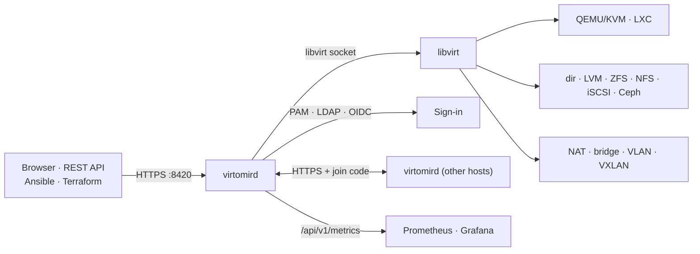

<p align="center"></p>

<h1 align="center">VirtoMir</h1>

<p align="center"><strong>A Detailed Control Deck for Virtual Environments.</strong><br>
Современная веб-панель управления для KVM / QEMU / libvirt, которая устанавливается на уже работающий у вас Linux.</p>

<p align="center">
<a href="../../README.md">English</a> ·
<a href="README.tr.md">Türkçe</a> ·
<a href="README.de.md">Deutsch</a> ·
<a href="README.fr.md">Français</a> ·
<a href="README.es.md">Español</a> ·
<a href="README.pt-BR.md">Português</a> ·
<a href="README.it.md">Italiano</a> ·
<a href="README.pl.md">Polski</a> ·
<a href="README.nl.md">Nederlands</a> ·
Русский ·
<a href="README.uk.md">Українська</a> ·
<a href="README.zh-CN.md">简体中文</a> ·
<a href="README.zh-TW.md">繁體中文</a> ·
<a href="README.ja.md">日本語</a> ·
<a href="README.ko.md">한국어</a> ·
<a href="README.ar.md">العربية</a>
</p>

<p align="center">
  <a href="https://github.com/onurbaydas/VirtoMir/releases/latest"></a>
  <a href="https://github.com/onurbaydas/VirtoMir/actions/workflows/ci.yml"></a>
  <a href="../../LICENSE"></a>
  
  <a href="https://scorecard.dev/viewer/?uri=github.com/onurbaydas/VirtoMir"></a>
  <a href="https://www.bestpractices.dev/projects/16980"></a>
  <a href="https://registry.terraform.io/providers/onurbaydas/virtomir/latest"></a>
</p>

<p align="center">
  <a href="https://github.com/onurbaydas/VirtoMir/stargazers"></a>
  <a href="https://github.com/onurbaydas/VirtoMir/fork"></a>
  <a href="https://github.com/onurbaydas/VirtoMir/subscription"></a>
</p>

<p align="center">
  <a href="https://onurbaydas.github.io/VirtoMir/demo/"><b>▶ Живое демо</b></a> ·
  <a href="#install">Установка</a> ·
  <a href="../try-in-a-vm.md">Попробовать в ВМ</a> ·
  <a href="../features.md">Все возможности</a> ·
  <a href="#contribute">Участвовать</a> ·
  <a href="https://github.com/onurbaydas/VirtoMir/discussions">Обсуждения</a>
</p>

<table align="center">
<tr><td align="center"><h3>1</h3></td><td align="center"><h3>0</h3></td><td align="center"><h3>0</h3></td><td align="center"><h3>90+</h3></td><td align="center"><h3>16</h3></td><td align="center"><h3>1 s</h3></td></tr>
<tr><td align="center"><sub>бинарник со встроенным UI</sub></td><td align="center"><sub>баз данных</sub></td><td align="center"><sub>агентов в ВМ</sub></td><td align="center"><sub>возможностей</sub></td><td align="center"><sub>языков README</sub></td><td align="center"><sub>живые графики</sub></td></tr>
</table>

> Этот перевод поддерживается сообществом и может отставать от [английского README](../../README.md).

<p align="center"></p>

VirtoMir старается быть двумя вещами сразу:

- **Без усилий.** Создайте и запустите ВМ, почти ничего не зная о виртуализации.
- **Пугающе подробный.** Любая настройка libvirt доступна, изменяема и, да, её можно сломать.

Один исполняемый файл со встроенным веб-интерфейсом: без отдельного дистрибутива, без базы данных, без агентов внутри машин. Установите на хост с KVM, откройте `https://<хост>:8420/` и войдите под своей учётной записью Linux.

> **Состояние: 1.2.** Проверено на Ubuntu 26.04 и Fedora 44, на одиночных хостах и небольших кластерах. Высокая доступность ещё не проверялась на настоящем оборудовании с BMC, импорт из VMware экспериментальный. С версии 1.0 новые функции не добавляются: вся работа идёт на надёжность повседневного использования на одном хосте. Проверьте его, прежде чем доверять продакшн, и расскажите в [#1](https://github.com/onurbaydas/VirtoMir/issues/1), что не работает.

> [!TIP]
> **Нравится, куда всё идёт? Поставьте ⭐.** VirtoMir делает один человек: по звёздам его находят другие, и они поддерживают проект. Чтобы узнавать о новых версиях: **Watch → Custom → Releases**.

> [!NOTE]
> **Попробовали? Расскажите за 30 секунд. (без регистрации)** [Откройте форму быстрого отзыва](https://tally.so/r/db904z), выберите 😀 😐 😞 или 💡 и, если хотите, добавьте фразу. Внутри VirtoMir кнопка 💬 внизу боковой панели открывает ту же форму с уже заполненными версиями. Если есть аккаунт GitHub, подойдёт и [форма issue](https://github.com/onurbaydas/VirtoMir/issues/new?template=quick_feedback.yml).

## Попробуйте за 30 секунд

| | |
|---|---|
| **Просто посмотреть** | Пощёлкайте [онлайн-демо](https://onurbaydas.github.io/VirtoMir/demo/): вымышленные хосты, ничего не нужно устанавливать. |
| **Одноразовый хост** | Одна команда создаёт тестовую ВМ с VirtoMir внутри: [Попробуйте VirtoMir, не трогая свои серверы](../try-in-a-vm.md). |
| **Debian / Ubuntu** | `sudo apt install ./virtomir_1.2.3_amd64.deb` — [последний релиз](https://github.com/onurbaydas/VirtoMir/releases/latest) |
| **Fedora / RHEL** | `sudo dnf install ./virtomir-1.2.3-1.x86_64.rpm` — [последний релиз](https://github.com/onurbaydas/VirtoMir/releases/latest) |

Пакет сам доустановит libvirt и QEMU/KVM, если их нет, откроет порт 8420 и запустит службу. Больше ничего вводить не нужно.

## Почему VirtoMir?

| | **VirtoMir** | Cockpit Machines | virt-manager | Proxmox VE |
|---|:---:|:---:|:---:|:---:|
| Ставится на уже имеющийся Linux | ✅ | ✅ | ✅ | ❌ это сама ОС |
| В браузере | ✅ | ✅ | ❌ настольное приложение | ✅ |
| Любая настройка libvirt, с XML-диффом перед сохранением | ✅ | ➖ базовые настройки | ✅ | ➖ не libvirt |
| История каждого изменения, откат в один клик | ✅ | ❌ | ❌ | ❌ |
| Живые графики и 30 дней истории из коробки | ✅ | ➖ | ❌ | ✅ |
| Снимки, резервные копии по расписанию, внешние копии | ✅ | ➖ снимки | ➖ снимки | ✅ |
| Несколько хостов, живая миграция, высокая доступность | ✅ | ❌ | ➖ миграция | ✅ |

VirtoMir посередине: прост, как Cockpit, и дотошен, как «сырой» XML libvirt.

## Главное

<table>
<tr>
<td width="50%" valign="top">
<h3>🖥️ Машины во всех подробностях</h3>
Мастер спрашивает только то, что нужно любой машине (ISO, облачный образ с cloud-init или существующий диск), а за ним — все настройки libvirt: топология и привязка CPU, huge pages, NUMA, проброс PCI/USB, vGPU, TPM, Secure Boot, консоль в браузере через VNC или SPICE.
<br><br>
</td>
<td width="50%" valign="top">
<h3>🕰️ Что изменилось и когда</h3>
Хранится каждая версия определения машины, включая изменения через <code>virsh</code>. Хронология собирает события жизненного цикла, изменения, снимки, резервные копии и оповещения в один список: ответ на «вчера же работало».
<br><br>
</td>
</tr>
<tr>
<td valign="top">
<h3>💾 Хранилища и сети</h3>
Пулы в каталогах, LVM, ZFS, NFS, iSCSI и Ceph; NFS, SMB и iSCSI-цели в локальной сети находятся и подключаются в один клик. Сети NAT, мосты (в том числе через Wi-Fi), VLAN и VXLAN, а изменения сети самого хоста откатываются сами, если вы потеряли связь.
<br><br>
</td>
<td valign="top">
<h3>🛟 Резервные копии, которые восстанавливаются</h3>
Живые копии без простоя, расписания с хранением, восстановление как новая машина, проверка контрольных сумм. Внешние копии через restic в S3, B2, Azure, SFTP или на диск — зашифрованные и с дедупликацией.
<br><br>
</td>
</tr>
<tr>
<td valign="top">
<h3>🌐 Много хостов — один вид</h3>
Объединяйте хосты одноразовым кодом: без общей базы данных и дополнительных служб. Живая миграция, планировщик, выравнивающий нагрузку, режим обслуживания, поэтапное обновление и высокая доступность с кворумом и фенсингом.
<br><br>
</td>
<td valign="top">
<h3>🔐 Для общего хоста</h3>
Вход через учётные записи Linux (PAM), LDAP/AD или OpenID Connect, двухэтапный вход, роли, проекты с квотами, API-токены и журнал действий, защищённый от подделки. HTTPS по умолчанию.
<br><br>
</td>
</tr>
</table>

Всё остальное — от оповещений и отчётов до кластеров Kubernetes и импорта из VMware — в **[полном списке возможностей](../features.md)** (на английском).

## Как это работает



- **Одна служба, `virtomird`**, работает от root, потому что обращается к системному сокету libvirt и проверяет пароли через PAM.
- **Собственное состояние в `/var/lib/virtomir`**: сертификат, история метрик, настройки, журнал действий. Без базы данных.
- **Никогда сама не трогает существующие машины.** Читает то, что есть в libvirt, и меняет только то, что вы просите; каждое изменение попадает в журнал действий.
- **Удаляется чисто:** `sudo apt purge virtomir` удаляет службу и её состояние; машины, диски и сети остаются.

<a id="install"></a>
## Установка

```sh
# Debian / Ubuntu
sudo install -d -m 0755 /etc/apt/keyrings
sudo curl -fsSL -o /etc/apt/keyrings/virtomir.asc https://onurbaydas.github.io/VirtoMir/virtomir.asc
echo "deb [signed-by=/etc/apt/keyrings/virtomir.asc] https://onurbaydas.github.io/VirtoMir/apt stable main" | sudo tee /etc/apt/sources.list.d/virtomir.list
sudo apt update && sudo apt install virtomir

# Fedora / RHEL 10
sudo curl -fsSL -o /etc/yum.repos.d/virtomir.repo https://onurbaydas.github.io/VirtoMir/virtomir.repo
sudo dnf install virtomir
```

Затем откройте `https://<хост>:8420/` и войдите как `root` или администратор (группы `sudo`, `wheel` или `libvirt`). Браузер один раз попросит принять самоподписанный сертификат. Первого администратора проведут по тому, чего хосту ещё не хватает: хранилище, место для резервных копий, первый образ.

Пакеты, tar-архив, настройка и сборка из исходников: [английский README](../../README.md#install).

О проблемах безопасности сообщайте приватно, см. [SECURITY.md](../../SECURITY.md).

<a id="contribute"></a>
## Нужна помощь

VirtoMir создаёт один человек вместе с ИИ-агентами для программирования. Поэтому он вырос так быстро, и поэтому ему нужно больше глаз, чем обычному хобби-проекту.

- 🧪 **Запустите** на Debian, более старой Ubuntu, Rocky/Alma или Arch и расскажите, что ломается.
- 🔍 **Проверьте чувствительные к безопасности части**: он работает от root и отвечает за вход (`internal/auth`, `internal/api`).
- 🔧 **Проверьте то, до чего мы не дотягиваемся**: проброс GPU, Ceph, настоящие BMC, VMware.
- 🌍 **Переводите**: интерфейс ([`web/src/lib/locales`](../../web/src/lib/locales)) или этот README ([`docs/i18n`](.)).
- 💻 **Пишите код**: сервер не нужен, `cd web && npm install && npm run dev:demo` запускает весь интерфейс на имитированном кластере. Начните с [good first issue](https://github.com/onurbaydas/VirtoMir/issues?q=is%3Aissue+is%3Aopen+label%3A%22good+first+issue%22), см. [CONTRIBUTING.md](../../CONTRIBUTING.md).

Идеи и вопросы: [Обсуждения](https://github.com/onurbaydas/VirtoMir/discussions). Нашли ошибку? [Откройте issue](https://github.com/onurbaydas/VirtoMir/issues/new/choose).

## Благодарности

<p><br>Благодарим Mega Bilgisayar.</p>

<p align="center">
  <b>Если VirtoMir вам полезен, звезда поможет другим его найти.</b><br><br>
  <a href="https://github.com/onurbaydas/VirtoMir/stargazers"></a>
  <a href="https://github.com/onurbaydas/VirtoMir/fork"></a>
  <a href="https://github.com/onurbaydas/VirtoMir/subscription"></a>
</p>

## Лицензия

VirtoMir — свободное ПО: **GNU Affero General Public License v3.0 или новее**, см. [LICENSE](../../LICENSE). Его можно использовать, изучать, изменять и распространять; если вы предоставляете изменённый VirtoMir другим по сети, вы должны предоставить им и исходный код.

Copyright © 2026 Onur Baydas. Для коммерческой лицензии без обязательств AGPL свяжитесь с автором через GitHub. Вклад принимается на условиях [Contributor License Agreement](../../CLA.md), который сохраняет возможность обеих лицензий.
