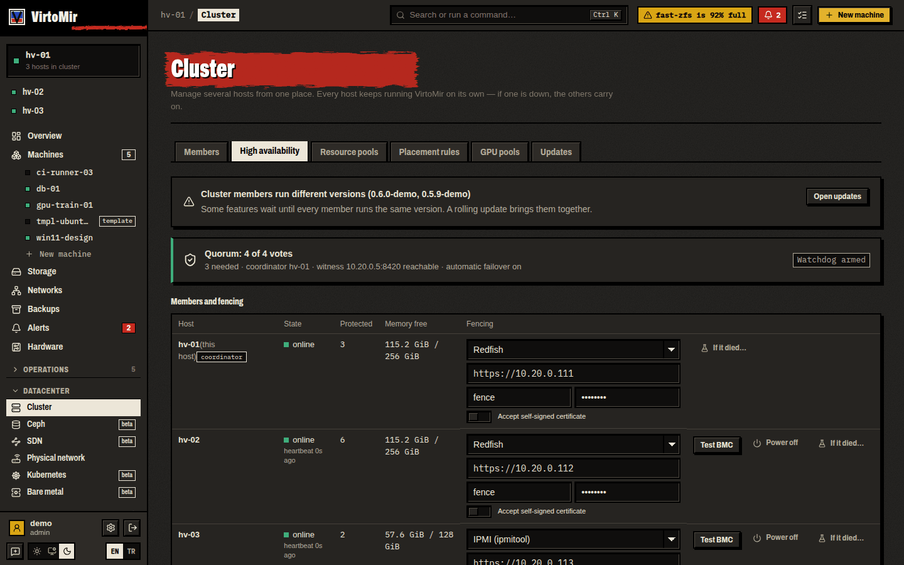
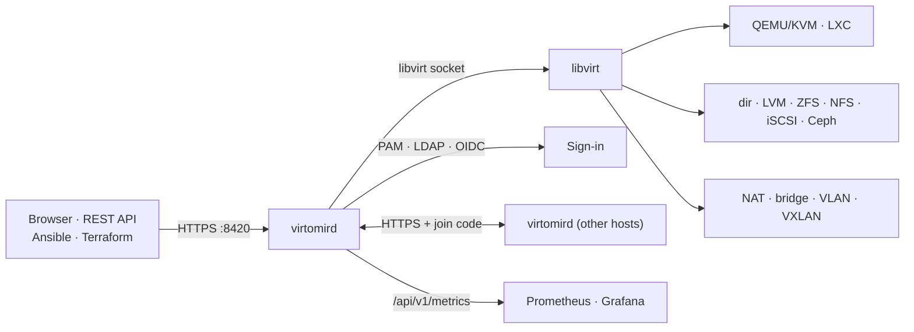

<p align="center"></p>

<h1 align="center">VirtoMir</h1>

<p align="center"><strong>A Detailed Control Deck for Virtual Environments.</strong><br>
KVM / QEMU / libvirt için modern bir web kontrol paneli; zaten kullandığın Linux'a kurulur.</p>

<p align="center">
<a href="../../README.md">English</a> ·
Türkçe ·
<a href="README.de.md">Deutsch</a> ·
<a href="README.fr.md">Français</a> ·
<a href="README.es.md">Español</a> ·
<a href="README.pt-BR.md">Português</a> ·
<a href="README.it.md">Italiano</a> ·
<a href="README.pl.md">Polski</a> ·
<a href="README.nl.md">Nederlands</a> ·
<a href="README.ru.md">Русский</a> ·
<a href="README.uk.md">Українська</a> ·
<a href="README.zh-CN.md">简体中文</a> ·
<a href="README.zh-TW.md">繁體中文</a> ·
<a href="README.ja.md">日本語</a> ·
<a href="README.ko.md">한국어</a> ·
<a href="README.ar.md">العربية</a>
</p>

<p align="center">
  <a href="https://github.com/onurbaydas/VirtoMir/releases/latest"></a>
  <a href="https://github.com/onurbaydas/VirtoMir/actions/workflows/ci.yml"></a>
  <a href="../../LICENSE"></a>
  
</p>

<p align="center">
  <a href="https://github.com/onurbaydas/VirtoMir/stargazers"></a>
  <a href="https://github.com/onurbaydas/VirtoMir/fork"></a>
  <a href="https://github.com/onurbaydas/VirtoMir/subscription"></a>
</p>

<p align="center">
  <a href="https://onurbaydas.github.io/VirtoMir/demo/"><b>▶ Canlı demo</b></a> ·
  <a href="#install">Kurulum</a> ·
  <a href="../try-in-a-vm.md">Bir VM'de dene</a> ·
  <a href="../features.md">Tüm özellikler</a> ·
  <a href="#contribute">Katkıda bulun</a> ·
  <a href="https://github.com/onurbaydas/VirtoMir/discussions">Tartışmalar</a>
</p>

<table align="center">
<tr><td align="center"><h3>1</h3></td><td align="center"><h3>0</h3></td><td align="center"><h3>0</h3></td><td align="center"><h3>90+</h3></td><td align="center"><h3>16</h3></td><td align="center"><h3>1 s</h3></td></tr>
<tr><td align="center"><sub>ikili, arayüz içinde</sub></td><td align="center"><sub>veritabanı</sub></td><td align="center"><sub>VM'lerinde ajan</sub></td><td align="center"><sub>özellik</sub></td><td align="center"><sub>README dili</sub></td><td align="center"><sub>canlı grafikler</sub></td></tr>
</table>

> Bu çeviri topluluk tarafından sürdürülür ve [İngilizce README](../../README.md)'nin gerisinde kalabilir.

<p align="center"></p>

VirtoMir aynı anda iki şey olmaya çalışır:

- **Zahmetsiz.** Sanallaştırmayı pek bilmeden bir VM oluşturup çalıştırırsın.
- **Korkutucu derecede ayrıntılı.** libvirt'in her ayarına ulaşılabilir, değiştirilebilir ve evet, bozulabilir.

Web arayüzü içine gömülü tek bir ikili dosyadır: ayrı bir dağıtım, veritabanı ya da makinelerinin içinde ajan yok. KVM çalışan bir hosta kur, `https://<host>:8420/` adresini aç ve Linux hesabınla giriş yap.

> **Durum: 1.2.** Ubuntu 26.04 ve Fedora 44 üzerinde, tek host ve küçük cluster'larda test edildi. Yüksek erişilebilirlik henüz gerçek BMC donanımında denenmedi, VMware içe aktarma deneyseldir. 1.0'dan beri yeni özellik eklenmiyor: emek, günlük tek host kullanımını sağlamlaştırmaya gidiyor. Üretimde güvenmeden önce test et ve neyin bozulduğunu [#1](https://github.com/onurbaydas/VirtoMir/issues/1)'de anlat.

> [!TIP]
> **Gidişatı beğendin mi? Bir ⭐ ver.** VirtoMir'i tek bir kişi geliştiriyor: başkaları onu yıldızlar sayesinde buluyor ve proje yıldızlarla ayakta kalıyor. Yeni sürümlerden haberdar olmak için **Watch → Custom → Releases**'e tıkla.

> [!NOTE]
> **Denedin mi? 30 saniyede anlat.** [Hızlı geri bildirim formunu aç](https://github.com/onurbaydas/VirtoMir/issues/new?template=quick_feedback.yml), 😀 😐 😞 ya da 💡 seç, istersen bir cümle ekle. VirtoMir'in içinde kenar çubuğunun altındaki 💬 düğmesi aynı formu sürüm bilgilerin doldurulmuş olarak açar.

## 30 saniyede dene

| | |
|---|---|
| **Sadece bak** | [Çevrimiçi demoya](https://onurbaydas.github.io/VirtoMir/demo/) tıkla: uydurma hostlar, kurulacak bir şey yok. |
| **Tek kullanımlık host** | Tek komutla içinde VirtoMir olan bir test VM'i: [Sunucularına dokunmadan VirtoMir'i dene](../try-in-a-vm.md). |
| **Debian / Ubuntu** | `sudo apt install ./virtomir_1.2.1_amd64.deb` — [son sürüm](https://github.com/onurbaydas/VirtoMir/releases/latest) |
| **Fedora / RHEL** | `sudo dnf install ./virtomir-1.2.1-1.x86_64.rpm` — [son sürüm](https://github.com/onurbaydas/VirtoMir/releases/latest) |

Paket eksikse libvirt ve QEMU/KVM'i kendisi kurar, 8420 portunu açar ve servisi başlatır. Elle yazılacak başka bir şey kalmaz.

## Neden VirtoMir?

| | **VirtoMir** | Cockpit Machines | virt-manager | Proxmox VE |
|---|:---:|:---:|:---:|:---:|
| Zaten kullandığın Linux'a kurulur | ✅ | ✅ | ✅ | ❌ kendisi işletim sistemi |
| Tarayıcıda çalışır | ✅ | ✅ | ❌ masaüstü uygulaması | ✅ |
| libvirt'in her ayarı, kaydetmeden önce XML farkıyla | ✅ | ➖ temel ayarlar | ✅ | ➖ libvirt değil |
| Her değişikliğin geçmişi, tek tıkla geri alma | ✅ | ❌ | ❌ | ❌ |
| Canlı grafikler ve 30 günlük geçmiş hazır gelir | ✅ | ➖ | ❌ | ✅ |
| Snapshot, zamanlanmış yedek, uzak kopya | ✅ | ➖ snapshot | ➖ snapshot | ✅ |
| Birden çok host, canlı taşıma, yüksek erişilebilirlik | ✅ | ❌ | ➖ taşıma | ✅ |

VirtoMir ortada durur: Cockpit kadar kolay, ham libvirt XML'i kadar eksiksiz.

## Öne çıkanlar

<table>
<tr>
<td width="50%" valign="top">
<h3>🖥️ Makineler, derinlemesine</h3>
Yalnızca her makinenin ihtiyacını soran bir sihirbaz (ISO, cloud-init'li cloud imajı ya da mevcut bir disk) ve arkasında libvirt'in her ayarı: CPU topolojisi ve pinning, huge pages, NUMA, PCI/USB passthrough, vGPU, TPM, Secure Boot, VNC ya da SPICE ile tarayıcıda konsol.
<br><br>
</td>
<td width="50%" valign="top">
<h3>🕰️ Ne değişti, ne zaman</h3>
Bir makine tanımının her sürümü saklanır, <code>virsh</code> ile yapılan değişiklikler de. Zaman çizelgesi yaşam döngüsü olaylarını, değişiklikleri, snapshot'ları, yedekleri ve alarmları tek listede gösterir: "dün çalışıyordu" sorusunun cevabı.
<br><br>
</td>
</tr>
<tr>
<td valign="top">
<h3>💾 Depolama ve ağlar</h3>
Dizin, LVM, ZFS, NFS, iSCSI ve Ceph havuzları; ağdaki NFS, SMB ve iSCSI hedefleri bulunur ve tek tıkla bağlanır. NAT, köprü (Wi-Fi'da da), VLAN ve VXLAN ağları; bağlantıyı kaybedersen kendini geri alan host ağ değişiklikleri.
<br><br>
</td>
<td valign="top">
<h3>🛟 Geri dönen yedekler</h3>
Kesintisiz canlı yedek, saklama kurallı zamanlamalar, yeni makine olarak geri yükleme, doğrulanan sağlama toplamları. restic ile S3, B2, Azure, SFTP ya da diske şifreli ve tekilleştirilmiş uzak kopyalar.
<br><br>
</td>
</tr>
<tr>
<td valign="top">
<h3>🌐 Birden çok host, tek görünüm</h3>
Hostları tek kullanımlık bir kodla birleştir: ortak veritabanı ya da ek servis yok. Canlı taşıma, yükü dengeleyen bir zamanlayıcı, bakım modu, sırayla güncelleme ve quorum ile fencing'li yüksek erişilebilirlik.
<br><br>
</td>
<td valign="top">
<h3>🔐 Paylaşılan host için</h3>
Linux hesapları (PAM), LDAP/AD ya da OpenID Connect ile giriş, iki adımlı doğrulama, roller, kotalı projeler, API token'ları ve kurcalanırsa fark edilen etkinlik günlüğü. Varsayılan olarak HTTPS.
<br><br>
</td>
</tr>
</table>

Geri kalan her şey, alarmlardan raporlara, Kubernetes cluster'larından VMware içe aktarmaya kadar, **[tam özellik listesinde](../features.md)** (İngilizce).

## Nasıl çalışır



- **Tek servis, `virtomird`**, root olarak çalışır; çünkü sistemin libvirt soketiyle konuşur ve parolaları PAM ile denetler.
- **Kendi durumunu `/var/lib/virtomir`'de tutar**: sertifika, metrik geçmişi, ayarlar, etkinlik günlüğü. Veritabanı yok.
- **Mevcut makinelerine kendi kendine dokunmaz.** libvirt'te olanı okur ve yalnızca istediğini değiştirir; her değişiklik etkinlik günlüğündedir.
- **Temiz kaldırılır:** `sudo apt purge virtomir` servisi ve durumunu siler; makinelerin, disklerin ve ağların yerinde kalır.

<a id="install"></a>
## Kurulum

```sh
# Debian / Ubuntu
sudo install -d -m 0755 /etc/apt/keyrings
sudo curl -fsSL -o /etc/apt/keyrings/virtomir.asc https://onurbaydas.github.io/VirtoMir/virtomir.asc
echo "deb [signed-by=/etc/apt/keyrings/virtomir.asc] https://onurbaydas.github.io/VirtoMir/apt stable main" | sudo tee /etc/apt/sources.list.d/virtomir.list
sudo apt update && sudo apt install virtomir

# Fedora / RHEL 10
sudo curl -fsSL -o /etc/yum.repos.d/virtomir.repo https://onurbaydas.github.io/VirtoMir/virtomir.repo
sudo dnf install virtomir
```

Sonra `https://<host>:8420/` adresini aç ve `root` ya da yönetici olarak (`sudo`, `wheel` veya `libvirt` grubu) giriş yap. Tarayıcı kendinden imzalı sertifikayı bir kez onaylamanı ister. İlk giriş yapan yöneticiye hostta eksik olanlar adım adım gösterilir: depolama, yedek yeri, ilk imaj.

Paketler, tarball, yapılandırma ve kaynaktan derleme: [İngilizce README](../../README.md#install).

Güvenlik sorunlarını lütfen gizli olarak bildir, bkz. [SECURITY.md](../../SECURITY.md).

<a id="contribute"></a>
## Yardım aranıyor

VirtoMir'i tek bir kişi, yapay zekâ kodlama ajanlarıyla birlikte geliştiriyor. Bu kadar hızlı büyümesinin sebebi bu; tipik bir yan projeden daha fazla göze ihtiyaç duymasının sebebi de bu.

- 🧪 **Çalıştır**: Debian, eski bir Ubuntu, Rocky/Alma ya da Arch üzerinde; neyin bozulduğunu anlat.
- 🔍 **Güvenliğe duyarlı kısımları incele**: root olarak çalışır ve girişi yönetir (`internal/auth`, `internal/api`).
- 🔧 **Bizim ulaşamadığımızı test et**: GPU passthrough, Ceph, gerçek BMC'ler, VMware.
- 🌍 **Çevir**: arayüzü ([`web/src/lib/locales`](../../web/src/lib/locales)) ya da bu README'yi ([`docs/i18n`](.)).
- 💻 **Kod yaz**: sunucu gerekmez, `cd web && npm install && npm run dev:demo` tüm arayüzü sahte bir cluster'a karşı çalıştırır. Bir [good first issue](https://github.com/onurbaydas/VirtoMir/issues?q=is%3Aissue+is%3Aopen+label%3A%22good+first+issue%22) ile başla, bkz. [CONTRIBUTING.md](../../CONTRIBUTING.md).

Fikirler ve sorular: [Tartışmalar](https://github.com/onurbaydas/VirtoMir/discussions). Hata mı buldun? [Bir issue aç](https://github.com/onurbaydas/VirtoMir/issues/new/choose).

## Teşekkürler

<p><br>Mega Bilgisayar'a teşekkürler.</p>

<p align="center">
  <b>VirtoMir işine yarıyorsa, bir yıldız başkalarının da onu bulmasını sağlar.</b><br><br>
  <a href="https://github.com/onurbaydas/VirtoMir/stargazers"></a>
  <a href="https://github.com/onurbaydas/VirtoMir/fork"></a>
  <a href="https://github.com/onurbaydas/VirtoMir/subscription"></a>
</p>

## Lisans

VirtoMir özgür yazılımdır: **GNU Affero Genel Kamu Lisansı v3.0 veya sonrası**, bkz. [LICENSE](../../LICENSE). Kullanabilir, inceleyebilir, değiştirebilir ve paylaşabilirsin; değiştirilmiş bir VirtoMir'i başkalarına ağ üzerinden sunarsan kaynak kodunu da onlara sunmalısın.

Copyright © 2026 Onur Baydas. AGPL yükümlülükleri olmayan ticari lisans için yazara GitHub üzerinden ulaş. Katkılar, iki lisansı da mümkün kılan [Katkıda Bulunan Lisans Sözleşmesi](../../CLA.md) ile kabul edilir.
