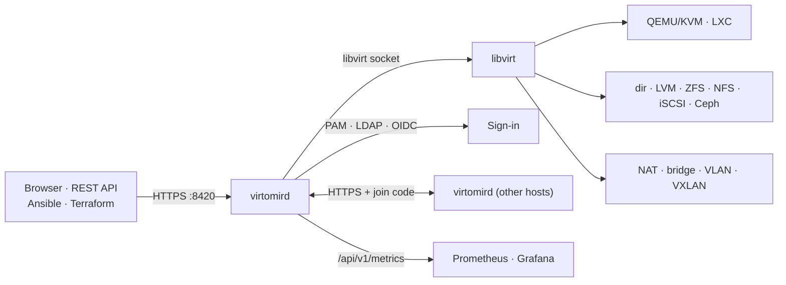

<p align="center"></p>

<h1 align="center">VirtoMir</h1>

<p align="center"><strong>A Detailed Control Deck for Virtual Environments.</strong><br>
Сучасна веб-панель керування для KVM / QEMU / libvirt, що встановлюється на Linux, який у вас уже працює.</p>

<p align="center">
<a href="../../README.md">English</a> ·
<a href="README.tr.md">Türkçe</a> ·
<a href="README.de.md">Deutsch</a> ·
<a href="README.fr.md">Français</a> ·
<a href="README.es.md">Español</a> ·
<a href="README.pt-BR.md">Português</a> ·
<a href="README.it.md">Italiano</a> ·
<a href="README.pl.md">Polski</a> ·
<a href="README.nl.md">Nederlands</a> ·
<a href="README.ru.md">Русский</a> ·
Українська ·
<a href="README.zh-CN.md">简体中文</a> ·
<a href="README.zh-TW.md">繁體中文</a> ·
<a href="README.ja.md">日本語</a> ·
<a href="README.ko.md">한국어</a> ·
<a href="README.ar.md">العربية</a>
</p>

<p align="center">
  <a href="https://github.com/onurbaydas/VirtoMir/releases/latest"></a>
  <a href="https://github.com/onurbaydas/VirtoMir/actions/workflows/ci.yml"></a>
  <a href="../../LICENSE"></a>
  
</p>

<p align="center">
  <a href="https://github.com/onurbaydas/VirtoMir/stargazers"></a>
  <a href="https://github.com/onurbaydas/VirtoMir/fork"></a>
  <a href="https://github.com/onurbaydas/VirtoMir/subscription"></a>
</p>

<p align="center">
  <a href="https://onurbaydas.github.io/VirtoMir/demo/"><b>▶ Живе демо</b></a> ·
  <a href="#install">Встановлення</a> ·
  <a href="../try-in-a-vm.md">Спробувати у ВМ</a> ·
  <a href="../features.md">Усі можливості</a> ·
  <a href="#contribute">Долучитися</a> ·
  <a href="https://github.com/onurbaydas/VirtoMir/discussions">Обговорення</a>
</p>

<table align="center">
<tr><td align="center"><h3>1</h3></td><td align="center"><h3>0</h3></td><td align="center"><h3>0</h3></td><td align="center"><h3>90+</h3></td><td align="center"><h3>16</h3></td><td align="center"><h3>1 s</h3></td></tr>
<tr><td align="center"><sub>бінарник із вбудованим UI</sub></td><td align="center"><sub>баз даних</sub></td><td align="center"><sub>агентів у ВМ</sub></td><td align="center"><sub>можливостей</sub></td><td align="center"><sub>мов README</sub></td><td align="center"><sub>живі графіки</sub></td></tr>
</table>

> Цей переклад підтримує спільнота, і він може відставати від [англійського README](../../README.md).

<p align="center"></p>

VirtoMir намагається бути двома речами водночас:

- **Без зусиль.** Створіть і запустіть ВМ, майже нічого не знаючи про віртуалізацію.
- **Моторошно детальний.** Кожне налаштування libvirt доступне, змінюване і, так, його можна зламати.

Один виконуваний файл із вбудованим веб-інтерфейсом: без окремого дистрибутива, без бази даних, без агентів усередині машин. Встановіть на хост із KVM, відкрийте `https://<хост>:8420/` і увійдіть своїм обліковим записом Linux.

> **Стан: 1.2.** Перевірено на Ubuntu 26.04 і Fedora 44, на окремих хостах і невеликих кластерах. Високу доступність ще не перевіряли на справжньому обладнанні з BMC, імпорт із VMware експериментальний. Від версії 1.0 нові функції не додаються: уся робота йде на надійність щоденного використання на одному хості. Перевірте його, перш ніж довіряти продакшн, і розкажіть у [#1](https://github.com/onurbaydas/VirtoMir/issues/1), що не працює.

> [!TIP]
> **Подобається напрям? Поставте ⭐.** VirtoMir робить одна людина: за зірками його знаходять інші, і вони підтримують проєкт. Щоб дізнаватися про нові версії: **Watch → Custom → Releases**.

> [!NOTE]
> **Спробували? Розкажіть за 30 секунд.** [Відкрийте форму швидкого відгуку](https://github.com/onurbaydas/VirtoMir/issues/new?template=quick_feedback.yml), виберіть 😀 😐 😞 або 💡 і, якщо хочете, додайте речення. У VirtoMir кнопка 💬 внизу бічної панелі відкриває ту саму форму з уже заповненими версіями.

## Спробуйте за 30 секунд

| | |
|---|---|
| **Просто подивитися** | Поклацайте [онлайн-демо](https://onurbaydas.github.io/VirtoMir/demo/): вигадані хости, нічого не треба встановлювати. |
| **Одноразовий хост** | Одна команда створює тестову ВМ із VirtoMir усередині: [Спробуйте VirtoMir, не чіпаючи своїх серверів](../try-in-a-vm.md). |
| **Debian / Ubuntu** | `sudo apt install ./virtomir_1.2.1_amd64.deb` — [останній реліз](https://github.com/onurbaydas/VirtoMir/releases/latest) |
| **Fedora / RHEL** | `sudo dnf install ./virtomir-1.2.1-1.x86_64.rpm` — [останній реліз](https://github.com/onurbaydas/VirtoMir/releases/latest) |

Пакет сам довстановить libvirt і QEMU/KVM, якщо їх немає, відкриє порт 8420 і запустить службу. Більше нічого вводити не потрібно.

## Чому VirtoMir?

| | **VirtoMir** | Cockpit Machines | virt-manager | Proxmox VE |
|---|:---:|:---:|:---:|:---:|
| Встановлюється на наявний Linux | ✅ | ✅ | ✅ | ❌ це сама ОС |
| У браузері | ✅ | ✅ | ❌ настільний застосунок | ✅ |
| Кожне налаштування libvirt, з XML-діфом перед збереженням | ✅ | ➖ базові налаштування | ✅ | ➖ не libvirt |
| Історія кожної зміни, відкат одним кліком | ✅ | ❌ | ❌ | ❌ |
| Живі графіки й 30 днів історії з коробки | ✅ | ➖ | ❌ | ✅ |
| Знімки, резервні копії за розкладом, зовнішні копії | ✅ | ➖ знімки | ➖ знімки | ✅ |
| Кілька хостів, жива міграція, висока доступність | ✅ | ❌ | ➖ міграція | ✅ |

VirtoMir посередині: простий, як Cockpit, і ретельний, як «сирий» XML libvirt.

## Головне

<table>
<tr>
<td width="50%" valign="top">
<h3>🖥️ Машини в усіх подробицях</h3>
Майстер питає лише те, що потрібно будь-якій машині (ISO, хмарний образ із cloud-init або наявний диск), а за ним — усі налаштування libvirt: топологія та прив'язка CPU, huge pages, NUMA, прокидання PCI/USB, vGPU, TPM, Secure Boot, консоль у браузері через VNC або SPICE.
<br><br>
</td>
<td width="50%" valign="top">
<h3>🕰️ Що змінилося і коли</h3>
Зберігається кожна версія визначення машини, зокрема зміни через <code>virsh</code>. Хронологія збирає події життєвого циклу, зміни, знімки, резервні копії та сповіщення в один список: відповідь на «вчора ж працювало».
<br><br>
</td>
</tr>
<tr>
<td valign="top">
<h3>💾 Сховища та мережі</h3>
Пули в каталогах, LVM, ZFS, NFS, iSCSI і Ceph; NFS-, SMB- та iSCSI-цілі в локальній мережі знаходяться й підключаються одним кліком. Мережі NAT, мости (зокрема через Wi-Fi), VLAN і VXLAN, а зміни мережі самого хоста відкочуються самі, якщо ви втратили зв'язок.
<br><br>
</td>
<td valign="top">
<h3>🛟 Резервні копії, що повертаються</h3>
Живі копії без простою, розклади зі зберіганням, відновлення як нова машина, перевірка контрольних сум. Зовнішні копії через restic у S3, B2, Azure, SFTP або на диск — зашифровані й із дедуплікацією.
<br><br>
</td>
</tr>
<tr>
<td valign="top">
<h3>🌐 Багато хостів — один вигляд</h3>
Об'єднуйте хости одноразовим кодом: без спільної бази даних і додаткових служб. Жива міграція, планувальник, що вирівнює навантаження, режим обслуговування, поетапне оновлення та висока доступність із кворумом і фенсингом.
<br><br>
</td>
<td valign="top">
<h3>🔐 Для спільного хоста</h3>
Вхід через облікові записи Linux (PAM), LDAP/AD або OpenID Connect, двоетапний вхід, ролі, проєкти з квотами, API-токени та журнал дій, захищений від підробки. HTTPS за замовчуванням.
<br><br>
</td>
</tr>
</table>

Усе інше — від сповіщень і звітів до кластерів Kubernetes та імпорту з VMware — у **[повному переліку можливостей](../features.md)** (англійською).

## Як це працює



- **Одна служба, `virtomird`**, працює від root, бо звертається до системного сокета libvirt і перевіряє паролі через PAM.
- **Власний стан у `/var/lib/virtomir`**: сертифікат, історія метрик, налаштування, журнал дій. Без бази даних.
- **Ніколи сама не чіпає наявні машини.** Читає те, що є в libvirt, і змінює лише те, про що ви просите; кожна зміна потрапляє до журналу дій.
- **Видаляється чисто:** `sudo apt purge virtomir` видаляє службу та її стан; машини, диски й мережі залишаються.

<a id="install"></a>
## Встановлення

```sh
# Debian / Ubuntu
sudo install -d -m 0755 /etc/apt/keyrings
sudo curl -fsSL -o /etc/apt/keyrings/virtomir.asc https://onurbaydas.github.io/VirtoMir/virtomir.asc
echo "deb [signed-by=/etc/apt/keyrings/virtomir.asc] https://onurbaydas.github.io/VirtoMir/apt stable main" | sudo tee /etc/apt/sources.list.d/virtomir.list
sudo apt update && sudo apt install virtomir

# Fedora / RHEL 10
sudo curl -fsSL -o /etc/yum.repos.d/virtomir.repo https://onurbaydas.github.io/VirtoMir/virtomir.repo
sudo dnf install virtomir
```

Потім відкрийте `https://<хост>:8420/` і увійдіть як `root` або адміністратор (групи `sudo`, `wheel` або `libvirt`). Браузер один раз попросить прийняти самопідписаний сертифікат. Першого адміністратора проведуть тим, чого хосту ще бракує: сховище, місце для резервних копій, перший образ.

Пакети, tar-архів, налаштування та збирання з вихідних кодів: [англійський README](../../README.md#install).

Про проблеми безпеки повідомляйте приватно, див. [SECURITY.md](../../SECURITY.md).

<a id="contribute"></a>
## Потрібна допомога

VirtoMir створює одна людина разом з ІІ-агентами для програмування. Тому він виріс так швидко, і тому йому потрібно більше очей, ніж звичайному хобі-проєкту.

- 🧪 **Запустіть** на Debian, старішій Ubuntu, Rocky/Alma або Arch і розкажіть, що ламається.
- 🔍 **Перевірте чутливі до безпеки частини**: він працює від root і відповідає за вхід (`internal/auth`, `internal/api`).
- 🔧 **Перевірте те, до чого ми не дотягуємося**: прокидання GPU, Ceph, справжні BMC, VMware.
- 🌍 **Перекладайте**: інтерфейс ([`web/src/lib/locales`](../../web/src/lib/locales)) або цей README ([`docs/i18n`](.)).
- 💻 **Пишіть код**: сервер не потрібен, `cd web && npm install && npm run dev:demo` запускає весь інтерфейс на імітованому кластері. Почніть із [good first issue](https://github.com/onurbaydas/VirtoMir/issues?q=is%3Aissue+is%3Aopen+label%3A%22good+first+issue%22), див. [CONTRIBUTING.md](../../CONTRIBUTING.md).

Ідеї та питання: [Обговорення](https://github.com/onurbaydas/VirtoMir/discussions). Знайшли помилку? [Відкрийте issue](https://github.com/onurbaydas/VirtoMir/issues/new/choose).

## Подяки

<p><br>Дякуємо Mega Bilgisayar.</p>

<p align="center">
  <b>Якщо VirtoMir вам корисний, зірка допоможе іншим його знайти.</b><br><br>
  <a href="https://github.com/onurbaydas/VirtoMir/stargazers"></a>
  <a href="https://github.com/onurbaydas/VirtoMir/fork"></a>
  <a href="https://github.com/onurbaydas/VirtoMir/subscription"></a>
</p>

## Ліцензія

VirtoMir — вільне ПЗ: **GNU Affero General Public License v3.0 або новіша**, див. [LICENSE](../../LICENSE). Його можна використовувати, вивчати, змінювати й поширювати; якщо ви надаєте змінений VirtoMir іншим через мережу, ви маєте надати їм і вихідний код.

Copyright © 2026 Onur Baydas. Щодо комерційної ліцензії без зобов'язань AGPL зв'яжіться з автором через GitHub. Внески приймаються на умовах [Contributor License Agreement](../../CLA.md), що зберігає можливість обох ліцензій.
