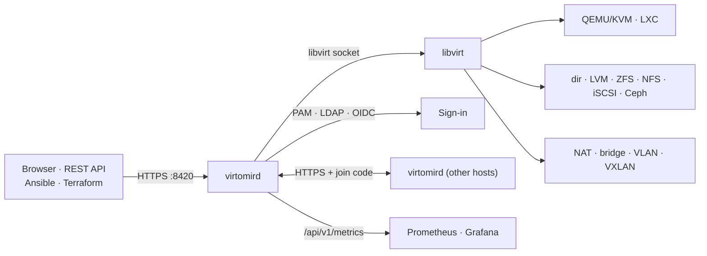

<p align="center"></p>

<h1 align="center">VirtoMir</h1>

<p align="center"><strong>A Detailed Control Deck for Virtual Environments.</strong><br>
一个面向 KVM / QEMU / libvirt 的现代 Web 控制面板，直接安装在你已经在用的 Linux 上。</p>

<p align="center">
<a href="../../README.md">English</a> ·
<a href="README.tr.md">Türkçe</a> ·
<a href="README.de.md">Deutsch</a> ·
<a href="README.fr.md">Français</a> ·
<a href="README.es.md">Español</a> ·
<a href="README.pt-BR.md">Português</a> ·
<a href="README.it.md">Italiano</a> ·
<a href="README.pl.md">Polski</a> ·
<a href="README.nl.md">Nederlands</a> ·
<a href="README.ru.md">Русский</a> ·
<a href="README.uk.md">Українська</a> ·
简体中文 ·
<a href="README.zh-TW.md">繁體中文</a> ·
<a href="README.ja.md">日本語</a> ·
<a href="README.ko.md">한국어</a> ·
<a href="README.ar.md">العربية</a>
</p>

<p align="center">
  <a href="https://github.com/onurbaydas/VirtoMir/releases/latest"></a>
  <a href="https://github.com/onurbaydas/VirtoMir/actions/workflows/ci.yml"></a>
  <a href="../../LICENSE"></a>
  
  <a href="https://scorecard.dev/viewer/?uri=github.com/onurbaydas/VirtoMir"></a>
  <a href="https://www.bestpractices.dev/projects/16980"></a>
  <a href="https://registry.terraform.io/providers/onurbaydas/virtomir/latest"></a>
</p>

<p align="center">
  <a href="https://github.com/onurbaydas/VirtoMir/stargazers"></a>
  <a href="https://github.com/onurbaydas/VirtoMir/fork"></a>
  <a href="https://github.com/onurbaydas/VirtoMir/subscription"></a>
</p>

<p align="center">
  <a href="https://onurbaydas.github.io/VirtoMir/demo/"><b>▶ 在线演示</b></a> ·
  <a href="#install">安装</a> ·
  <a href="../try-in-a-vm.md">在虚拟机里试用</a> ·
  <a href="../features.md">全部功能</a> ·
  <a href="#contribute">参与贡献</a> ·
  <a href="https://github.com/onurbaydas/VirtoMir/discussions">讨论区</a>
</p>

<table align="center">
<tr><td align="center"><h3>1</h3></td><td align="center"><h3>0</h3></td><td align="center"><h3>0</h3></td><td align="center"><h3>90+</h3></td><td align="center"><h3>16</h3></td><td align="center"><h3>1 s</h3></td></tr>
<tr><td align="center"><sub>个二进制文件，内置 UI</sub></td><td align="center"><sub>个数据库</sub></td><td align="center"><sub>虚拟机内代理</sub></td><td align="center"><sub>项功能</sub></td><td align="center"><sub>种 README 语言</sub></td><td align="center"><sub>实时图表</sub></td></tr>
</table>

> 本翻译由社区维护，可能落后于[英文 README](../../README.md)。

<p align="center"></p>

VirtoMir 想同时做到两件事：

- **毫不费力。** 不太懂虚拟化，也能创建并运行虚拟机。
- **细致得吓人。** libvirt 的每一项设置都能找到、能修改，当然，也能改坏。

一个内置 Web 界面的单一二进制文件：不需要专用发行版，没有数据库，虚拟机里也不装代理。在运行 KVM 的主机上安装，打开 `https://<主机>:8420/`，用你的 Linux 账户登录即可。

> **状态：1.2。** 已在 Ubuntu 26.04 和 Fedora 44 上测试，包括单台主机和小型集群。高可用尚未在真实的 BMC 硬件上验证，VMware 导入仍属实验性质。从 1.0 起不再添加新功能：精力都放在让单主机的日常使用更可靠。投入生产前请先测试，并在 [#1](https://github.com/onurbaydas/VirtoMir/issues/1) 中告诉我们哪里出了问题。

> [!TIP]
> **喜欢这个方向？点个 ⭐ 吧。** VirtoMir 由一个人开发：Star 能让更多人发现它，也让项目持续下去。想收到新版本通知，请点 **Watch → Custom → Releases**。

> [!NOTE]
> **试过了吗？花 30 秒告诉我们。 (无需账号)** [打开快速反馈表单](https://tally.so/r/db904z)，选 😀 😐 😞 或 💡，愿意的话再写一句。在 VirtoMir 里，侧边栏底部的 💬 按钮会打开同一个表单，并自动填好你的版本信息。 有 GitHub 账号的话，也可以用[议题表单](https://github.com/onurbaydas/VirtoMir/issues/new?template=quick_feedback.yml)。

## 30 秒上手

| | |
|---|---|
| **随便看看** | 点开[在线演示](https://onurbaydas.github.io/VirtoMir/demo/)：虚构的主机，无需安装。 |
| **一次性主机** | 一条命令即可得到一台装好 VirtoMir 的测试虚拟机：[不碰你的服务器就能试用 VirtoMir](../try-in-a-vm.md)。 |
| **Debian / Ubuntu** | `sudo apt install ./virtomir_1.2.3_amd64.deb` — [最新版本](https://github.com/onurbaydas/VirtoMir/releases/latest) |
| **Fedora / RHEL** | `sudo dnf install ./virtomir-1.2.3-1.x86_64.rpm` — [最新版本](https://github.com/onurbaydas/VirtoMir/releases/latest) |

如果缺少 libvirt 和 QEMU/KVM，安装包会自动安装它们，开放 8420 端口并启动服务。不需要再敲任何命令。

## 为什么选择 VirtoMir？

| | **VirtoMir** | Cockpit Machines | virt-manager | Proxmox VE |
|---|:---:|:---:|:---:|:---:|
| 安装在你现有的 Linux 上 | ✅ | ✅ | ✅ | ❌ 它本身就是操作系统 |
| 在浏览器中使用 | ✅ | ✅ | ❌ 桌面应用 | ✅ |
| libvirt 的全部设置，保存前显示 XML 差异 | ✅ | ➖ 基础设置 | ✅ | ➖ 不是 libvirt |
| 每次修改都有历史记录，一键恢复 | ✅ | ❌ | ❌ | ❌ |
| 内置实时图表和 30 天历史 | ✅ | ➖ | ❌ | ✅ |
| 快照、定时备份、异地副本 | ✅ | ➖ 快照 | ➖ 快照 | ✅ |
| 多主机、在线迁移、高可用 | ✅ | ❌ | ➖ 迁移 | ✅ |

VirtoMir 介于两者之间：像 Cockpit 一样简单，又像原始 libvirt XML 一样完整。

## 亮点

<table>
<tr>
<td width="50%" valign="top">
<h3>🖥️ 深入到每台虚拟机</h3>
向导只问每台机器真正需要的东西（ISO、带 cloud-init 的云镜像或现有磁盘），背后则是 libvirt 的全部设置：CPU 拓扑与绑定、大页内存、NUMA、PCI/USB 直通、vGPU、TPM、安全启动，以及通过 VNC 或 SPICE 的浏览器控制台。
<br><br>
</td>
<td width="50%" valign="top">
<h3>🕰️ 什么变了，什么时候变的</h3>
虚拟机定义的每个版本都会保留，包括用 <code>virsh</code> 做的修改。时间线把生命周期事件、修改、快照、备份和告警放在同一个列表里：回答“昨天还好好的”。
<br><br>
</td>
</tr>
<tr>
<td valign="top">
<h3>💾 存储与网络</h3>
目录、LVM、ZFS、NFS、iSCSI 和 Ceph 存储池；局域网中的 NFS、SMB 和 iSCSI 目标会被自动发现，一键连接。NAT、桥接（Wi-Fi 也可以）、VLAN 和 VXLAN 网络；修改主机网络时如果断开连接，会自动撤销。
<br><br>
</td>
<td valign="top">
<h3>🛟 真正能恢复的备份</h3>
不停机的在线备份、带保留策略的定时任务、恢复为新虚拟机、校验和验证。通过 restic 把异地副本存到 S3、B2、Azure、SFTP 或磁盘，加密且去重。
<br><br>
</td>
</tr>
<tr>
<td valign="top">
<h3>🌐 多台主机，一个视图</h3>
用一次性加入码把主机连起来：不需要共享数据库，也不需要额外服务。在线迁移、负载均衡调度、维护模式、滚动升级，以及带仲裁和隔离的高可用。
<br><br>
</td>
<td valign="top">
<h3>🔐 为共享主机而设计</h3>
支持 Linux 账户（PAM）、LDAP/AD 或 OpenID Connect 登录，两步验证，角色，带配额的项目，API 令牌，以及防篡改的活动日志。默认启用 HTTPS。
<br><br>
</td>
</tr>
</table>

其余所有功能，从告警、报表到 Kubernetes 集群和 VMware 导入，请看**[完整功能列表](../features.md)**（英文）。

## 工作原理



- **只有一个服务 `virtomird`**，以 root 运行，因为它要连接系统的 libvirt 套接字并通过 PAM 校验密码。
- **自身状态保存在 `/var/lib/virtomir`**：证书、指标历史、设置、活动日志。没有数据库。
- **从不擅自改动你现有的虚拟机。** 它读取 libvirt 中已有的内容，只修改你要求的部分；每次修改都会记入活动日志。
- **卸载干净：** `sudo apt purge virtomir` 会删除服务及其状态；你的虚拟机、磁盘和网络都保留。

<a id="install"></a>
## 安装

```sh
# Debian / Ubuntu
sudo install -d -m 0755 /etc/apt/keyrings
sudo curl -fsSL -o /etc/apt/keyrings/virtomir.asc https://onurbaydas.github.io/VirtoMir/virtomir.asc
echo "deb [signed-by=/etc/apt/keyrings/virtomir.asc] https://onurbaydas.github.io/VirtoMir/apt stable main" | sudo tee /etc/apt/sources.list.d/virtomir.list
sudo apt update && sudo apt install virtomir

# Fedora / RHEL 10
sudo curl -fsSL -o /etc/yum.repos.d/virtomir.repo https://onurbaydas.github.io/VirtoMir/virtomir.repo
sudo dnf install virtomir
```

然后打开 `https://<主机>:8420/`，以 `root` 或管理员（`sudo`、`wheel` 或 `libvirt` 组成员）登录。浏览器会要求你接受一次自签名证书。第一位登录的管理员会被引导完成主机尚缺的配置：存储、备份位置、第一个镜像。

安装包、tar 包、配置以及从源码构建：见[英文 README](../../README.md#install)。

安全问题请私下报告，见 [SECURITY.md](../../SECURITY.md)。

<a id="contribute"></a>
## 欢迎参与

VirtoMir 由一个人和 AI 编程助手一起开发。这让它成长得很快，也意味着它比一般的个人项目更需要更多人来把关。

- 🧪 **运行它**：在 Debian、较旧的 Ubuntu、Rocky/Alma 或 Arch 上试试，告诉我们哪里出错。
- 🔍 **审查安全相关部分**：它以 root 运行并负责登录（`internal/auth`、`internal/api`）。
- 🔧 **测试我们接触不到的环境**：GPU 直通、Ceph、真实 BMC、VMware。
- 🌍 **翻译**：界面（[`web/src/lib/locales`](../../web/src/lib/locales)）或本 README（[`docs/i18n`](.)）。
- 💻 **贡献代码**：不需要服务器，`cd web && npm install && npm run dev:demo` 就能在模拟集群上运行整个界面。可以从 [good first issue](https://github.com/onurbaydas/VirtoMir/issues?q=is%3Aissue+is%3Aopen+label%3A%22good+first+issue%22) 开始，参见 [CONTRIBUTING.md](../../CONTRIBUTING.md)。

想法与问题：[讨论区](https://github.com/onurbaydas/VirtoMir/discussions)。发现了 bug？[提交 issue](https://github.com/onurbaydas/VirtoMir/issues/new/choose)。

## 致谢

<p><br>感谢 Mega Bilgisayar。</p>

<p align="center">
  <b>如果 VirtoMir 对你有用，点个 Star 能帮助更多人找到它。</b><br><br>
  <a href="https://github.com/onurbaydas/VirtoMir/stargazers"></a>
  <a href="https://github.com/onurbaydas/VirtoMir/fork"></a>
  <a href="https://github.com/onurbaydas/VirtoMir/subscription"></a>
</p>

## 许可证

VirtoMir 是自由软件：**GNU Affero 通用公共许可证 v3.0 或更高版本**，见 [LICENSE](../../LICENSE)。你可以使用、研究、修改和分享它；如果你通过网络向他人提供修改后的 VirtoMir，也必须向他们提供源代码。

Copyright © 2026 Onur Baydas. 如需不受 AGPL 义务约束的商业许可，请通过 GitHub 联系作者。欢迎在[贡献者许可协议](../../CLA.md)下贡献代码，该协议使两种许可方式都得以保留。
