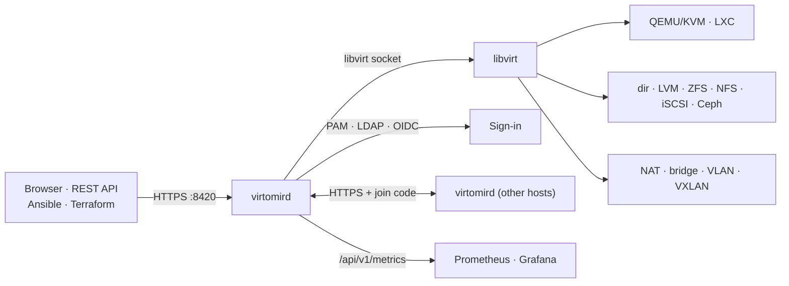

<p align="center"></p>

<h1 align="center">VirtoMir</h1>

<p align="center"><strong>A Detailed Control Deck for Virtual Environments.</strong><br>
一個為 KVM / QEMU / libvirt 打造的現代 Web 控制面板，直接安裝在你已經在用的 Linux 上。</p>

<p align="center">
<a href="../../README.md">English</a> ·
<a href="README.tr.md">Türkçe</a> ·
<a href="README.de.md">Deutsch</a> ·
<a href="README.fr.md">Français</a> ·
<a href="README.es.md">Español</a> ·
<a href="README.pt-BR.md">Português</a> ·
<a href="README.it.md">Italiano</a> ·
<a href="README.pl.md">Polski</a> ·
<a href="README.nl.md">Nederlands</a> ·
<a href="README.ru.md">Русский</a> ·
<a href="README.uk.md">Українська</a> ·
<a href="README.zh-CN.md">简体中文</a> ·
繁體中文 ·
<a href="README.ja.md">日本語</a> ·
<a href="README.ko.md">한국어</a> ·
<a href="README.ar.md">العربية</a>
</p>

<p align="center">
  <a href="https://github.com/onurbaydas/VirtoMir/releases/latest"></a>
  <a href="https://github.com/onurbaydas/VirtoMir/actions/workflows/ci.yml"></a>
  <a href="../../LICENSE"></a>
  
</p>

<p align="center">
  <a href="https://github.com/onurbaydas/VirtoMir/stargazers"></a>
  <a href="https://github.com/onurbaydas/VirtoMir/fork"></a>
  <a href="https://github.com/onurbaydas/VirtoMir/subscription"></a>
</p>

<p align="center">
  <a href="https://onurbaydas.github.io/VirtoMir/demo/"><b>▶ 線上展示</b></a> ·
  <a href="#install">安裝</a> ·
  <a href="../try-in-a-vm.md">在虛擬機中試用</a> ·
  <a href="../features.md">所有功能</a> ·
  <a href="#contribute">參與貢獻</a> ·
  <a href="https://github.com/onurbaydas/VirtoMir/discussions">討論區</a>
</p>

<table align="center">
<tr><td align="center"><h3>1</h3></td><td align="center"><h3>0</h3></td><td align="center"><h3>0</h3></td><td align="center"><h3>90+</h3></td><td align="center"><h3>16</h3></td><td align="center"><h3>1 s</h3></td></tr>
<tr><td align="center"><sub>個執行檔，內建 UI</sub></td><td align="center"><sub>個資料庫</sub></td><td align="center"><sub>虛擬機內代理程式</sub></td><td align="center"><sub>項功能</sub></td><td align="center"><sub>種 README 語言</sub></td><td align="center"><sub>即時圖表</sub></td></tr>
</table>

> 本翻譯由社群維護，可能落後於[英文 README](../../README.md)。

<p align="center"></p>

VirtoMir 想同時做到兩件事：

- **毫不費力。** 不太懂虛擬化，也能建立並執行虛擬機。
- **細緻得嚇人。** libvirt 的每一項設定都找得到、改得了，當然，也弄得壞。

一個內建 Web 介面的單一執行檔：不需要專用發行版，沒有資料庫，虛擬機裡也不裝代理程式。在執行 KVM 的主機上安裝，開啟 `https://<主機>:8420/`，用你的 Linux 帳號登入即可。

> **狀態：1.2。** 已在 Ubuntu 26.04 與 Fedora 44 上測試，包括單台主機與小型叢集。高可用性尚未在真實的 BMC 硬體上驗證，VMware 匯入仍屬實驗性質。從 1.0 起不再新增功能：心力都放在讓單主機的日常使用更穩固。投入正式環境前請先測試，並在 [#1](https://github.com/onurbaydas/VirtoMir/issues/1) 告訴我們哪裡出了問題。

> [!TIP]
> **喜歡這個方向嗎？給個 ⭐ 吧。** VirtoMir 由一個人開發：星星能讓更多人發現它，也讓專案持續下去。想收到新版本通知，請點 **Watch → Custom → Releases**。

> [!NOTE]
> **試過了嗎？花 30 秒告訴我們。 (無需帳號)** [開啟快速回饋表單](https://tally.so/r/db904z)，選 😀 😐 😞 或 💡，想的話再寫一句。在 VirtoMir 裡，側邊欄底部的 💬 按鈕會開啟同一份表單，並自動填好你的版本資訊。 有 GitHub 帳號的話，也可以用[議題表單](https://github.com/onurbaydas/VirtoMir/issues/new?template=quick_feedback.yml)。

## 30 秒上手

| | |
|---|---|
| **隨便看看** | 點開[線上展示](https://onurbaydas.github.io/VirtoMir/demo/)：虛構的主機，不必安裝任何東西。 |
| **拋棄式主機** | 一個指令就能得到一台裝好 VirtoMir 的測試虛擬機：[不碰你的伺服器就能試用 VirtoMir](../try-in-a-vm.md)。 |
| **Debian / Ubuntu** | `sudo apt install ./virtomir_1.2.2_amd64.deb` — [最新版本](https://github.com/onurbaydas/VirtoMir/releases/latest) |
| **Fedora / RHEL** | `sudo dnf install ./virtomir-1.2.2-1.x86_64.rpm` — [最新版本](https://github.com/onurbaydas/VirtoMir/releases/latest) |

若缺少 libvirt 與 QEMU/KVM，套件會自動安裝，開放 8420 連接埠並啟動服務。不需要再輸入任何指令。

## 為什麼選 VirtoMir？

| | **VirtoMir** | Cockpit Machines | virt-manager | Proxmox VE |
|---|:---:|:---:|:---:|:---:|
| 安裝在你現有的 Linux 上 | ✅ | ✅ | ✅ | ❌ 它本身就是作業系統 |
| 在瀏覽器中使用 | ✅ | ✅ | ❌ 桌面應用程式 | ✅ |
| libvirt 的所有設定，儲存前顯示 XML 差異 | ✅ | ➖ 基本設定 | ✅ | ➖ 不是 libvirt |
| 每次變更都有歷史紀錄，一鍵還原 | ✅ | ❌ | ❌ | ❌ |
| 內建即時圖表與 30 天歷史 | ✅ | ➖ | ❌ | ✅ |
| 快照、排程備份、異地副本 | ✅ | ➖ 快照 | ➖ 快照 | ✅ |
| 多主機、即時遷移、高可用性 | ✅ | ❌ | ➖ 遷移 | ✅ |

VirtoMir 介於兩者之間：像 Cockpit 一樣簡單，又像原始 libvirt XML 一樣完整。

## 亮點

<table>
<tr>
<td width="50%" valign="top">
<h3>🖥️ 深入每一台虛擬機</h3>
精靈只問每台機器真正需要的東西（ISO、含 cloud-init 的雲端映像或既有磁碟），背後則是 libvirt 的所有設定：CPU 拓撲與綁定、大型分頁、NUMA、PCI/USB 直通、vGPU、TPM、安全開機，以及透過 VNC 或 SPICE 的瀏覽器主控台。
<br><br>
</td>
<td width="50%" valign="top">
<h3>🕰️ 什麼變了，什麼時候變的</h3>
虛擬機定義的每個版本都會保留，包括以 <code>virsh</code> 所做的變更。時間軸把生命週期事件、變更、快照、備份與警示放在同一份清單：回答「昨天還好好的」。
<br><br>
</td>
</tr>
<tr>
<td valign="top">
<h3>💾 儲存與網路</h3>
目錄、LVM、ZFS、NFS、iSCSI 與 Ceph 儲存池；區域網路中的 NFS、SMB 與 iSCSI 目標會自動找到，一鍵連線。NAT、橋接（Wi-Fi 也行）、VLAN 與 VXLAN 網路；修改主機網路時若斷線，會自動復原。
<br><br>
</td>
<td valign="top">
<h3>🛟 真的能還原的備份</h3>
不停機的即時備份、含保留原則的排程、還原為新虛擬機、驗證校驗和。透過 restic 將異地副本存到 S3、B2、Azure、SFTP 或磁碟，加密並去除重複。
<br><br>
</td>
</tr>
<tr>
<td valign="top">
<h3>🌐 多台主機，一個畫面</h3>
用一次性加入碼把主機連起來：不需共用資料庫，也不需額外服務。即時遷移、平衡負載的排程器、維護模式、滾動升級，以及具備仲裁與隔離的高可用性。
<br><br>
</td>
<td valign="top">
<h3>🔐 為共用主機而設計</h3>
支援 Linux 帳號（PAM）、LDAP/AD 或 OpenID Connect 登入，兩步驟驗證，角色，含配額的專案，API 權杖，以及防竄改的活動紀錄。預設啟用 HTTPS。
<br><br>
</td>
</tr>
</table>

其餘所有功能，從警示、報表到 Kubernetes 叢集與 VMware 匯入，請見**[完整功能清單](../features.md)**（英文）。

## 運作方式



- **只有一個服務 `virtomird`**，以 root 執行，因為它要連到系統的 libvirt 通訊端並透過 PAM 驗證密碼。
- **自身狀態存放在 `/var/lib/virtomir`**：憑證、指標歷史、設定、活動紀錄。沒有資料庫。
- **絕不擅自更動你現有的虛擬機。** 它讀取 libvirt 中既有的內容，只修改你要求的部分；每次變更都會記入活動紀錄。
- **移除乾淨：** `sudo apt purge virtomir` 會刪除服務及其狀態；你的虛擬機、磁碟與網路都會保留。

<a id="install"></a>
## 安裝

```sh
# Debian / Ubuntu
sudo install -d -m 0755 /etc/apt/keyrings
sudo curl -fsSL -o /etc/apt/keyrings/virtomir.asc https://onurbaydas.github.io/VirtoMir/virtomir.asc
echo "deb [signed-by=/etc/apt/keyrings/virtomir.asc] https://onurbaydas.github.io/VirtoMir/apt stable main" | sudo tee /etc/apt/sources.list.d/virtomir.list
sudo apt update && sudo apt install virtomir

# Fedora / RHEL 10
sudo curl -fsSL -o /etc/yum.repos.d/virtomir.repo https://onurbaydas.github.io/VirtoMir/virtomir.repo
sudo dnf install virtomir
```

接著開啟 `https://<主機>:8420/`，以 `root` 或管理員（`sudo`、`wheel` 或 `libvirt` 群組成員）登入。瀏覽器會請你接受一次自簽憑證。第一位登入的管理員會被引導完成主機尚缺的設定：儲存、備份位置、第一個映像。

套件、tar 檔、設定與從原始碼建置：見[英文 README](../../README.md#install)。

安全問題請私下回報，見 [SECURITY.md](../../SECURITY.md)。

<a id="contribute"></a>
## 歡迎參與

VirtoMir 由一個人與 AI 程式設計助手一起開發。這讓它成長得很快，也代表它比一般的個人專案更需要更多人把關。

- 🧪 **執行它**：在 Debian、較舊的 Ubuntu、Rocky/Alma 或 Arch 上試試，告訴我們哪裡出錯。
- 🔍 **審查安全相關的部分**：它以 root 執行並負責登入（`internal/auth`、`internal/api`）。
- 🔧 **測試我們接觸不到的環境**：GPU 直通、Ceph、真實 BMC、VMware。
- 🌍 **翻譯**：介面（[`web/src/lib/locales`](../../web/src/lib/locales)）或本 README（[`docs/i18n`](.)）。
- 💻 **貢獻程式碼**：不需要伺服器，`cd web && npm install && npm run dev:demo` 就能在模擬叢集上執行整個介面。可以從 [good first issue](https://github.com/onurbaydas/VirtoMir/issues?q=is%3Aissue+is%3Aopen+label%3A%22good+first+issue%22) 開始，參見 [CONTRIBUTING.md](../../CONTRIBUTING.md)。

想法與問題：[討論區](https://github.com/onurbaydas/VirtoMir/discussions)。發現 bug？[開一個 issue](https://github.com/onurbaydas/VirtoMir/issues/new/choose)。

## 致謝

<p><br>感謝 Mega Bilgisayar。</p>

<p align="center">
  <b>如果 VirtoMir 對你有幫助，給顆星能讓更多人找到它。</b><br><br>
  <a href="https://github.com/onurbaydas/VirtoMir/stargazers"></a>
  <a href="https://github.com/onurbaydas/VirtoMir/fork"></a>
  <a href="https://github.com/onurbaydas/VirtoMir/subscription"></a>
</p>

## 授權

VirtoMir 是自由軟體：**GNU Affero 通用公共授權條款 v3.0 或更新版本**，見 [LICENSE](../../LICENSE)。你可以使用、研究、修改與分享；若你透過網路向他人提供修改過的 VirtoMir，也必須向他們提供原始碼。

Copyright © 2026 Onur Baydas. 如需不受 AGPL 義務約束的商業授權，請透過 GitHub 聯絡作者。歡迎依[貢獻者授權協議](../../CLA.md)貢獻，該協議讓兩種授權方式都得以保留。
